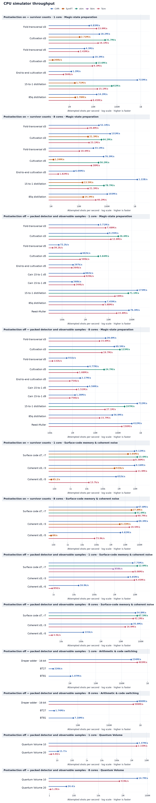
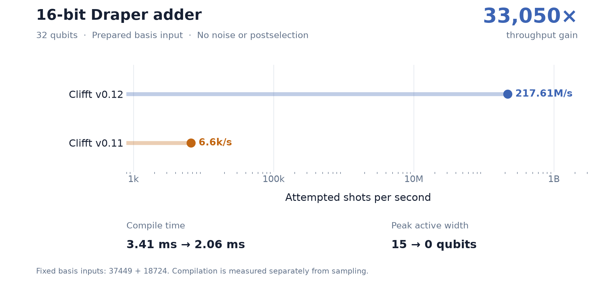

# clifft-bench

Reproducible performance benchmarks for
[Clifft](https://github.com/unitaryfoundation/clifft) and comparable
near-Clifford circuit simulators.

This repository tracks Clifft's performance across releases and compares it
with other simulators on the same workloads. It contains the benchmarks,
reviewed results, and scripts that generate the figures below.

The workloads include a Draper adder generated with
[MQT Bench](https://github.com/munich-quantum-toolkit/bench).

Looking to use Clifft? Start with the
[Clifft documentation](https://unitaryfoundation.github.io/clifft/stable/).

## Regular release questions

See the [Performance guide](https://unitaryfoundation.github.io/clifft/stable/guide/performance/)
for interpretation, methodology, and longer-term performance history.

The release and peer figures use the Clifft **0.14.0rc1** campaign on an AWS
`m7a.4xlarge` with one or eight pinned physical cores. The 0.14.0 label refers
to RC1. Throughput is the median attempted shots per second across three
repetitions after compilation and the first full sampling call.
[Campaign report](https://github.com/unitaryfoundation/clifft-bench/blob/1993504c9217da4d4f432bcf853614b29c315bec/results/release-v1/0.14.0rc1-20261120-2134/report/review.md) ·
[Case table](https://github.com/unitaryfoundation/clifft-bench/blob/1993504c9217da4d4f432bcf853614b29c315bec/results/release-v1/0.14.0rc1-20261120-2134/cases.csv) · [Raw measurements](https://github.com/unitaryfoundation/clifft-bench/blob/1993504c9217da4d4f432bcf853614b29c315bec/results/release-v1/0.14.0rc1-20261120-2134/raw.json)

### Did Clifft get faster in the latest release?

<picture>
  <source media="(prefers-color-scheme: dark)" srcset="reporting/figures/web/release-change-dark.png">
  
</picture>

Clifft 0.14.0rc1 had higher survivor-count throughput than 0.13.0 on all nine
circuits at both core counts. For example, fold d3 reached 18.3× the previous
release’s throughput on one core and 18.7× on eight. Fold d5 appears in the
peer figure below. The campaign omitted its two 0.13.0 survivor-count baselines
because of their runtime.

### How does Clifft compare with other simulators?

<picture>
  <source media="(prefers-color-scheme: dark)" srcset="reporting/figures/web/simulator-throughput-dark.png">
  
</picture>

On eight cores, Clifft led Tsim on all 10 shared survivor-count workloads and
15 of 16 packed-sampling workloads. Tsim led on packed fold d3, and xtim led
Clifft on three of its four eight-core packed workloads. Stim’s single measured
comparison is one-core surface-code d7/r7, where both tools return packed
detector and observable samples. [Benchmark contract](docs/benchmark-contract.md)

### Earlier Draper adder comparison

The Clifft 0.12.0rc1 and 0.11.0rc1 campaign measured the prepared-basis
adder separately. [Archived release results](results/release-v1/release-v1-20261009-192718/)

<picture>
  <source media="(prefers-color-scheme: dark)" srcset="reporting/figures/web/draper-adder-dark.png">
  
</picture>

These adder rates apply to the specified basis input (37449 + 18724), with no
noise or postselection. They exclude compilation, which is shown separately.
The release configurations also differ in calibrated batch size, which rises from 1 to 1024.

## Reproduce or contribute

- [Generate release reports](CONTRIBUTING.md#release-reporting) from one execution.
  The earlier adder figure uses the [archived tools](CONTRIBUTING.md#historical-evidence).
- [Collect release benchmarks](CONTRIBUTING.md#reference-host-collection) on the reference EC2 host.
- [Contribute](CONTRIBUTING.md): local development, release setup, and new workloads.
- [Explore other experiments](experiments/README.md), including
  [Quantum Volume comparisons](experiments/qv/README.md) and the
  [Tsim GPU study](experiments/tsim-gpu/README.md), with results pushed back from the GPU host.
