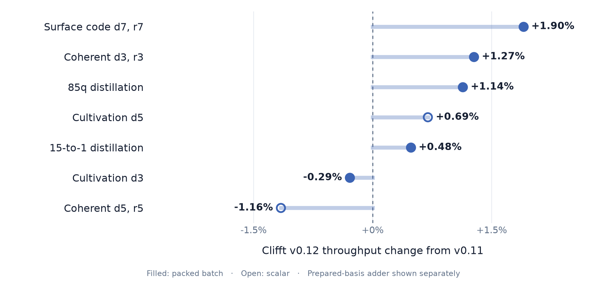
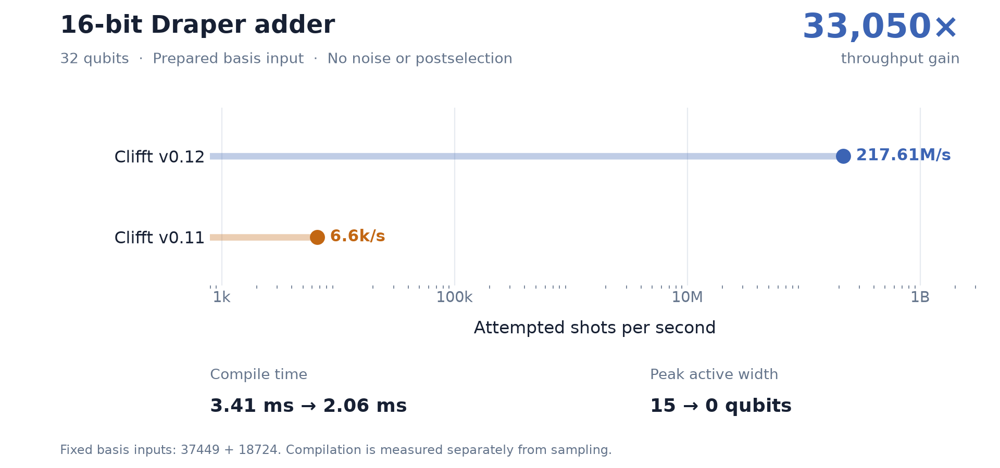
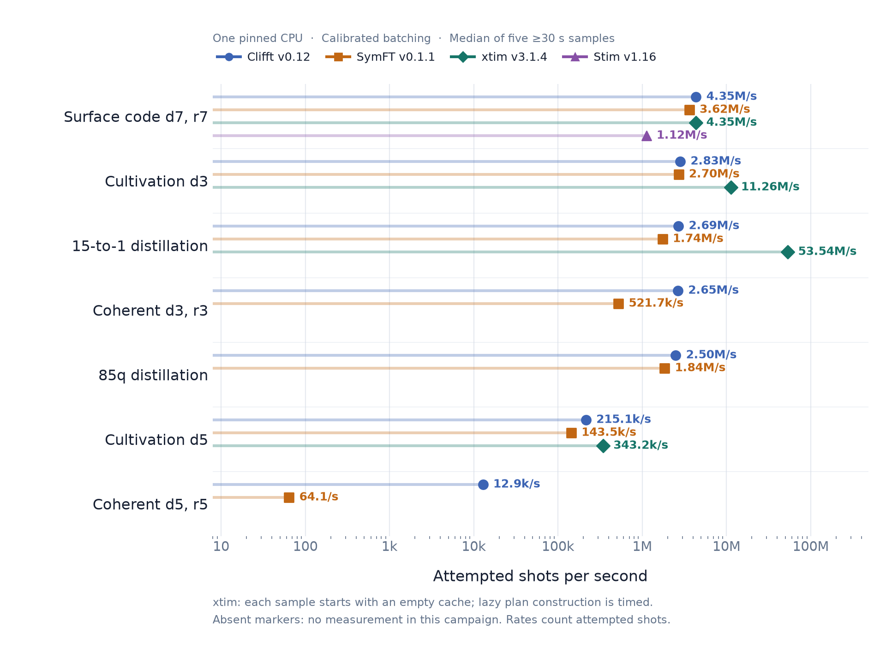

# clifft-bench

Reproducible performance benchmarks for
[Clifft](https://github.com/unitaryfoundation/clifft) and comparable
near-Clifford circuit simulators.

This repository tracks Clifft's performance across releases and compares it
with other simulators on the same workloads. It contains the benchmarks,
reviewed results, and scripts that generate the figures below.

The workloads include a Draper adder generated with
[MQT Bench](https://github.com/munich-quantum-toolkit/bench).

Looking to use Clifft? Start with the
[Clifft documentation](https://unitaryfoundation.github.io/clifft/stable/).

## Regular release questions

See the [Performance guide](https://unitaryfoundation.github.io/clifft/stable/guide/performance/)
for interpretation, methodology, and longer-term performance history.

These figures use the reviewed
[Clifft 0.12.0 release-candidate results](results/release-v1/release-v1-20261009-192718/).
Plot labels show the intended release versions; the measurements used
0.12.0rc1 and the 0.11.0rc1 baseline, with each release's default compiler passes
and active-width scheduling. Batch size is calibrated independently for each
workload and implementation on one pinned logical CPU.

### Did Clifft get faster in the latest release?

<picture>
  <source media="(prefers-color-scheme: dark)" srcset="reporting/figures/web/v012-vs-v011-dark.png">
  
</picture>

The QEC changes range from −1.16% to +1.90% on this host. These small changes
should not be read as an established release-wide speedup. The historical
median retains its original six workloads; 15-to-1 joins the current comparisons.

The prepared-basis adder shows the larger compiler improvement and is reported
separately from QEC:

<picture>
  <source media="(prefers-color-scheme: dark)" srcset="reporting/figures/web/draper-adder-dark.png">
  
</picture>

These adder rates apply to the specified basis input (37449 + 18724), with no
noise or postselection. They exclude compilation, which is shown separately.
The calibrated batch changes from 1 to 1024; this is a full release comparison,
not an isolated compiler-pass ablation.

### How does Clifft compare with other simulators?

<picture>
  <source media="(prefers-color-scheme: dark)" srcset="reporting/figures/web/simulator-throughput-dark.png">
  
</picture>

Missing markers mean no measurement in this campaign. xtim covers cultivation
d3/d5, surface code, and 15-to-1; Stim supplies the Clifford surface-code anchor.
For xtim, each timed sample starts with an empty plan cache and includes lazy
plan construction. See the [benchmark contract](docs/benchmark-contract.md) for
timing, aggregate-count endpoints, and build settings. The
[Tsim GPU study](experiments/tsim-gpu/README.md) uses its own hardware and contract.

## Reproduce or contribute

- [Regenerate the figures](reporting/README.md) from checked-in results.
- [Collect release benchmarks](docs/manual-ec2.md) on the reference EC2 host.
- [Contribute](CONTRIBUTING.md): local development, release setup, and new workloads.
- [Explore other experiments](experiments/README.md), including
  [Quantum Volume comparisons](experiments/qv/README.md) and the
  [Tsim GPU study](experiments/tsim-gpu/README.md), with results pushed back from the GPU host.
