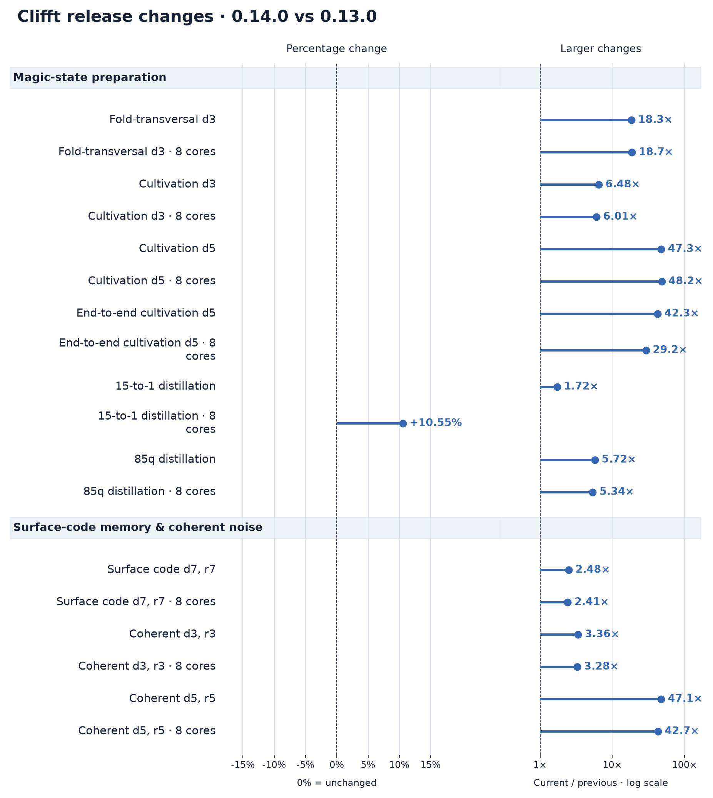
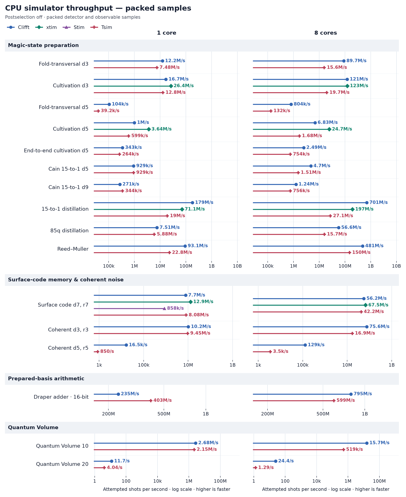
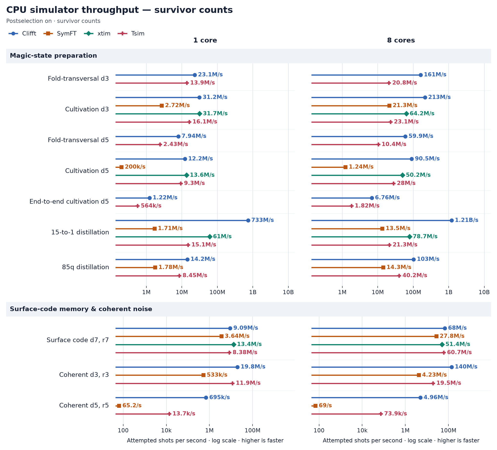

# clifft-bench

Reproducible performance benchmarks for
[Clifft](https://github.com/unitaryfoundation/clifft) and comparable
near-Clifford circuit simulators.

This repository tracks Clifft's performance across releases and compares it
with other simulators on the same workloads. It contains the benchmarks,
reviewed results, and scripts that generate the figures below.

The workloads include a Draper adder generated with
[MQT Bench](https://github.com/munich-quantum-toolkit/bench).

Looking to use Clifft? Start with the
[Clifft documentation](https://unitaryfoundation.github.io/clifft/stable/).

## Regular release questions

See the [Performance guide](https://unitaryfoundation.github.io/clifft/stable/guide/performance/)
for interpretation, methodology, and longer-term performance history.

The release figure compares **Clifft 0.14.0rc3** with **0.13.0**. The peer
figure combines these new Clifft measurements with the peer results from the
RC1 campaign. Both runs used the same AWS `m7a.4xlarge` and one or eight pinned
physical cores. The 0.14.0 label refers to RC3. Throughput is the median
attempted shots per second over three repetitions after compilation and the
first full sampling call. [Campaign report](results/release-clifft/0.14.0rc3-20261124-0148/report/review.md) ·
[Clifft case table](results/release-clifft/0.14.0rc3-20261124-0148/cases.csv) ·
[Clifft raw measurements](results/release-clifft/0.14.0rc3-20261124-0148/raw.json) ·
[Peer raw measurements](results/release-v1/0.14.0rc1-20261120-2134/raw.json)

### Did Clifft get faster in the latest release?

<picture>
  <source media="(prefers-color-scheme: dark)" srcset="reporting/figures/web/release-change-dark.png">
  
</picture>

Clifft 0.14.0rc3 had higher survivor-count throughput than 0.13.0 on all nine
circuits at both core counts. Fold d3 reached 65.0× the previous release’s
throughput on one core and 54.9× on eight. Fold d5 appears in the peer figures
below. The campaign omitted its two 0.13.0 survivor-count baselines because of
their runtime.

### How does Clifft compare with other simulators?

For interactive simulator filtering, full per-workload metrics, and Clifft-only
circuits (`BT27`, `BT81`), use the
[interactive throughput chart in the Clifft Performance guide](https://unitaryfoundation.github.io/clifft/stable/guide/performance/#cpu-simulator-throughput).

Each entry counts workloads where Clifft had higher median throughput out of
those measured by both tools. A dash means there was no paired measurement.

| Peer | Survivor counts, 1 core | Survivor counts, 8 cores | Packed samples, 1 core | Packed samples, 8 cores |
| --- | ---: | ---: | ---: | ---: |
| Tsim 1.0.0 | 10/10 | 10/10 | 12/16 | 16/16 |
| xtim 4.1.2 | 1/4 | 4/4 | 1/4 | 1/4 |
| SymFT 2026.10.8 | 7/7 | 7/7 | — | — |
| Stim 1.16.0 | — | — | 1/1 | — |

On packed fold d3, Clifft delivered 1.63× Tsim’s throughput on one core
and 5.73× on eight. Stim’s single measured comparison is
one-core surface-code d7/r7, where both tools return packed detector and
observable samples. The peer charts below omit `BT27` and `BT81`, which have no
peer measurements; their rates remain in the interactive chart, campaign report,
and raw data. [Benchmark contract](docs/benchmark-contract.md)

<picture>
  <source media="(prefers-color-scheme: dark)" srcset="reporting/figures/web/simulator-throughput-packed-dark.png">
  
</picture>

Survivor counts (postselection on) — 1 core and 8 cores

<picture>
  <source media="(prefers-color-scheme: dark)" srcset="reporting/figures/web/simulator-throughput-survivors-dark.png">
  
</picture>

## Reproduce or contribute

- [Generate release reports](CONTRIBUTING.md#release-reporting) from a full campaign or a Clifft refresh with its peer results.
  Archived 0.12 and earlier results use the [archived tools](CONTRIBUTING.md#historical-evidence).
- [Collect release benchmarks](CONTRIBUTING.md#reference-host-collection) on the reference EC2 host.
- [Contribute](CONTRIBUTING.md): local development, release setup, and new workloads.
- [Explore other experiments](experiments/README.md), including
  [Quantum Volume comparisons](experiments/qv/README.md) and the
  [Tsim GPU study](experiments/tsim-gpu/README.md), with results pushed back from the GPU host.
