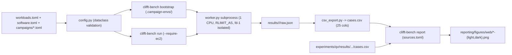

# `clifft-bench` Target Architecture Specification

> [!IMPORTANT]
> This design preserves the battle-tested measurement core (process-isolated single-CPU workers, simulator parity adapters, immutable raw JSON evidence, and paired-ratio release chaining) while removing ~65% of the repository's ceremony, redundant schemas/CSVs, re-validation layers, and append-only docs/tests.

## 1. Design Principles

1. **Stdlib-only core (`Python >= 3.12`)**: Drop `jsonschema` and all 5 `schemas/*.schema.json` files. Parse configuration with `tomllib` and validate once into frozen `dataclasses`.
2. **Convention over env-var plumbing**: Isolated simulator virtualenvs live at `.campaign-envs/<implementation-id>/` and lockfiles at `environments/<implementation-id>.txt`. Delete all 21 `CLIFFT_BENCH_*_PYTHON` and 19 `CLIFFT_BENCH_CLOUD_*` / `CLIFFT_BENCH_RUN_*` environment variables.
3. **Adapter options stay opaque to the core**: Simulator-specific knobs (`scheduler`, `trajectory_sharing`, `sample_chunk_shots`) pass through `options: dict[str, Any]` and are validated by `Adapter.validate_options()`, never added to global schemas or CSV columns.
4. **One calibration policy**: Inspecting Clifft's C++ `batch_tuning_candidates` (`{1, 64, 256, 1024, 2048}` plus power-of-two `default_batch_execution_policy` baselines) shows every native proposal is covered by a fixed power-of-two grid. Use a single bounded calibration policy across the suite—60 s soft setup budget, 3 x 1 s warmed probes, smaller-batch tie-break, with candidate grid `(1, 32, 64, 256, 1024, 2048)` for Clifft/SymFT, `(1, 32, 256, 1024, 8192, 65536)` for Tsim, and `(256, 1024, 4096, 16384, 65536)` for Stim/xtim—deleting `native_batch_choices()`, `grid-v1` vs `bounded-v2` branching, and the 38 duplicate `*-tuned` cases.
5. **Single derived table (`cases.csv`)**: Each execution directory (`results/<campaign>/<execution-id>/`) stores only `raw.json` and a 25-column `cases.csv`. Drop `comparisons.csv`, `index.json`, and multi-placement spooling. Migrate the 5 archived executions in `results/` from their existing `raw/*.json` files so `reporting/` has zero legacy compatibility branches.
6. **Unified reporting & lean experiments**: Keep only the 6 consumed light/dark web figure pairs under `reporting/figures/web/` (including Quantum Volume), rendered by one command (`clifft-bench report`) using version-independent filenames (`release-change-{light,dark}.png`). Slim `experiments/qv` and `experiments/tsim-gpu` from multi-module mini-harnesses down to single ~200-line scripts plus their result CSVs.

---

## 2. Target Repository Layout

```text
clifft-bench/
├── AGENTS.md
├── README.md
├── CONTRIBUTING.md
├── LICENSE
├── pyproject.toml                  # dependencies = [] (stdlib only); extras: report, test
├── workloads.toml                  # Circuit registry, SHA-256, metadata, default shots_per_call
├── software.toml                   # Active simulator implementations & build/install settings
├── campaigns/
│   ├── release-v1.toml             # Canonical single-core release campaign (~47 cases)
│   └── smoke.toml                  # Fast developer/CI correctness smoke profile
├── environments/                   # Active pinned lockfiles only (~6 .txt files, no .in pairs or 0.1-0.10 locks)
│   ├── clifft-0.12.0rc1.txt
│   ├── clifft-<current>.txt
│   ├── stim-1.16.0.txt
│   ├── symft-0.1.1-c89b985.txt
│   ├── tsim-0.1.5-e9406ed.txt
│   └── xtim-3.2.2-edf0dd0.txt
├── workloads/
│   └── circuits/                   # Immutable .stim files + licenses
├── docs/
│   └── benchmark-contract.md       # Single ~150-line spec (methodology, data layout, reference host)
├── scripts/
│   ├── ec2-run.sh                  # Single ~35-line wrapper: shutdown guard, apt deps, bootstrap + run --require-ec2
│   └── generate_full_d5.py         # Reproducible benchmark circuit generator for msc_full_d5
├── src/clifft_bench/
│   ├── __init__.py
│   ├── __main__.py
│   ├── cli.py                      # Subcommands: bootstrap, list, run, csv, report
│   ├── config.py                   # tomllib loader + Workload, Implementation, Variant, Case, Campaign dataclasses
│   ├── selection.py                # Detector selection masks ("all", "none", or explicit index subset)
│   ├── runner.py                   # Subprocess WorkerClient, serial execution, raw.json + cases.csv writer
│   ├── worker.py                   # Isolated worker: affinity, RLIMIT_AS, fd-1 guard, calibration, timed sampling
│   ├── csv_export.py               # Deterministic raw.json -> 25-column cases.csv projection (~90 lines)
│   ├── system.py                   # Thread-cap env, host/git metadata, optional stdlib IMDSv2 query (~160 lines)
│   ├── report.py                   # Unified light/dark web figure renderer (QEC + Draper adder + QV, ~450 lines)
│   └── adapters/
│       ├── __init__.py
│       ├── base.py                 # Adapter, PreparedAdapter, Counts, validate_counts, validate_options
│       ├── _shared.py              # PEP 610 git commit check + PackedCountsReducer
│       ├── clifft.py               # Modern Clifft (>=0.11) adapter (~120 lines; pre-0.11 shims removed)
│       ├── symft.py
│       ├── xtim.py
│       ├── tsim.py
│       ├── stim.py
│       └── fixture.py
├── reporting/
│   ├── sources.toml                # Selected history, release chain, and QV execution paths
│   └── figures/web/                # 12 PNGs (6 light/dark pairs, stable filenames)
├── results/
│   ├── clifft-history-v1/
│   │   └── clifft-history-v1-20260902/{raw.json, cases.csv}
│   └── release-v1/
│       └── release-v1-<timestamp>/{raw.json, cases.csv}
├── experiments/
│   ├── README.md
│   ├── qv/
│   │   ├── pyproject.toml
│   │   ├── uv.lock
│   │   ├── run_qv.py               # Single ~200-line script (accepts any Clifft version)
│   │   └── results/qv-0.10.0rc1-20260902/{metadata.json, cases.csv}
│   └── tsim-gpu/
│       ├── pyproject.toml
│       ├── uv.lock
│       ├── run_tsim_gpu.py         # Single ~220-line GPU probe/measure script
│       └── results/tsim-gpu-20260909-131821/{metadata.json, cases.csv}
└── tests/                          # Behavioral unit & adapter contract tests (no prose/snapshot tests)
```



---

## 3. Configuration Formats (TOML)

### `workloads.toml`
Eliminates repeated prose paragraphs and centralizes default `shots_per_call` and workload groups:

```toml
[groups]
history_core = [
  "msc-d3-inject-cultivate-p1e-3",
  "msc-d5-inject-cultivate-p1e-3",
  "distillation-color-code-85q-p5e-2",
  "surface-code-d7-r7-p1e-3",
  "coherent-surface-d3-r3-p1e-3-rz2e-2",
  "coherent-surface-d5-r5-p1e-3-rz2e-2",
]
current_qec = [
  "msc-d3-inject-cultivate-p1e-3",
  "msc-d5-inject-cultivate-p1e-3",
  "distillation-color-code-85q-p5e-2",
  "surface-code-d7-r7-p1e-3",
  "coherent-surface-d3-r3-p1e-3-rz2e-2",
  "coherent-surface-d5-r5-p1e-3-rz2e-2",
  "distillation-15to1-rm15-p1e-3",
]

[workloads.msc-d3-inject-cultivate-p1e-3]
label = "Cultivation d3"
family = "magic-state-cultivation"
path = "workloads/circuits/msc_d3_inject_cultivate_p1e-3.stim"
sha256 = "90a7d841e003e5ee38137cd9a3eb6529bb552e49c424bc6b0932a27d97cdb41f"
default_shots_per_call = 100_000
observable_index = 0
postselect_detectors = "all"        # "all", "none", or sorted index list [...] (e.g. msc-full-d5)
compatible_adapters = ["clifft", "symft", "xtim", "tsim"]
expected = { num_qubits = 15, num_measurements = 21, num_detectors = 20, num_observables = 1 }
provenance = { source_url = "https://github.com/unitaryfoundation/clifft-paper", source_commit = "db7dc9f13a2c2854690e92390c779048a1ac1400", license = "Apache-2.0" }
```

### `software.toml`
Only active implementations; lockfile path defaults to `environments/<id>.txt` and Python interpreter defaults to `.campaign-envs/<id>/bin/python` (falling back to `sys.executable` for local single-env `--case` runs):

```toml
[implementations."clifft-0.12.0rc1"]
name = "Clifft"
adapter = "clifft"
distribution = "clifft"
version = "0.12.0rc1"
display_version = "0.12.0"
commit_sha = "847757e2bc8c4f7439b9e92011550fd61719eb85"
source_url = "https://github.com/unitaryfoundation/clifft"
import_modules = ["clifft"]
dependencies = ["numpy"]

[implementations."symft-0.1.1-c89b985"]
name = "SymFT"
adapter = "symft"
distribution = "symft"
version = "0.1.1"
commit_sha = "c89b98514a919240b8afa53a271e08d926d3c987"
source_url = "https://github.com/haoliri0/SOFT"
import_modules = ["symft"]
dependencies = ["numpy"]
install_env = { SYMFT_PY_NATIVE = "1", SYMFT_PY_ENABLE_CUDA = "0" }
```

### `campaigns/release-v1.toml`
Replaces 487 lines of duplicated JSON with ~75 lines of declarative TOML:

```toml
campaign_id = "release-v1"
classification = "official"
seed = 20260819
hardware_epoch = "aws-m7a-xlarge-ubuntu2404-v1"

[reference_host]
provider = "aws"
instance_type = "m7a.xlarge"
architecture = "x86_64"
os_id = "ubuntu"
os_version = "24.04"
memory_limit_gib = 12.0
run_timeout_minutes = 240

[measurement]
setup_timeout_seconds = 1800
request_timeout_seconds = 1800
warmup_shots = 1
correctness_shots = 8
min_sample_seconds = 30.0
repetitions = 5

[presets.clifft_scheduled]
scheduler = { beam_width = 8, search_budget = 16.0, noise_transparent = true, sink_neutral_rotations = true }

[variants.clifft-previous]
implementation = "clifft-0.12.0rc1"
batch_size = "calibrate"
options_preset = "clifft_scheduled"
workloads = ["@current_qec", "draper-adder-m16-basis", "reed-muller-measured"]

[variants.clifft-current]
implementation = "clifft-63cd885"
batch_size = "calibrate"
options_preset = "clifft_scheduled"
workloads = ["@current_qec", "draper-adder-m16-basis", "bt27-direct-x", "bt81-direct-x", "reed-muller-measured"]

[variants.symft-current]
implementation = "symft-0.1.1-c89b985"
batch_size = "calibrate"
options = { sample_chunk_shots = 2048 }
workloads = ["@current_qec", "reed-muller-measured"]

[variants.xtim-current]
implementation = "xtim-3.2.2-edf0dd0"
batch_size = "calibrate"
workloads = ["msc-d3-inject-cultivate-p1e-3", "msc-d5-inject-cultivate-p1e-3", "surface-code-d7-r7-p1e-3", "distillation-15to1-rm15-p1e-3"]

[variants.stim-current]
implementation = "stim-1.16.0"
batch_size = "calibrate"
workloads = ["surface-code-d7-r7-p1e-3"]

[variants.tsim-current]
implementation = "tsim-0.1.5-e9406ed"
batch_size = "calibrate"
options = { trajectory_sharing = true }
workloads = ["@current_qec", "draper-adder-m16-basis", "reed-muller-measured"]

[variants.clifft-bulk]
implementation = "clifft-63cd885"
batch_size = "calibrate"
options_preset = "clifft_scheduled"
shots_per_call = { "coherent-surface-d5-r5-p1e-3-rz2e-2" = 256, "draper-adder-m16-basis" = 100_000 }

[variants.symft-bulk]
implementation = "symft-0.1.1-c89b985"
batch_size = "calibrate"
options = { sample_chunk_shots = 2048 }
shots_per_call = { "coherent-surface-d5-r5-p1e-3-rz2e-2" = 256 }

[variants.tsim-bulk]
implementation = "tsim-0.1.5-e9406ed"
batch_size = "calibrate"
options = { trajectory_sharing = true }
shots_per_call = { "coherent-surface-d5-r5-p1e-3-rz2e-2" = 256, "draper-adder-m16-basis" = 100_000 }
```

---

## 4. Result Layout & Slim `cases.csv` Schema

Every execution lives at `results/<campaign-id>/<execution-id>/` and contains **two files**:
1. `raw.json` — Complete run envelope, host/cloud/git provenance, setup/calibration details, warmup, correctness check, and all individual sample records.
2. `cases.csv` — Deterministically generated from `raw.json` via `clifft-bench csv` (and automatically at the end of `clifft-bench run`).

### `CASE_FIELDS` (25 universal columns)
```python
CASE_FIELDS = [
    "execution_id",
    "campaign_id",
    "hardware_epoch",
    "case_id",
    "variant_id",
    "workload_id",
    "implementation_id",
    "simulator_name",
    "simulator_version",
    "simulator_display_version",
    "shots_per_call",
    "batch_size_effective",
    "status",
    "error_phase",
    "error_type",
    "error_message",
    "setup_seconds",
    "compile_seconds",
    "peak_active_width",
    "peak_rss_bytes",
    "sample_count",
    "median_attempted_shots_per_second",
    "mad_attempted_shots_per_second",
    "total_attempted_shots",
    "total_duration_seconds",
]
```

### Migration of the 5 Archived Executions
For each of the 5 checked-in folders under `results/`:
- Move `raw/*-p01-r01-raw.json` to `raw.json`.
- Regenerate `cases.csv` from `raw.json` using `csv_export.py`.
- Delete `comparisons.csv`, `index.json`, and the `raw/` subdirectory.

> [!NOTE]
> All existing links from `clifft` documentation into `clifft-bench/results/.../comparisons.csv` are pinned to immutable Git commit SHAs (`59f78d28...`), so migrating `main` breaks zero published links while eliminating all legacy shims in `report.py`.

---

## 5. CLI & EC2 Workflow

Five subcommands in `src/clifft_bench/cli.py`:
- `clifft-bench bootstrap [CAMPAIGN]` — Creates `.campaign-envs/<impl_id>` virtualenvs for every implementation referenced by `CAMPAIGN` (default `release-v1`), installs `environments/<impl_id>.txt` with `--no-deps` and `install_env`, runs `pip check`, and verifies `import_modules`.
- `clifft-bench list [CAMPAIGN] [--json]` — Lists expanded cases without importing simulators.
- `clifft-bench run [CAMPAIGN] [--output-dir DIR] [--execution-id ID] [--case REGEX] [--cpu N] [--memory-limit-gib GIB] [--min-sample-seconds SEC] [--repetitions N] [--require-ec2]` — Runs selected cases serially in isolated workers and writes `raw.json` + `cases.csv`. When `--require-ec2` is passed, verifies clean git status, queries IMDSv2 in Python (`urllib.request`), enforces `reference_host` instance type / Ubuntu 24.04 / on-demand lifecycle, and applies the campaign's `memory_limit_gib`.
- `clifft-bench csv RAW_JSON [--output CASES_CSV]` — Regenerates `cases.csv` (and prints a compact Markdown/terminal comparison summary for PR review) from any `raw.json`.
- `clifft-bench report [--sources reporting/sources.toml] [--output-dir reporting/figures/web] [--check]` — Validates the release chain and renders all 6 consumed light/dark web figure pairs:
  1. `clifft-throughput-{light,dark}.png`
  2. `simulator-throughput-{light,dark}.png`
  3. `performance-over-time-{light,dark}.png`
  4. `release-change-{light,dark}.png` *(replaces hardcoded `v012-vs-v011`)*
  5. `draper-adder-{light,dark}.png`
  6. `quantum-volume-{light,dark}.png` *(folded in from `experiments/qv`)*

`scripts/ec2-run.sh` shrinks to ~35 lines: checks `Amazon EC2` DMI vendor, arms `sudo shutdown -h +480`, ensures `build-essential python3.12-dev python3.12-venv tmux` are installed, syncs `.venv`, runs `clifft-bench bootstrap "$campaign"`, and runs `clifft-bench run "$campaign" --execution-id "$exec_id" --require-ec2`.
