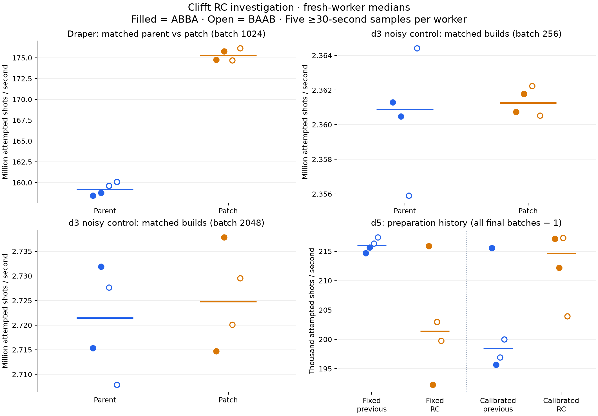

# Clifft RC reference-host investigation

These are the targeted reference-host measurements requested by
[Clifft #656](https://github.com/unitaryfoundation/clifft/issues/656) and
[patch #655](https://github.com/unitaryfoundation/clifft/pull/655), collected on
2026-11-04. They supplement the
[original release campaign](https://github.com/unitaryfoundation/clifft-bench/blob/d2e711f61b4cad439a5f1752edefc51bb96905f1/results/release-v1/0.13.0rc1-20261103-183623/raw.json).
They are not a replacement release campaign or published site figures.

The patch improves matched-build Draper throughput by about 10%, with no material
loss in either d3 noisy control. Published-wheel Draper still reproduces a roughly
4.1% release loss. The original d3 loss does not reproduce. D5 remains unresolved:
fixed preparation and full calibration produce opposite release comparisons,
with large differences between fresh workers despite low variation within each.

## Inputs and measurement

- Harness: `d2e711f61b4cad439a5f1752edefc51bb96905f1`; unchanged runner,
  WorkerClient, worker, adapters, circuits, scheduler and output semantics.
- Previous published wheel: `0.12.0rc1`, source
  `847757e2bc8c4f7439b9e92011550fd61719eb85`.
- Current published wheel and matched source parent: `0.13.0rc1`, source
  `69b5869267c1823ded4bc7156c76d9673c350ba5`.
- Matched source patch: `6abe2509d57acedbae2b2b497e28379f106194f4`, actual installed
  version `0.13.0rc2.dev1+g6abe2509d`. Both source installations retain their
  pinned VCS requirements and PEP 610 identities.
- Same m7a.xlarge placement/boot throughout; Ubuntu 24.04, Python 3.12.3,
  NumPy 2.5.4, logical CPU 0, one thread, 12 GiB address-space ceiling.
  The original campaign's previous-release environment used NumPy 2.5.2;
  these four fresh environments all use 2.5.4 as requested in #656.
- Source builds use GCC 13.3, Release, x86-64-v2 baseline, IPO OFF, OpenMP AUTO;
  runtime ISA is AVX-512. Exact build inputs and package/wheel hashes are in
  [environment.json](environment.json) and the four installation reports.
- Twelve conditions each ran four fresh workers in ABBA order. Seven conditions
  also ran BAAB: all three patch comparisons, the wheel/source bridge, both d5
  histories, and the published Draper anchor. The repeat rule was declared in
  the driver: mandatory controls plus any initial loss or independent-worker
  spread above 1.1%.
- Every worker retains one warmup shot, eight correctness shots and five samples
  of at least 30 seconds. Seeds, public call sizes and scheduler settings match
  the issue. Draper uses 2,048 shots/call, d3 100,000, and d5 20,000.

[plan.json](plan.json) records the conditions; [progress.json](progress.json)
records order, process medians and completed blocks. A block ratio is the median
of B's two worker medians divided by the median of A's two worker medians.
Across both blocks, the combined ratio uses four worker medians per implementation.
Within-worker samples are not treated as independent worker replicates.

## Results

Positive percentages mean higher attempted-shot throughput for B.

| Condition (A → B) | ABBA | BAAB | Combined |
| --- | ---: | ---: | ---: |
| Draper b1024, source parent → patch | +10.505% | +9.726% | +10.089% |
| d3 b256, source parent → patch | +0.016% | +0.052% | +0.016% |
| d3 b2048, source parent → patch | +0.098% | +0.259% | +0.123% |
| Draper b1024, published previous → RC | -4.220% | -4.046% | -4.091% |
| Draper b1024, RC wheel → same-commit source parent | -10.833% | -11.359% | -10.918% |
| d3 b32, published previous → RC | +1.144% | — | +1.144% |
| d3 b256, published previous → RC | +2.274% | — | +2.274% |
| d3 b1024, published previous → RC | +2.731% | — | +2.731% |
| d3 b2048, published previous → RC | +2.449% | — | +2.449% |
| d3 full calibration, published previous → RC | +2.507% | — | +2.507% |
| d5 fixed b1, published previous → RC | -5.160% | -7.137% | -6.771% |
| d5 full calibration, published previous → RC | +4.404% | +6.132% | +8.174% |

Each point is one fresh worker's five-sample median; filled points are ABBA and
open points BAAB. Horizontal marks show medians across workers. Axes show each
panel's measured range; consult the percentage table for effect sizes.

### Patch and Draper disposition

Carry #655 on this evidence: its matched-build gain repeats in both orders, and
both noisy controls are within the 1.1% inconclusive band. This is performance
validation of the pinned patch, not a merge action or evidence that #656 is closed.
D5 was measured only for the published release pair, not parent versus patch.

The matched source parent is about 10.9% slower than the published RC wheel at the
same commit. The source-pair effect therefore cannot be applied numerically to a
future release wheel or used to claim that the published-wheel loss is already
recovered. The final built release artifact should be measured. The bridge
establishes a build-dependent difference; it does not isolate a compiler, linker,
or code-layout cause.

### d3 disposition

Neither the fixed-batch tests nor full calibration reproduces the original loss
or its large-batch collapse. Previous calibration selected 2048 twice; RC selected
2048 and 1024. Every calibration candidate succeeded, and the final rates match
the corresponding fixed-batch range. The original 256 selection is not a reason
to force a batch setting or change calibration. This placement bounds the observed
behavior; it does not explain the earlier transient decline. No d3 bisect is
justified by these measurements.

### d5 disposition and unresolved release impact

All eight calibrated workers selected batch 1, so the comparisons below are
scalar-to-scalar. Rates are attempted shots/s, rounded to the nearest whole shot.
The first scalar candidate is measured before the rest of calibration; final
sampling follows fresh preparation of the selected configuration.

| Block / position | Wheel | First scalar calibration median | Final sampling median |
| --- | --- | ---: | ---: |
| ABBA / 1 | previous | 213859 | 215554 |
| ABBA / 2 | RC | 196492 | 217135 |
| ABBA / 3 | RC | 210931 | 212194 |
| ABBA / 4 | previous | 196281 | 195666 |
| BAAB / 1 | RC | 214137 | 217281 |
| BAAB / 2 | previous | 193865 | 196905 |
| BAAB / 3 | previous | 197488 | 199980 |
| BAAB / 4 | RC | 216117 | 203941 |

Fixed-b1 previous worker medians are 214698, 215677, 216303 and 217381; RC medians
are 215896, 192272, 202959 and 199773. The fixed-history loss repeats at block
level and must not be dismissed as negligible. However, independent RC workers
span 12.29%, and full calibration reverses the release comparison in both blocks;
previous calibrated workers themselves span 10.16%. Changes between first-scalar
and final preparation can go in either direction. These observations establish
process/preparation sensitivity, not an allocator/cache mechanism or a culprit
commit. The original calibrated -1.46% loss is not a stable release-effect estimate.

Keep d5 and the broader issue open. A separate placement and a stable controlled
reproducer are needed before assigning a culprit commit or claiming the regression
is cleared. No new placement was launched and no speculative source fix/bisect
was performed. The release cannot be described as having no performance regressions
from this run; accepting the unresolved d5 risk is a release decision. The d5
uncertainty does not invalidate the separately matched #655 controls.

The original color-code (-0.115%) and surface-code (-0.020%) differences remain
inside the 1.1% inconclusive band; #656 requested no dedicated reruns for them.

## Evidence and checks

- 76/76 successful workers, 380 samples, all correctness checks passed.
- Every raw document passes the pinned harness reader and every regenerated
  `cases.csv` matches byte for byte. Affinity, memory/thread limits, durations,
  seeds and aggregate count relationships were checked.
- Maximum within-worker relative MAD: 0.4994%; maximum recorded peak RSS:
  102809600 bytes (98.05 MiB). Process variability must still be considered.
- All 170 remote evidence files matched local SHA256 before shutdown, including
  both source-built wheels. [validation.json](validation.json) records checks;
  [remote-sha256.json](remote-sha256.json) records the original remote paths/hashes.
- [workers/](workers/) contains authoritative raw JSON and derived CSV for each
  fresh worker. [console.log](console.log), [exit-status.json](exit-status.json),
  [environment.json](environment.json), installation reports and input snapshots
  retain the execution/build provenance.
- [reproduction.tar.gz](reproduction.tar.gz) preserves the exact temporary
  `driver.py`, `inspect_envs.py`, `run.sh` and `clifft656.service` as data. Extract
  it to recover their original names for comparison with the hash manifest.
  These are the captured run's scripts, not a maintained alternative harness.
- The two built wheel files are retained in the durable local evidence folder;
  they are omitted from this Git change. Their paths and hashes are retained in
  `environment.json` and `remote-sha256.json`. All other original remote files
  are present directly or in the reproduction archive.

The matrix finished successfully at 05:16:27 UTC. After retrieval and validation,
`sudo shutdown -h now` returned successfully at 05:18:19 UTC; a later SSH attempt
timed out. The user confirmed instance-initiated shutdown behavior **Stop**.
AWS API state was not independently verified because the CLI session had expired
and no authenticated console was available. [shutdown.json](shutdown.json)
records the evidence without treating unreachability as API-confirmed stopped state.
