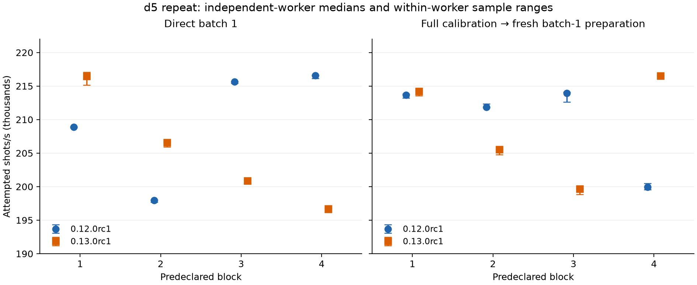

# Bounded d5 repeat on a second stop/start placement

This is the predeclared 16-worker repeat for [Clifft #656](https://github.com/unitaryfoundation/clifft/issues/656), following the
[first investigation at its immutable evidence commit](https://github.com/unitaryfoundation/clifft-bench/tree/3bb234081a62c19b0854d99d554c5a15f4444c37/results/investigation-656/20261104-014655).
It measures only the published release pair on `msc-d5-inject-cultivate-p1e-3`.
It does not test #655 or replace the release campaign/site figures.

The combined direct-batch-1 loss repeats at **−4.017%**, compared with −6.771%
in the first investigation. However, its block comparisons change sign: the RC
wins the first two and loses the last two. Full calibration gives a combined
**−1.347%**, with block changes from −6.664% to +8.309%. Every calibrated worker
selects batch 1. The result is a material release-artifact concern with substantial
process/placement uncertainty, not a stable estimate of a uniform release slowdown.

## Release disposition

The requested bounded repeat is complete. The aggregate direct loss on the second
stop/start placement prevents clearing the earlier concern: a fix with supporting
evidence or explicit acceptance of the unresolved release risk is required.
At the same time, sign reversals and 7–10% differences among identical-condition
workers make a simple “the RC is consistently 4% slower” claim unsupported.
The interleaving removes the earlier grouping of preparation conditions in time,
but does not eliminate process variability. This experiment cannot separate process,
placement and time effects or establish a cache, warmup, allocator or layout mechanism.

Keep d5's release disposition explicit in #656. This result does not prove that
there is no regression, identify a culprit, or establish that #655 fixes d5.
No additional matrix, conditioning experiment or bisect was started.

## Inputs and execution

- Harness and circuit snapshot: `d2e711f61b4cad439a5f1752edefc51bb96905f1`;
  unchanged `run_suite` → `WorkerClient` → worker/adapter.
- Published previous wheel: `clifft==0.12.0rc1`, source
  `847757e2bc8c4f7439b9e92011550fd61719eb85`.
- Published RC wheel: `clifft==0.13.0rc1`, source
  `69b5869267c1823ded4bc7156c76d9673c350ba5`.
- Fresh environments: Python 3.12.3, NumPy 2.5.4, x86-64-v2 wheel baseline,
  runtime AVX-512. All downloaded Clifft and NumPy wheel hashes match the first
  investigation's installation reports. No wheel was rebuilt. Installed identities,
  extension/metadata hashes and downloaded artifact hashes are in
  [environment.json](environment.json) and the installation reports.
- Same instance restarted by the user: `i-0b559eec365c2acb7`, m7a.xlarge,
  Ubuntu 24.04.4, AMD EPYC 9R14, us-east-1c. New boot
  `d6fd85a0-f272-42a3-8f20-96388d772c7a`; prior boot
  `245a2b00-efd4-4f77-b8d3-e9b0e71f31dc`. This is an independent stop/start
  placement under the benchmark contract; AWS physical-host identity was not
  exposed or independently verified.
- One logical CPU (0), one thread, 12 GiB address-space limit, serial workers,
  20,000 attempted shots/public call, five samples of at least 30 seconds each.
  Scheduler: beam width 8, search budget 16, noise transparency and neutral-rotation
  sinking enabled. Detector postselection and observable-0 raw-parity aggregate
  output remain unchanged.
- Original seeds: preparation/calibration 520270819, final preparation/warmup
  20260818, correctness 20260819, sample `i` starts at
  `20270819 + i × 100000000`. One warmup shot and eight correctness shots.
- The original full `bounded-v3` calibration tries `1, 32, 64, 256, 1024, 2048`,
  takes three ≥1-second probes per candidate, observes its 60-second soft budget,
  releases trial samplers, and freshly prepares the winner in the same worker.
  No pre-calibration baseline or extra conditioning was inserted.

| Condition | Wheel | Preparation |
| --- | --- | --- |
| A | 0.12.0rc1 | Direct batch 1 |
| B | 0.13.0rc1 | Direct batch 1 |
| C | 0.12.0rc1 | Full calibration, then fresh preparation of the winner |
| D | 0.13.0rc1 | Full calibration, then fresh preparation of the winner |

[request.json](request.json) retains the requested bounds; [plan.json](plan.json)
records the declared order. Each entry is a fresh worker: `ABDC`, `BCAD`, `CDBA`,
`DACB`. Each condition occupies each block position exactly once.

## Comparisons

Positive means higher RC attempted-shot throughput. Each block compares its one
RC worker median with its one previous-release worker median. The combined rows
compare the medians of four independent-worker medians per condition; they are
neither pooled sample comparisons nor averages of block percentages.

| Block | Direct B/A | Calibrated D/C |
| --- | ---: | ---: |
| 1 | +3.641% | +0.270% |
| 2 | +4.356% | -2.978% |
| 3 | -6.844% | -6.664% |
| 4 | -9.187% | +8.309% |
| Combined | **-4.017%** | **-1.347%** |

The calibrated −1.347% is just outside the contract's 1.1% inconclusive band,
but that band does not remove the much larger independent-worker uncertainty
seen here. No population confidence claim is made from four workers per condition.

Points are individual workers' five-sample medians; whiskers span their five
sample rates and are not confidence intervals. The vertical axis is truncated
to show observed rates. Every worker used batch 1.

| Condition | Median across workers (shots/s) | Worker minimum–maximum (shots/s) | Spread, max/min − 1 |
| --- | ---: | ---: | ---: |
| A | 212252 | 197959–216589 | 9.411% |
| B | 203727 | 196691–216481 | 10.062% |
| C | 212753 | 199930–213934 | 7.004% |
| D | 209888 | 199677–216543 | 8.446% |

Both releases fluctuate substantially across fresh workers, including the previous
release's direct workers (about 198k–217k shots/s). Maximum within-worker relative
MAD is only 0.197%; the largest five-sample max/min range is 0.910%. Stable samples
inside a process therefore do not make its rate representative of all fresh processes.

## Every worker

Rates are attempted shots/s; relative MAD is median absolute deviation divided by
the worker median. Raw links retain all five rates, counts, seeds and durations.

| Block / position | Condition | Worker median | Sample minimum–maximum | Relative MAD |
| --- | --- | ---: | ---: | ---: |
| 1 / 1 | [A](workers/block-1/1-A/raw.json) | 208875.649 | 208763.706–208961.311 | 0.0216% |
| 1 / 2 | [B](workers/block-1/2-B/raw.json) | 216481.463 | 215123.803–217081.295 | 0.1630% |
| 1 / 3 | [D](workers/block-1/3-D/raw.json) | 214228.964 | 213543.114–214293.189 | 0.0205% |
| 1 / 4 | [C](workers/block-1/4-C/raw.json) | 213651.710 | 213233.086–213807.210 | 0.0728% |
| 2 / 1 | [B](workers/block-2/1-B/raw.json) | 206582.542 | 205941.355–206698.313 | 0.0560% |
| 2 / 2 | [C](workers/block-2/2-C/raw.json) | 211855.068 | 211776.189–212351.339 | 0.0372% |
| 2 / 3 | [A](workers/block-2/3-A/raw.json) | 197958.941 | 197661.199–197991.103 | 0.0162% |
| 2 / 4 | [D](workers/block-2/4-D/raw.json) | 205546.921 | 204797.210–205562.596 | 0.0052% |
| 3 / 1 | [C](workers/block-3/1-C/raw.json) | 213933.569 | 212626.686–214102.832 | 0.0791% |
| 3 / 2 | [D](workers/block-3/2-D/raw.json) | 199677.482 | 198825.305–199702.968 | 0.0128% |
| 3 / 3 | [B](workers/block-3/3-B/raw.json) | 200871.431 | 200462.801–201030.709 | 0.0519% |
| 3 / 4 | [A](workers/block-3/4-A/raw.json) | 215629.245 | 215418.987–215694.588 | 0.0220% |
| 4 / 1 | [D](workers/block-4/1-D/raw.json) | 216543.038 | 216449.622–216562.641 | 0.0091% |
| 4 / 2 | [A](workers/block-4/2-A/raw.json) | 216588.894 | 216128.721–216655.377 | 0.0267% |
| 4 / 3 | [C](workers/block-4/3-C/raw.json) | 199930.335 | 199536.621–200502.694 | 0.1969% |
| 4 / 4 | [B](workers/block-4/4-B/raw.json) | 196690.573 | 196155.451–196798.828 | 0.0294% |

## Calibration evidence

All 48 candidates (six in each of eight workers) succeeded; none was skipped.
All eight selected batch 1. The complete candidate sequence and probe evidence
remain in each calibrated worker's raw document. The table below retains the
first scalar candidate and final measurement; they have different seed/duration
phases and must not be interpreted as a controlled causal before/after test.

| Block / condition | Scalar candidate median (shots/s) | Final worker median (shots/s) | Selected batch |
| --- | ---: | ---: | ---: |
| 1 / D | 197843.978 | 214228.964 | 1 |
| 1 / C | 216600.922 | 213651.710 | 1 |
| 2 / C | 214424.260 | 211855.068 | 1 |
| 2 / D | 212689.688 | 205546.921 | 1 |
| 3 / C | 214386.001 | 213933.569 | 1 |
| 3 / D | 211062.271 | 199677.482 | 1 |
| 4 / D | 214935.226 | 216543.038 | 1 |
| 4 / C | 205517.593 | 199930.335 | 1 |

## Validation, evidence and cleanup

- 16/16 workers succeeded, 80 final samples, all correctness checks passed.
- Every raw file passes the pinned harness reader; all 16 `cases.csv` files
  regenerate byte for byte. Exact declared ordering, identities, workload,
  scheduler, postselection, counts, seeds and resource limits were checked.
- Minimum final sample duration: 30.001 seconds. Maximum recorded final-sample
  peak RSS: 104685568 bytes (99.84 MiB). See [validation.json](validation.json).
- All 50 remote evidence files, including the four downloaded wheel files,
  matched local SHA256 before shutdown. [remote-sha256.json](remote-sha256.json)
  retains their original relative paths and hashes. Wheel binaries remain in the
  durable local evidence folder and are omitted from this Git change.
- The other remote files are included directly or in
  [reproduction.tar.gz](reproduction.tar.gz), containing the exact temporary
  `driver.py`, `inspect_envs.py`, `run.sh` and `clifft-d5-repeat.service`.
  The archive also includes the local `analyze.py` used for validation and
  independent-worker summaries; it was not run on EC2 or used to alter measurement.
  These are captured one-off artifacts, not maintained harness code.
- [progress.json](progress.json), [console.log](console.log),
  [exit-status.json](exit-status.json), [service-final.txt](service-final.txt),
  and the issue/PR snapshots retain provenance. Validation and shutdown records
  were generated locally after retrieval and are outside the remote hash manifest.

Measurements ran from 11:33:13 to 12:16:24 UTC on 2026-11-04 (about 43 minutes).
After copying, SHA256 matching and validation, `sudo shutdown -h now` returned
success at 12:17:26 UTC (7:17 a.m. Eastern). SSH subsequently timed out at
12:18:31 UTC. The user confirmed instance-initiated shutdown behavior **Stop**.
AWS API stopped state was not independently verified because the CLI OAuth session
had expired; SSH unreachability is not treated as API-confirmed stopped state.
The exact evidence is in [shutdown.json](shutdown.json).
