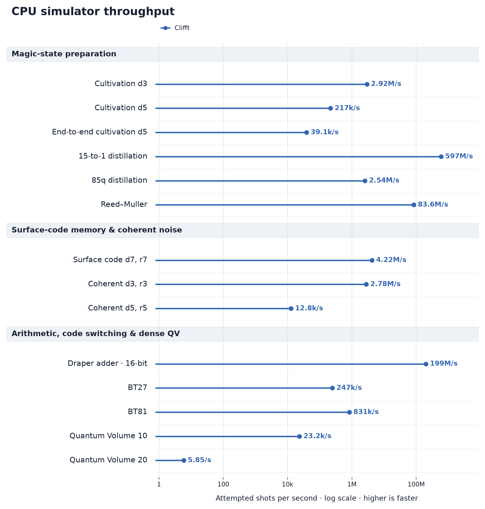
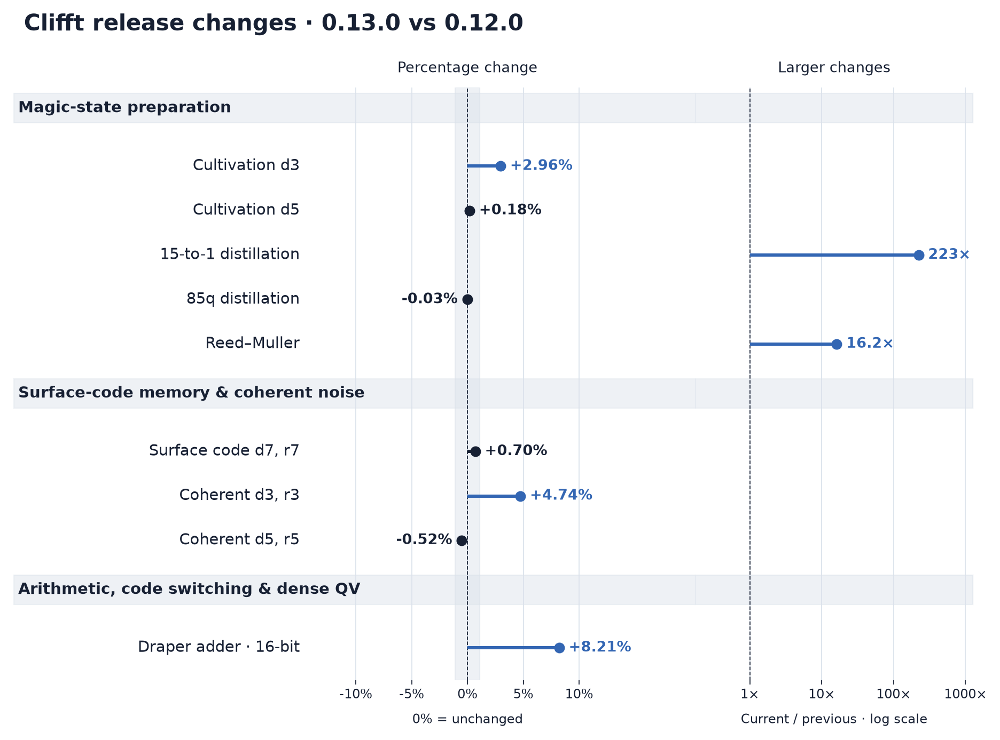

# release-clifft — fc091f89-b63e-4be6-9e72-87cc15fcd04a

Classification: **official**. Collected 2026-11-04T15:29:23.958328Z.
Source: `3c89445367581edba4d9b7ec5c72e53c4e68eddc`; dirty: False.
Host: AMD EPYC 9R14 (Linux, x86_64).

## Measured implementations

| Implementation | Exact version | Commit |
| --- | --- | --- |
| clifft-0.12.0rc1 | 0.12.0rc1 | `847757e2bc8c4f7439b9e92011550fd61719eb85` |
| clifft-0.13.0rc2 | 0.13.0rc2 | `7e83ec2823bf99c54aa1b90c54a092641c10c4b0` |

## Outcomes

| Case | Outcome | Detail |
| --- | --- | --- |
| msc-d3-inject-cultivate-p1e-3--clifft-previous | success | 5 samples; batch 2048 |
| msc-d5-inject-cultivate-p1e-3--clifft-previous | success | 5 samples; batch 1 |
| distillation-color-code-85q-p5e-2--clifft-previous | success | 5 samples; batch 1024 |
| surface-code-d7-r7-p1e-3--clifft-previous | success | 5 samples; batch 2048 |
| coherent-surface-d3-r3-p1e-3-rz2e-2--clifft-previous | success | 5 samples; batch 2048 |
| coherent-surface-d5-r5-p1e-3-rz2e-2--clifft-previous | success | 5 samples; batch 1 |
| draper-adder-m16-basis-all-observables--clifft-previous | success | 5 samples; batch 1024 |
| distillation-15to1-rm15-p1e-3--clifft-previous | success | 5 samples; batch 1024 |
| reed-muller-measured--clifft-previous | success | 5 samples; batch 256 |
| msc-d3-inject-cultivate-p1e-3--clifft-current | success | 5 samples; batch 2048 |
| msc-d5-inject-cultivate-p1e-3--clifft-current | success | 5 samples; batch 1 |
| distillation-color-code-85q-p5e-2--clifft-current | success | 5 samples; batch 1024 |
| surface-code-d7-r7-p1e-3--clifft-current | success | 5 samples; batch 2048 |
| coherent-surface-d3-r3-p1e-3-rz2e-2--clifft-current | success | 5 samples; batch 2048 |
| coherent-surface-d5-r5-p1e-3-rz2e-2--clifft-current | success | 5 samples; batch 1 |
| draper-adder-m16-basis-all-observables--clifft-current | success | 5 samples; batch 1024 |
| distillation-15to1-rm15-p1e-3--clifft-current | success | 5 samples; batch 2048 |
| bt27-direct-x--clifft-current | success | 5 samples; batch 1 |
| bt81-direct-x--clifft-current | success | 5 samples; batch 1024 |
| reed-muller-measured--clifft-current | success | 5 samples; batch 256 |
| coherent-surface-d5-r5-p1e-3-rz2e-2--clifft-bulk | success | 5 samples; batch 1 |
| draper-adder-m16-basis-all-observables--clifft-bulk | success | 5 samples; batch 2048 |
| msc-d3-inject-cultivate-p1e-3-unselected--clifft-coverage | success | 5 samples; batch 2048 |
| surface-code-d7-r7-p1e-3-unselected--clifft-coverage | success | 5 samples; batch 2048 |
| coherent-surface-d3-r3-p1e-3-rz2e-2-unselected--clifft-coverage | success | 5 samples; batch 2048 |
| quantum-volume-q10-seed42-all-observables--clifft-coverage | success | 5 samples; batch 1 |
| quantum-volume-q20-seed42-all-observables--clifft-coverage | success | 5 samples; batch 1 |
| msc-d7-proxy-unverified-p1e-3--clifft-coverage | success | 5 samples; batch 1 |
| msc-full-d5-cultivation-selected-p1e-3--clifft-coverage | success | 5 samples; batch 256 |

## Paired comparisons

Ratios are candidate / baseline sample medians. Failed cases have no rate or ratio.
Bulk and short calls remain separate. Missing baselines are not regressions.

| Comparison | Workload | Candidate | Candidate / baseline | Outcome |
| --- | --- | --- | ---: | --- |
| current-vs-previous | msc-d3-inject-cultivate-p1e-3 | clifft-current | 1.02963× | baseline: measured; candidate: measured |
| current-vs-previous | msc-d5-inject-cultivate-p1e-3 | clifft-current | 1.00185× | baseline: measured; candidate: measured |
| current-vs-previous | distillation-color-code-85q-p5e-2 | clifft-current | 0.999688× | baseline: measured; candidate: measured |
| current-vs-previous | surface-code-d7-r7-p1e-3 | clifft-current | 1.00697× | baseline: measured; candidate: measured |
| current-vs-previous | coherent-surface-d3-r3-p1e-3-rz2e-2 | clifft-current | 1.04739× | baseline: measured; candidate: measured |
| current-vs-previous | coherent-surface-d5-r5-p1e-3-rz2e-2 | clifft-current | 0.994786× | baseline: measured; candidate: measured |
| current-vs-previous | draper-adder-m16-basis-all-observables | clifft-current | 1.08211× | baseline: measured; candidate: measured |
| current-vs-previous | distillation-15to1-rm15-p1e-3 | clifft-current | 222.993× | baseline: measured; candidate: measured |
| current-vs-previous | reed-muller-measured | clifft-current | 16.2169× | baseline: measured; candidate: measured |
| current-vs-previous | bt27-direct-x | clifft-current | — | baseline: not measured; candidate: measured |
| current-vs-previous | bt81-direct-x | clifft-current | — | baseline: not measured; candidate: measured |

## Figures

Rates count attempted shots and exclude compilation; lazy planning during sampling
is included. The main figures share circuit selection and thematic ordering.
Selection-off controls, the unverified cultivation proxy, and bulk-call variants
remain in the detailed results above. Colors and marker shapes identify simulators.
Unsupported pairings have
no marker; unmeasured and failed cases are labeled. Exact identities and outcomes
are recorded above. Call sizes are in cases.csv; postselection settings are in raw.json.

Release changes within ±50% use a linear percentage axis; larger changes use
a separate logarithmic ratio panel. The shaded ±1.1% band is the contract's
inconclusive region, not a confidence interval. Unpaired workloads have no ratio.

### CPU simulator throughput

[Dark version](simulator-throughput-dark.png)

### Clifft release changes

[Dark version](release-change-dark.png)

