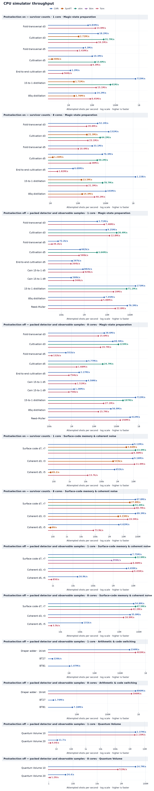
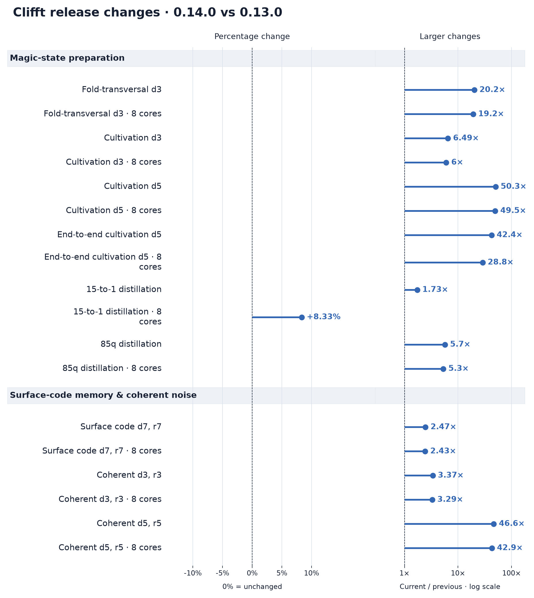

# release-clifft — 83bd8bd6-a5b6-4984-af90-e3ced3b6f7da

Classification: **official**. Collected 2026-11-23T15:19:08.004791Z.
Source: `27884762ef4ee6a50f9ff5e67d5d6aa8abd59d2d`; dirty: False.
Host: AMD EPYC 9R14 (Linux, x86_64).

## Collection sources

Clifft and paired release changes use the primary execution above.
Peer throughput is reused from run `1b252b89-75d2-4881-ade9-114e09db6c9d`, collected 2026-11-21T00:10:46.758644Z.
Peer source: `dd362f5977c178ad5da5d4588404841f59ae6e6c`.
These are separate collections on matching reference hardware and protocols;
cross-collection throughput is not a fresh paired comparison.
The peer versions below retain their source measurements; peers were not rerun.

## Measured implementations

| Implementation | Exact version | Commit |
| --- | --- | --- |
| clifft-0.13.0 | 0.13.0 | `9b9091c8267321e2a2fd967f0674a65e4baf0e38` |
| clifft-0.14.0rc2 | 0.14.0rc2 | `4e5d60dc34ebf49722aba59dd92e8a61cad6cd6d` |
| tsim-1.0.0 | 1.0.0 | `136bcc6bec7edba88bbb28152da05e33d17f77d0` |
| xtim-4.1.2 | 4.1.2 | `b6dc0302604c4faf59a7b753004fddb42cb8d615` |
| symft-2026.10.8 | 2026.10.8 | `81d28499b6da8c0b84b7567482c4692f509bd416` |
| stim-1.16.0 | 1.16.0 | `e2fc1eca7fd21684d433aa5f10f4504ea4860d07` |

## Outcomes

| Case | Outcome | Detail |
| --- | --- | --- |
| msc-d3-inject-cultivate-p1e-3--clifft-previous | success | 3 samples; batch unknown; 1 physical cores |
| msc-d5-inject-cultivate-p1e-3--clifft-previous | success | 3 samples; batch unknown; 1 physical cores |
| surface-code-d7-r7-p1e-3--clifft-previous | success | 3 samples; batch unknown; 1 physical cores |
| distillation-color-code-85q-p5e-2--clifft-previous | success | 3 samples; batch unknown; 1 physical cores |
| coherent-surface-d3-r3-p1e-3-rz2e-2--clifft-previous | success | 3 samples; batch unknown; 1 physical cores |
| coherent-surface-d5-r5-p1e-3-rz2e-2--clifft-previous | success | 3 samples; batch unknown; 1 physical cores |
| distillation-15to1-rm15-p1e-3--clifft-previous | success | 3 samples; batch unknown; 1 physical cores |
| msc-full-d5-cultivation-selected-p1e-3--clifft-previous | success | 3 samples; batch unknown; 1 physical cores |
| fold-transversal-d3-p1e-3--clifft-previous | success | 3 samples; batch unknown; 1 physical cores |
| msc-d3-inject-cultivate-p1e-3--clifft-current | success | 3 samples; batch 8192; 1 physical cores |
| msc-d5-inject-cultivate-p1e-3--clifft-current | success | 3 samples; batch 8192; 1 physical cores |
| surface-code-d7-r7-p1e-3--clifft-current | success | 3 samples; batch 2048; 1 physical cores |
| distillation-color-code-85q-p5e-2--clifft-current | success | 3 samples; batch 8192; 1 physical cores |
| coherent-surface-d3-r3-p1e-3-rz2e-2--clifft-current | success | 3 samples; batch 8192; 1 physical cores |
| coherent-surface-d5-r5-p1e-3-rz2e-2--clifft-current | success | 3 samples; batch 341; 1 physical cores |
| distillation-15to1-rm15-p1e-3--clifft-current | success | 3 samples; batch 2048; 1 physical cores |
| msc-full-d5-cultivation-selected-p1e-3--clifft-current | success | 3 samples; batch 8192; 1 physical cores |
| fold-transversal-d3-p1e-3--clifft-current | success | 3 samples; batch 8192; 1 physical cores |
| fold-transversal-d5-p1e-3--clifft-current | success | 3 samples; batch 8192; 1 physical cores |
| msc-d3-inject-cultivate-p1e-3--clifft-previous-off | unsupported | setup: UnsupportedConfiguration: clifft does not support postselect=off |
| msc-d5-inject-cultivate-p1e-3--clifft-previous-off | unsupported | setup: UnsupportedConfiguration: clifft does not support postselect=off |
| surface-code-d7-r7-p1e-3--clifft-previous-off | unsupported | setup: UnsupportedConfiguration: clifft does not support postselect=off |
| distillation-color-code-85q-p5e-2--clifft-previous-off | unsupported | setup: UnsupportedConfiguration: clifft does not support postselect=off |
| coherent-surface-d3-r3-p1e-3-rz2e-2--clifft-previous-off | unsupported | setup: UnsupportedConfiguration: clifft does not support postselect=off |
| coherent-surface-d5-r5-p1e-3-rz2e-2--clifft-previous-off | unsupported | setup: UnsupportedConfiguration: clifft does not support postselect=off |
| quantum-volume-q10-seed42-all-observables--clifft-previous-off | unsupported | setup: UnsupportedConfiguration: clifft does not support postselect=off |
| quantum-volume-q20-seed42-all-observables--clifft-previous-off | unsupported | setup: UnsupportedConfiguration: clifft does not support postselect=off |
| draper-adder-m16-basis-all-observables--clifft-previous-off | unsupported | setup: UnsupportedConfiguration: clifft does not support postselect=off |
| distillation-15to1-rm15-p1e-3--clifft-previous-off | unsupported | setup: UnsupportedConfiguration: clifft does not support postselect=off |
| bt27-direct-x--clifft-previous-off | unsupported | setup: UnsupportedConfiguration: clifft does not support postselect=off |
| bt81-direct-x--clifft-previous-off | unsupported | setup: UnsupportedConfiguration: clifft does not support postselect=off |
| reed-muller-measured--clifft-previous-off | unsupported | setup: UnsupportedConfiguration: clifft does not support postselect=off |
| msc-full-d5-cultivation-selected-p1e-3--clifft-previous-off | unsupported | setup: UnsupportedConfiguration: clifft does not support postselect=off |
| fold-transversal-d3-p1e-3--clifft-previous-off | unsupported | setup: UnsupportedConfiguration: clifft does not support postselect=off |
| fold-transversal-d5-p1e-3--clifft-previous-off | unsupported | setup: UnsupportedConfiguration: clifft does not support postselect=off |
| cain-15to1-d5-p1e-3--clifft-previous-off | unsupported | setup: UnsupportedConfiguration: clifft does not support postselect=off |
| cain-15to1-d9-p1e-3--clifft-previous-off | unsupported | setup: UnsupportedConfiguration: clifft does not support postselect=off |
| msc-d3-inject-cultivate-p1e-3--clifft-current-off | success | 3 samples; batch 8192; 1 physical cores |
| msc-d5-inject-cultivate-p1e-3--clifft-current-off | success | 3 samples; batch 512; 1 physical cores |
| surface-code-d7-r7-p1e-3--clifft-current-off | success | 3 samples; batch 2048; 1 physical cores |
| distillation-color-code-85q-p5e-2--clifft-current-off | success | 3 samples; batch 8192; 1 physical cores |
| coherent-surface-d3-r3-p1e-3-rz2e-2--clifft-current-off | success | 3 samples; batch 8192; 1 physical cores |
| coherent-surface-d5-r5-p1e-3-rz2e-2--clifft-current-off | success | 3 samples; batch 1; 1 physical cores |
| quantum-volume-q10-seed42-all-observables--clifft-current-off | success | 3 samples; batch 2730; 1 physical cores |
| quantum-volume-q20-seed42-all-observables--clifft-current-off | success | 3 samples; batch 2; 1 physical cores |
| draper-adder-m16-basis-all-observables--clifft-current-off | success | 3 samples; batch 2048; 1 physical cores |
| distillation-15to1-rm15-p1e-3--clifft-current-off | success | 3 samples; batch 2048; 1 physical cores |
| bt27-direct-x--clifft-current-off | success | 3 samples; batch 1; 1 physical cores |
| bt81-direct-x--clifft-current-off | success | 3 samples; batch 512; 1 physical cores |
| reed-muller-measured--clifft-current-off | success | 3 samples; batch 2048; 1 physical cores |
| msc-full-d5-cultivation-selected-p1e-3--clifft-current-off | success | 3 samples; batch 512; 1 physical cores |
| fold-transversal-d3-p1e-3--clifft-current-off | success | 3 samples; batch 8192; 1 physical cores |
| fold-transversal-d5-p1e-3--clifft-current-off | success | 3 samples; batch 128; 1 physical cores |
| cain-15to1-d5-p1e-3--clifft-current-off | success | 3 samples; batch 2048; 1 physical cores |
| cain-15to1-d9-p1e-3--clifft-current-off | success | 3 samples; batch 2048; 1 physical cores |
| msc-d3-inject-cultivate-p1e-3--clifft-previous-8c | success | 3 samples; batch unknown; 8 physical cores |
| msc-d5-inject-cultivate-p1e-3--clifft-previous-8c | success | 3 samples; batch unknown; 8 physical cores |
| surface-code-d7-r7-p1e-3--clifft-previous-8c | success | 3 samples; batch unknown; 8 physical cores |
| distillation-color-code-85q-p5e-2--clifft-previous-8c | success | 3 samples; batch unknown; 8 physical cores |
| coherent-surface-d3-r3-p1e-3-rz2e-2--clifft-previous-8c | success | 3 samples; batch unknown; 8 physical cores |
| coherent-surface-d5-r5-p1e-3-rz2e-2--clifft-previous-8c | success | 3 samples; batch unknown; 8 physical cores |
| distillation-15to1-rm15-p1e-3--clifft-previous-8c | success | 3 samples; batch unknown; 8 physical cores |
| msc-full-d5-cultivation-selected-p1e-3--clifft-previous-8c | success | 3 samples; batch unknown; 8 physical cores |
| fold-transversal-d3-p1e-3--clifft-previous-8c | success | 3 samples; batch unknown; 8 physical cores |
| msc-d3-inject-cultivate-p1e-3--clifft-current-8c | success | 3 samples; batch 8192; 8 physical cores |
| msc-d5-inject-cultivate-p1e-3--clifft-current-8c | success | 3 samples; batch 8192; 8 physical cores |
| surface-code-d7-r7-p1e-3--clifft-current-8c | success | 3 samples; batch 2048; 8 physical cores |
| distillation-color-code-85q-p5e-2--clifft-current-8c | success | 3 samples; batch 8192; 8 physical cores |
| coherent-surface-d3-r3-p1e-3-rz2e-2--clifft-current-8c | success | 3 samples; batch 8192; 8 physical cores |
| coherent-surface-d5-r5-p1e-3-rz2e-2--clifft-current-8c | success | 3 samples; batch 341; 8 physical cores |
| distillation-15to1-rm15-p1e-3--clifft-current-8c | success | 3 samples; batch 2048; 8 physical cores |
| msc-full-d5-cultivation-selected-p1e-3--clifft-current-8c | success | 3 samples; batch 2048; 8 physical cores |
| fold-transversal-d3-p1e-3--clifft-current-8c | success | 3 samples; batch 8192; 8 physical cores |
| fold-transversal-d5-p1e-3--clifft-current-8c | success | 3 samples; batch 8192; 8 physical cores |
| msc-d3-inject-cultivate-p1e-3--clifft-previous-off-8c | unsupported | setup: UnsupportedConfiguration: clifft does not support postselect=off |
| msc-d5-inject-cultivate-p1e-3--clifft-previous-off-8c | unsupported | setup: UnsupportedConfiguration: clifft does not support postselect=off |
| surface-code-d7-r7-p1e-3--clifft-previous-off-8c | unsupported | setup: UnsupportedConfiguration: clifft does not support postselect=off |
| distillation-color-code-85q-p5e-2--clifft-previous-off-8c | unsupported | setup: UnsupportedConfiguration: clifft does not support postselect=off |
| coherent-surface-d3-r3-p1e-3-rz2e-2--clifft-previous-off-8c | unsupported | setup: UnsupportedConfiguration: clifft does not support postselect=off |
| coherent-surface-d5-r5-p1e-3-rz2e-2--clifft-previous-off-8c | unsupported | setup: UnsupportedConfiguration: clifft does not support postselect=off |
| quantum-volume-q10-seed42-all-observables--clifft-previous-off-8c | unsupported | setup: UnsupportedConfiguration: clifft does not support postselect=off |
| quantum-volume-q20-seed42-all-observables--clifft-previous-off-8c | unsupported | setup: UnsupportedConfiguration: clifft does not support postselect=off |
| draper-adder-m16-basis-all-observables--clifft-previous-off-8c | unsupported | setup: UnsupportedConfiguration: clifft does not support postselect=off |
| distillation-15to1-rm15-p1e-3--clifft-previous-off-8c | unsupported | setup: UnsupportedConfiguration: clifft does not support postselect=off |
| bt27-direct-x--clifft-previous-off-8c | unsupported | setup: UnsupportedConfiguration: clifft does not support postselect=off |
| bt81-direct-x--clifft-previous-off-8c | unsupported | setup: UnsupportedConfiguration: clifft does not support postselect=off |
| reed-muller-measured--clifft-previous-off-8c | unsupported | setup: UnsupportedConfiguration: clifft does not support postselect=off |
| msc-full-d5-cultivation-selected-p1e-3--clifft-previous-off-8c | unsupported | setup: UnsupportedConfiguration: clifft does not support postselect=off |
| fold-transversal-d3-p1e-3--clifft-previous-off-8c | unsupported | setup: UnsupportedConfiguration: clifft does not support postselect=off |
| fold-transversal-d5-p1e-3--clifft-previous-off-8c | unsupported | setup: UnsupportedConfiguration: clifft does not support postselect=off |
| cain-15to1-d5-p1e-3--clifft-previous-off-8c | unsupported | setup: UnsupportedConfiguration: clifft does not support postselect=off |
| cain-15to1-d9-p1e-3--clifft-previous-off-8c | unsupported | setup: UnsupportedConfiguration: clifft does not support postselect=off |
| msc-d3-inject-cultivate-p1e-3--clifft-current-off-8c | success | 3 samples; batch 8192; 8 physical cores |
| msc-d5-inject-cultivate-p1e-3--clifft-current-off-8c | success | 3 samples; batch 512; 8 physical cores |
| surface-code-d7-r7-p1e-3--clifft-current-off-8c | success | 3 samples; batch 2048; 8 physical cores |
| distillation-color-code-85q-p5e-2--clifft-current-off-8c | success | 3 samples; batch 8192; 8 physical cores |
| coherent-surface-d3-r3-p1e-3-rz2e-2--clifft-current-off-8c | success | 3 samples; batch 8192; 8 physical cores |
| coherent-surface-d5-r5-p1e-3-rz2e-2--clifft-current-off-8c | success | 3 samples; batch 1; 8 physical cores |
| quantum-volume-q10-seed42-all-observables--clifft-current-off-8c | success | 3 samples; batch 2048; 8 physical cores |
| quantum-volume-q20-seed42-all-observables--clifft-current-off-8c | success | 3 samples; batch 2; 8 physical cores |
| draper-adder-m16-basis-all-observables--clifft-current-off-8c | success | 3 samples; batch 2048; 8 physical cores |
| distillation-15to1-rm15-p1e-3--clifft-current-off-8c | success | 3 samples; batch 2048; 8 physical cores |
| bt27-direct-x--clifft-current-off-8c | success | 3 samples; batch 1; 8 physical cores |
| bt81-direct-x--clifft-current-off-8c | success | 3 samples; batch 512; 8 physical cores |
| reed-muller-measured--clifft-current-off-8c | success | 3 samples; batch 2048; 8 physical cores |
| msc-full-d5-cultivation-selected-p1e-3--clifft-current-off-8c | success | 3 samples; batch 512; 8 physical cores |
| fold-transversal-d3-p1e-3--clifft-current-off-8c | success | 3 samples; batch 8192; 8 physical cores |
| fold-transversal-d5-p1e-3--clifft-current-off-8c | success | 3 samples; batch 128; 8 physical cores |
| cain-15to1-d5-p1e-3--clifft-current-off-8c | success | 3 samples; batch 2048; 8 physical cores |
| cain-15to1-d9-p1e-3--clifft-current-off-8c | success | 3 samples; batch 2048; 8 physical cores |
| msc-d3-inject-cultivate-p1e-3--tsim-current | success | 3 samples; batch unknown; 1 physical cores |
| msc-d5-inject-cultivate-p1e-3--tsim-current | success | 3 samples; batch unknown; 1 physical cores |
| surface-code-d7-r7-p1e-3--tsim-current | success | 3 samples; batch unknown; 1 physical cores |
| distillation-color-code-85q-p5e-2--tsim-current | success | 3 samples; batch unknown; 1 physical cores |
| coherent-surface-d3-r3-p1e-3-rz2e-2--tsim-current | success | 3 samples; batch unknown; 1 physical cores |
| coherent-surface-d5-r5-p1e-3-rz2e-2--tsim-current | success | 3 samples; batch unknown; 1 physical cores |
| distillation-15to1-rm15-p1e-3--tsim-current | success | 3 samples; batch unknown; 1 physical cores |
| msc-full-d5-cultivation-selected-p1e-3--tsim-current | success | 3 samples; batch unknown; 1 physical cores |
| fold-transversal-d3-p1e-3--tsim-current | success | 3 samples; batch unknown; 1 physical cores |
| fold-transversal-d5-p1e-3--tsim-current | success | 3 samples; batch unknown; 1 physical cores |
| msc-d3-inject-cultivate-p1e-3--xtim-current | success | 3 samples; batch unknown; 1 physical cores |
| msc-d5-inject-cultivate-p1e-3--xtim-current | success | 3 samples; batch unknown; 1 physical cores |
| surface-code-d7-r7-p1e-3--xtim-current | success | 3 samples; batch unknown; 1 physical cores |
| distillation-15to1-rm15-p1e-3--xtim-current | success | 3 samples; batch unknown; 1 physical cores |
| msc-full-d5-cultivation-selected-p1e-3--xtim-current | unsupported | setup: UnsupportedReferenceCircuit: xtim raw reference parity is unavailable for this circuit: Gate not found: 'T_DAG' |
| fold-transversal-d3-p1e-3--xtim-current | unsupported | setup: UnsupportedReferenceCircuit: xtim raw reference parity is unavailable for this circuit: Gate not found: 'T' |
| fold-transversal-d5-p1e-3--xtim-current | unsupported | setup: UnsupportedReferenceCircuit: xtim raw reference parity is unavailable for this circuit: Gate not found: 'T' |
| msc-d3-inject-cultivate-p1e-3--symft-current | success | 3 samples; batch 2048; 1 physical cores |
| msc-d5-inject-cultivate-p1e-3--symft-current | success | 3 samples; batch 32; 1 physical cores |
| surface-code-d7-r7-p1e-3--symft-current | success | 3 samples; batch 2048; 1 physical cores |
| distillation-color-code-85q-p5e-2--symft-current | success | 3 samples; batch 1024; 1 physical cores |
| coherent-surface-d3-r3-p1e-3-rz2e-2--symft-current | success | 3 samples; batch 256; 1 physical cores |
| coherent-surface-d5-r5-p1e-3-rz2e-2--symft-current | success | 3 samples; batch 1; 1 physical cores |
| distillation-15to1-rm15-p1e-3--symft-current | success | 3 samples; batch 1024; 1 physical cores |
| msc-full-d5-cultivation-selected-p1e-3--symft-current | unsupported | setup: UnsupportedConfiguration: symft does not support explicit detector subsets |
| surface-code-d7-r7-p1e-3--stim-current | unsupported | setup: UnsupportedConfiguration: stim does not support postselect=on |
| msc-d3-inject-cultivate-p1e-3--tsim-current-off | success | 3 samples; batch unknown; 1 physical cores |
| msc-d5-inject-cultivate-p1e-3--tsim-current-off | success | 3 samples; batch unknown; 1 physical cores |
| surface-code-d7-r7-p1e-3--tsim-current-off | success | 3 samples; batch unknown; 1 physical cores |
| distillation-color-code-85q-p5e-2--tsim-current-off | success | 3 samples; batch unknown; 1 physical cores |
| coherent-surface-d3-r3-p1e-3-rz2e-2--tsim-current-off | success | 3 samples; batch unknown; 1 physical cores |
| coherent-surface-d5-r5-p1e-3-rz2e-2--tsim-current-off | success | 3 samples; batch unknown; 1 physical cores |
| quantum-volume-q10-seed42-all-observables--tsim-current-off | success | 3 samples; batch unknown; 1 physical cores |
| quantum-volume-q20-seed42-all-observables--tsim-current-off | success | 3 samples; batch unknown; 1 physical cores |
| draper-adder-m16-basis-all-observables--tsim-current-off | success | 3 samples; batch unknown; 1 physical cores |
| distillation-15to1-rm15-p1e-3--tsim-current-off | success | 3 samples; batch unknown; 1 physical cores |
| reed-muller-measured--tsim-current-off | success | 3 samples; batch unknown; 1 physical cores |
| msc-full-d5-cultivation-selected-p1e-3--tsim-current-off | success | 3 samples; batch unknown; 1 physical cores |
| fold-transversal-d3-p1e-3--tsim-current-off | success | 3 samples; batch unknown; 1 physical cores |
| fold-transversal-d5-p1e-3--tsim-current-off | success | 3 samples; batch unknown; 1 physical cores |
| cain-15to1-d5-p1e-3--tsim-current-off | success | 3 samples; batch unknown; 1 physical cores |
| cain-15to1-d9-p1e-3--tsim-current-off | success | 3 samples; batch unknown; 1 physical cores |
| msc-d3-inject-cultivate-p1e-3--xtim-current-off | success | 3 samples; batch unknown; 1 physical cores |
| msc-d5-inject-cultivate-p1e-3--xtim-current-off | success | 3 samples; batch unknown; 1 physical cores |
| surface-code-d7-r7-p1e-3--xtim-current-off | success | 3 samples; batch unknown; 1 physical cores |
| distillation-15to1-rm15-p1e-3--xtim-current-off | success | 3 samples; batch unknown; 1 physical cores |
| bt27-direct-x--xtim-current-off | unsupported | setup: UnsupportedReferenceCircuit: xtim raw reference parity is unavailable for this circuit: Gate not found: 'T' |
| bt81-direct-x--xtim-current-off | unsupported | setup: UnsupportedReferenceCircuit: xtim raw reference parity is unavailable for this circuit: Gate not found: 'T' |
| reed-muller-measured--xtim-current-off | unsupported | setup: UnsupportedReferenceCircuit: xtim raw reference parity is unavailable for this circuit: Gate not found: 'T' |
| msc-full-d5-cultivation-selected-p1e-3--xtim-current-off | unsupported | setup: UnsupportedReferenceCircuit: xtim raw reference parity is unavailable for this circuit: Gate not found: 'T_DAG' |
| fold-transversal-d3-p1e-3--xtim-current-off | unsupported | setup: UnsupportedReferenceCircuit: xtim raw reference parity is unavailable for this circuit: Gate not found: 'T' |
| fold-transversal-d5-p1e-3--xtim-current-off | unsupported | setup: UnsupportedReferenceCircuit: xtim raw reference parity is unavailable for this circuit: Gate not found: 'T' |
| cain-15to1-d5-p1e-3--xtim-current-off | unsupported | setup: UnsupportedReferenceCircuit: xtim raw reference parity is unavailable for this circuit: Gate not found: 'T' |
| cain-15to1-d9-p1e-3--xtim-current-off | unsupported | setup: UnsupportedReferenceCircuit: xtim raw reference parity is unavailable for this circuit: Gate not found: 'T' |
| msc-d3-inject-cultivate-p1e-3--symft-current-off | unsupported | setup: UnsupportedConfiguration: symft does not support postselect=off |
| msc-d5-inject-cultivate-p1e-3--symft-current-off | unsupported | setup: UnsupportedConfiguration: symft does not support postselect=off |
| surface-code-d7-r7-p1e-3--symft-current-off | unsupported | setup: UnsupportedConfiguration: symft does not support postselect=off |
| distillation-color-code-85q-p5e-2--symft-current-off | unsupported | setup: UnsupportedConfiguration: symft does not support postselect=off |
| coherent-surface-d3-r3-p1e-3-rz2e-2--symft-current-off | unsupported | setup: UnsupportedConfiguration: symft does not support postselect=off |
| coherent-surface-d5-r5-p1e-3-rz2e-2--symft-current-off | unsupported | setup: UnsupportedConfiguration: symft does not support postselect=off |
| quantum-volume-q10-seed42-all-observables--symft-current-off | unsupported | setup: UnsupportedConfiguration: symft does not support postselect=off |
| quantum-volume-q20-seed42-all-observables--symft-current-off | unsupported | setup: UnsupportedConfiguration: symft does not support postselect=off |
| distillation-15to1-rm15-p1e-3--symft-current-off | unsupported | setup: UnsupportedConfiguration: symft does not support postselect=off |
| reed-muller-measured--symft-current-off | unsupported | setup: UnsupportedConfiguration: symft does not support postselect=off |
| msc-full-d5-cultivation-selected-p1e-3--symft-current-off | unsupported | setup: UnsupportedConfiguration: symft does not support postselect=off |
| surface-code-d7-r7-p1e-3--stim-current-off | success | 3 samples; batch unknown; 1 physical cores |
| msc-d3-inject-cultivate-p1e-3--tsim-current-8c | success | 3 samples; batch unknown; 8 physical cores |
| msc-d5-inject-cultivate-p1e-3--tsim-current-8c | success | 3 samples; batch unknown; 8 physical cores |
| surface-code-d7-r7-p1e-3--tsim-current-8c | success | 3 samples; batch unknown; 8 physical cores |
| distillation-color-code-85q-p5e-2--tsim-current-8c | success | 3 samples; batch unknown; 8 physical cores |
| coherent-surface-d3-r3-p1e-3-rz2e-2--tsim-current-8c | success | 3 samples; batch unknown; 8 physical cores |
| coherent-surface-d5-r5-p1e-3-rz2e-2--tsim-current-8c | success | 3 samples; batch unknown; 8 physical cores |
| distillation-15to1-rm15-p1e-3--tsim-current-8c | success | 3 samples; batch unknown; 8 physical cores |
| msc-full-d5-cultivation-selected-p1e-3--tsim-current-8c | success | 3 samples; batch unknown; 8 physical cores |
| fold-transversal-d3-p1e-3--tsim-current-8c | success | 3 samples; batch unknown; 8 physical cores |
| fold-transversal-d5-p1e-3--tsim-current-8c | success | 3 samples; batch unknown; 8 physical cores |
| msc-d3-inject-cultivate-p1e-3--xtim-current-8c | success | 3 samples; batch unknown; 8 physical cores |
| msc-d5-inject-cultivate-p1e-3--xtim-current-8c | success | 3 samples; batch unknown; 8 physical cores |
| surface-code-d7-r7-p1e-3--xtim-current-8c | success | 3 samples; batch unknown; 8 physical cores |
| distillation-15to1-rm15-p1e-3--xtim-current-8c | success | 3 samples; batch unknown; 8 physical cores |
| msc-full-d5-cultivation-selected-p1e-3--xtim-current-8c | unsupported | setup: UnsupportedReferenceCircuit: xtim raw reference parity is unavailable for this circuit: Gate not found: 'T_DAG' |
| fold-transversal-d3-p1e-3--xtim-current-8c | unsupported | setup: UnsupportedReferenceCircuit: xtim raw reference parity is unavailable for this circuit: Gate not found: 'T' |
| fold-transversal-d5-p1e-3--xtim-current-8c | unsupported | setup: UnsupportedReferenceCircuit: xtim raw reference parity is unavailable for this circuit: Gate not found: 'T' |
| msc-d3-inject-cultivate-p1e-3--symft-current-8c | success | 3 samples; batch 2048; 8 physical cores |
| msc-d5-inject-cultivate-p1e-3--symft-current-8c | success | 3 samples; batch 32; 8 physical cores |
| surface-code-d7-r7-p1e-3--symft-current-8c | success | 3 samples; batch 2048; 8 physical cores |
| distillation-color-code-85q-p5e-2--symft-current-8c | success | 3 samples; batch 1024; 8 physical cores |
| coherent-surface-d3-r3-p1e-3-rz2e-2--symft-current-8c | success | 3 samples; batch 256; 8 physical cores |
| coherent-surface-d5-r5-p1e-3-rz2e-2--symft-current-8c | success | 3 samples; batch 1; 8 physical cores |
| distillation-15to1-rm15-p1e-3--symft-current-8c | success | 3 samples; batch 1024; 8 physical cores |
| msc-full-d5-cultivation-selected-p1e-3--symft-current-8c | unsupported | setup: UnsupportedConfiguration: symft does not support explicit detector subsets |
| surface-code-d7-r7-p1e-3--stim-current-8c | unsupported | setup: UnsupportedConfiguration: stim does not support postselect=on |
| msc-d3-inject-cultivate-p1e-3--tsim-current-off-8c | success | 3 samples; batch unknown; 8 physical cores |
| msc-d5-inject-cultivate-p1e-3--tsim-current-off-8c | success | 3 samples; batch unknown; 8 physical cores |
| surface-code-d7-r7-p1e-3--tsim-current-off-8c | success | 3 samples; batch unknown; 8 physical cores |
| distillation-color-code-85q-p5e-2--tsim-current-off-8c | success | 3 samples; batch unknown; 8 physical cores |
| coherent-surface-d3-r3-p1e-3-rz2e-2--tsim-current-off-8c | success | 3 samples; batch unknown; 8 physical cores |
| coherent-surface-d5-r5-p1e-3-rz2e-2--tsim-current-off-8c | success | 3 samples; batch unknown; 8 physical cores |
| quantum-volume-q10-seed42-all-observables--tsim-current-off-8c | success | 3 samples; batch unknown; 8 physical cores |
| quantum-volume-q20-seed42-all-observables--tsim-current-off-8c | success | 3 samples; batch unknown; 8 physical cores |
| draper-adder-m16-basis-all-observables--tsim-current-off-8c | success | 3 samples; batch unknown; 8 physical cores |
| distillation-15to1-rm15-p1e-3--tsim-current-off-8c | success | 3 samples; batch unknown; 8 physical cores |
| reed-muller-measured--tsim-current-off-8c | success | 3 samples; batch unknown; 8 physical cores |
| msc-full-d5-cultivation-selected-p1e-3--tsim-current-off-8c | success | 3 samples; batch unknown; 8 physical cores |
| fold-transversal-d3-p1e-3--tsim-current-off-8c | success | 3 samples; batch unknown; 8 physical cores |
| fold-transversal-d5-p1e-3--tsim-current-off-8c | success | 3 samples; batch unknown; 8 physical cores |
| cain-15to1-d5-p1e-3--tsim-current-off-8c | success | 3 samples; batch unknown; 8 physical cores |
| cain-15to1-d9-p1e-3--tsim-current-off-8c | success | 3 samples; batch unknown; 8 physical cores |
| msc-d3-inject-cultivate-p1e-3--xtim-current-off-8c | success | 3 samples; batch unknown; 8 physical cores |
| msc-d5-inject-cultivate-p1e-3--xtim-current-off-8c | success | 3 samples; batch unknown; 8 physical cores |
| surface-code-d7-r7-p1e-3--xtim-current-off-8c | success | 3 samples; batch unknown; 8 physical cores |
| distillation-15to1-rm15-p1e-3--xtim-current-off-8c | success | 3 samples; batch unknown; 8 physical cores |
| bt27-direct-x--xtim-current-off-8c | unsupported | setup: UnsupportedReferenceCircuit: xtim raw reference parity is unavailable for this circuit: Gate not found: 'T' |
| bt81-direct-x--xtim-current-off-8c | unsupported | setup: UnsupportedReferenceCircuit: xtim raw reference parity is unavailable for this circuit: Gate not found: 'T' |
| reed-muller-measured--xtim-current-off-8c | unsupported | setup: UnsupportedReferenceCircuit: xtim raw reference parity is unavailable for this circuit: Gate not found: 'T' |
| msc-full-d5-cultivation-selected-p1e-3--xtim-current-off-8c | unsupported | setup: UnsupportedReferenceCircuit: xtim raw reference parity is unavailable for this circuit: Gate not found: 'T_DAG' |
| fold-transversal-d3-p1e-3--xtim-current-off-8c | unsupported | setup: UnsupportedReferenceCircuit: xtim raw reference parity is unavailable for this circuit: Gate not found: 'T' |
| fold-transversal-d5-p1e-3--xtim-current-off-8c | unsupported | setup: UnsupportedReferenceCircuit: xtim raw reference parity is unavailable for this circuit: Gate not found: 'T' |
| cain-15to1-d5-p1e-3--xtim-current-off-8c | unsupported | setup: UnsupportedReferenceCircuit: xtim raw reference parity is unavailable for this circuit: Gate not found: 'T' |
| cain-15to1-d9-p1e-3--xtim-current-off-8c | unsupported | setup: UnsupportedReferenceCircuit: xtim raw reference parity is unavailable for this circuit: Gate not found: 'T' |
| msc-d3-inject-cultivate-p1e-3--symft-current-off-8c | unsupported | setup: UnsupportedConfiguration: symft does not support postselect=off |
| msc-d5-inject-cultivate-p1e-3--symft-current-off-8c | unsupported | setup: UnsupportedConfiguration: symft does not support postselect=off |
| surface-code-d7-r7-p1e-3--symft-current-off-8c | unsupported | setup: UnsupportedConfiguration: symft does not support postselect=off |
| distillation-color-code-85q-p5e-2--symft-current-off-8c | unsupported | setup: UnsupportedConfiguration: symft does not support postselect=off |
| coherent-surface-d3-r3-p1e-3-rz2e-2--symft-current-off-8c | unsupported | setup: UnsupportedConfiguration: symft does not support postselect=off |
| coherent-surface-d5-r5-p1e-3-rz2e-2--symft-current-off-8c | unsupported | setup: UnsupportedConfiguration: symft does not support postselect=off |
| quantum-volume-q10-seed42-all-observables--symft-current-off-8c | unsupported | setup: UnsupportedConfiguration: symft does not support postselect=off |
| quantum-volume-q20-seed42-all-observables--symft-current-off-8c | unsupported | setup: UnsupportedConfiguration: symft does not support postselect=off |
| distillation-15to1-rm15-p1e-3--symft-current-off-8c | unsupported | setup: UnsupportedConfiguration: symft does not support postselect=off |
| reed-muller-measured--symft-current-off-8c | unsupported | setup: UnsupportedConfiguration: symft does not support postselect=off |
| msc-full-d5-cultivation-selected-p1e-3--symft-current-off-8c | unsupported | setup: UnsupportedConfiguration: symft does not support postselect=off |
| surface-code-d7-r7-p1e-3--stim-current-off-8c | unsupported | setup: UnsupportedConfiguration: stim does not support threads=8 |

## Measurements

| Case | Postselection | Shots per call | Compile (s) | First call (s) | Peak active width | Attempted shots/s (median) | Cores | 8-core / 1-core |
| --- | --- | ---: | ---: | ---: | ---: | ---: | ---: | ---: |
| msc-d3-inject-cultivate-p1e-3--clifft-previous | on | 262144 | 0.0128656 | 0.103565 | 4 | 2.80315e+06 | 1 | — |
| msc-d5-inject-cultivate-p1e-3--clifft-previous | on | 262144 | 0.0232119 | 1.29448 | 10 | 203918 | 1 | — |
| surface-code-d7-r7-p1e-3--clifft-previous | on | 262144 | 0.012871 | 0.0717692 | 0 | 3.70138e+06 | 1 | — |
| distillation-color-code-85q-p5e-2--clifft-previous | on | 262144 | 0.00302898 | 0.106044 | 3 | 2.48406e+06 | 1 | — |
| coherent-surface-d3-r3-p1e-3-rz2e-2--clifft-previous | on | 262144 | 0.00130623 | 0.0974968 | 4 | 2.71645e+06 | 1 | — |
| coherent-surface-d5-r5-p1e-3-rz2e-2--clifft-previous | on | 16384 | 0.0132304 | 1.16688 | 13 | 13999.5 | 1 | — |
| distillation-15to1-rm15-p1e-3--clifft-previous | on | 262144 | 0.000274853 | 0.00151678 | 0 | 4.12987e+08 | 1 | — |
| msc-full-d5-cultivation-selected-p1e-3--clifft-previous | on | 16384 | 2.4789 | 0.58165 | 10 | 28327.4 | 1 | — |
| fold-transversal-d3-p1e-3--clifft-previous | on | 262144 | 0.00682327 | 0.773655 | 8 | 338340 | 1 | — |
| msc-d3-inject-cultivate-p1e-3--clifft-current | on | 262144 | 0.0057772 | 0.0161192 | 4 | 1.81881e+07 | 1 | — |
| msc-d5-inject-cultivate-p1e-3--clifft-current | on | 262144 | 0.0484676 | 0.033993 | 6 | 1.02527e+07 | 1 | — |
| surface-code-d7-r7-p1e-3--clifft-current | on | 262144 | 0.0126359 | 0.034669 | 0 | 9.12482e+06 | 1 | — |
| distillation-color-code-85q-p5e-2--clifft-current | on | 262144 | 0.00619919 | 0.0200855 | 3 | 1.4168e+07 | 1 | — |
| coherent-surface-d3-r3-p1e-3-rz2e-2--clifft-current | on | 262144 | 0.00305683 | 0.0296212 | 4 | 9.16389e+06 | 1 | — |
| coherent-surface-d5-r5-p1e-3-rz2e-2--clifft-current | on | 16384 | 0.03787 | 0.0255494 | 13 | 651840 | 1 | — |
| distillation-15to1-rm15-p1e-3--clifft-current | on | 262144 | 0.000252152 | 0.00126586 | 0 | 7.14728e+08 | 1 | — |
| msc-full-d5-cultivation-selected-p1e-3--clifft-current | on | 16384 | 1.46413 | 0.0384681 | 6 | 1.20249e+06 | 1 | — |
| fold-transversal-d3-p1e-3--clifft-current | on | 262144 | 0.013656 | 0.0412733 | 8 | 6.82824e+06 | 1 | — |
| fold-transversal-d5-p1e-3--clifft-current | on | 262144 | 0.102625 | 0.0713176 | 8 | 4.30366e+06 | 1 | — |
| msc-d3-inject-cultivate-p1e-3--clifft-previous-off | off | 262144 | — | — | — | — | 1 | — |
| msc-d5-inject-cultivate-p1e-3--clifft-previous-off | off | 262144 | — | — | — | — | 1 | — |
| surface-code-d7-r7-p1e-3--clifft-previous-off | off | 262144 | — | — | — | — | 1 | — |
| distillation-color-code-85q-p5e-2--clifft-previous-off | off | 262144 | — | — | — | — | 1 | — |
| coherent-surface-d3-r3-p1e-3-rz2e-2--clifft-previous-off | off | 262144 | — | — | — | — | 1 | — |
| coherent-surface-d5-r5-p1e-3-rz2e-2--clifft-previous-off | off | 16384 | — | — | — | — | 1 | — |
| quantum-volume-q10-seed42-all-observables--clifft-previous-off | off | 16384 | — | — | — | — | 1 | — |
| quantum-volume-q20-seed42-all-observables--clifft-previous-off | off | 32 | — | — | — | — | 1 | — |
| draper-adder-m16-basis-all-observables--clifft-previous-off | off | 262144 | — | — | — | — | 1 | — |
| distillation-15to1-rm15-p1e-3--clifft-previous-off | off | 262144 | — | — | — | — | 1 | — |
| bt27-direct-x--clifft-previous-off | off | 16384 | — | — | — | — | 1 | — |
| bt81-direct-x--clifft-previous-off | off | 16384 | — | — | — | — | 1 | — |
| reed-muller-measured--clifft-previous-off | off | 262144 | — | — | — | — | 1 | — |
| msc-full-d5-cultivation-selected-p1e-3--clifft-previous-off | off | 16384 | — | — | — | — | 1 | — |
| fold-transversal-d3-p1e-3--clifft-previous-off | off | 262144 | — | — | — | — | 1 | — |
| fold-transversal-d5-p1e-3--clifft-previous-off | off | 262144 | — | — | — | — | 1 | — |
| cain-15to1-d5-p1e-3--clifft-previous-off | off | 16384 | — | — | — | — | 1 | — |
| cain-15to1-d9-p1e-3--clifft-previous-off | off | 16384 | — | — | — | — | 1 | — |
| msc-d3-inject-cultivate-p1e-3--clifft-current-off | off | 262144 | 0.00559358 | 0.0305912 | 4 | 9.25162e+06 | 1 | — |
| msc-d5-inject-cultivate-p1e-3--clifft-current-off | off | 262144 | 0.048152 | 0.40282 | 6 | 662221 | 1 | — |
| surface-code-d7-r7-p1e-3--clifft-current-off | off | 262144 | 0.0124846 | 0.0469555 | 0 | 7.74672e+06 | 1 | — |
| distillation-color-code-85q-p5e-2--clifft-current-off | off | 262144 | 0.00623282 | 0.0372015 | 3 | 7.45424e+06 | 1 | — |
| coherent-surface-d3-r3-p1e-3-rz2e-2--clifft-current-off | off | 262144 | 0.00332759 | 0.0587211 | 4 | 4.64511e+06 | 1 | — |
| coherent-surface-d5-r5-p1e-3-rz2e-2--clifft-current-off | off | 16384 | 0.0433327 | 0.969043 | 11 | 16933.5 | 1 | — |
| quantum-volume-q10-seed42-all-observables--clifft-current-off | off | 16384 | 0.0311169 | 0.0138102 | 10 | 2.36737e+06 | 1 | — |
| quantum-volume-q20-seed42-all-observables--clifft-current-off | off | 32 | 0.496259 | 2.71907 | 20 | 11.6853 | 1 | — |
| draper-adder-m16-basis-all-observables--clifft-current-off | off | 262144 | 0.0026219 | 0.00258268 | 0 | 2.338e+08 | 1 | — |
| distillation-15to1-rm15-p1e-3--clifft-current-off | off | 262144 | 0.000231053 | 0.0025945 | 0 | 1.73495e+08 | 1 | — |
| bt27-direct-x--clifft-current-off | off | 16384 | 0.0150554 | 0.0734807 | 9 | 225840 | 1 | — |
| bt81-direct-x--clifft-current-off | off | 16384 | 0.111289 | 0.0165049 | 6 | 1.06604e+06 | 1 | — |
| reed-muller-measured--clifft-current-off | off | 262144 | 0.000512865 | 0.00448246 | 1 | 7.62703e+07 | 1 | — |
| msc-full-d5-cultivation-selected-p1e-3--clifft-current-off | off | 16384 | 1.41346 | 0.0899675 | 6 | 296663 | 1 | — |
| fold-transversal-d3-p1e-3--clifft-current-off | off | 262144 | 0.0131818 | 0.0742011 | 6 | 3.70959e+06 | 1 | — |
| fold-transversal-d5-p1e-3--clifft-current-off | off | 262144 | 0.101396 | 3.64215 | 8 | 72187.3 | 1 | — |
| cain-15to1-d5-p1e-3--clifft-current-off | off | 16384 | 0.207154 | 0.0717493 | 4 | 881758 | 1 | — |
| cain-15to1-d9-p1e-3--clifft-current-off | off | 16384 | 1.00321 | 0.262182 | 4 | 268313 | 1 | — |
| msc-d3-inject-cultivate-p1e-3--clifft-previous-8c | on | 262144 | 0.00257961 | 0.0131267 | 4 | 2.17605e+07 | 8 | 7.763× |
| msc-d5-inject-cultivate-p1e-3--clifft-previous-8c | on | 262144 | 0.0228256 | 0.172998 | 10 | 1.54133e+06 | 8 | 7.559× |
| surface-code-d7-r7-p1e-3--clifft-previous-8c | on | 262144 | 0.0128932 | 0.0107195 | 0 | 2.78464e+07 | 8 | 7.523× |
| distillation-color-code-85q-p5e-2--clifft-previous-8c | on | 262144 | 0.00304643 | 0.0146805 | 3 | 1.9387e+07 | 8 | 7.805× |
| coherent-surface-d3-r3-p1e-3-rz2e-2--clifft-previous-8c | on | 262144 | 0.00128385 | 0.0137191 | 4 | 2.10446e+07 | 8 | 7.747× |
| coherent-surface-d5-r5-p1e-3-rz2e-2--clifft-previous-8c | on | 16384 | 0.0131924 | 0.152921 | 13 | 107751 | 8 | 7.697× |
| distillation-15to1-rm15-p1e-3--clifft-previous-8c | on | 262144 | 0.000280333 | 0.00162547 | 0 | 1.12404e+09 | 8 | 2.722× |
| msc-full-d5-cultivation-selected-p1e-3--clifft-previous-8c | on | 16384 | 2.47255 | 0.0735867 | 10 | 232439 | 8 | 8.205× |
| fold-transversal-d3-p1e-3--clifft-previous-8c | on | 262144 | 0.00681123 | 0.0973612 | 8 | 2.72183e+06 | 8 | 8.045× |
| msc-d3-inject-cultivate-p1e-3--clifft-current-8c | on | 262144 | 0.00580342 | 0.00401675 | 4 | 1.30667e+08 | 8 | 7.184× |
| msc-d5-inject-cultivate-p1e-3--clifft-current-8c | on | 262144 | 0.0494207 | 0.0129028 | 6 | 7.6273e+07 | 8 | 7.439× |
| surface-code-d7-r7-p1e-3--clifft-current-8c | on | 262144 | 0.0123926 | 0.0100855 | 0 | 6.77978e+07 | 8 | 7.43× |
| distillation-color-code-85q-p5e-2--clifft-current-8c | on | 262144 | 0.00623511 | 0.00456442 | 3 | 1.02837e+08 | 8 | 7.258× |
| coherent-surface-d3-r3-p1e-3-rz2e-2--clifft-current-8c | on | 262144 | 0.00309094 | 0.00522265 | 4 | 6.93071e+07 | 8 | 7.563× |
| coherent-surface-d5-r5-p1e-3-rz2e-2--clifft-current-8c | on | 16384 | 0.0373643 | 0.00543688 | 13 | 4.62147e+06 | 8 | 7.09× |
| distillation-15to1-rm15-p1e-3--clifft-current-8c | on | 262144 | 0.000235903 | 0.00189889 | 0 | 1.21771e+09 | 8 | 1.704× |
| msc-full-d5-cultivation-selected-p1e-3--clifft-current-8c | on | 16384 | 1.47576 | 0.0275796 | 6 | 6.69158e+06 | 8 | 5.565× |
| fold-transversal-d3-p1e-3--clifft-current-8c | on | 262144 | 0.0143102 | 0.00903226 | 8 | 5.21445e+07 | 8 | 7.637× |
| fold-transversal-d5-p1e-3--clifft-current-8c | on | 262144 | 0.102756 | 0.0189136 | 8 | 3.30808e+07 | 8 | 7.687× |
| msc-d3-inject-cultivate-p1e-3--clifft-previous-off-8c | off | 262144 | — | — | — | — | 8 | — |
| msc-d5-inject-cultivate-p1e-3--clifft-previous-off-8c | off | 262144 | — | — | — | — | 8 | — |
| surface-code-d7-r7-p1e-3--clifft-previous-off-8c | off | 262144 | — | — | — | — | 8 | — |
| distillation-color-code-85q-p5e-2--clifft-previous-off-8c | off | 262144 | — | — | — | — | 8 | — |
| coherent-surface-d3-r3-p1e-3-rz2e-2--clifft-previous-off-8c | off | 262144 | — | — | — | — | 8 | — |
| coherent-surface-d5-r5-p1e-3-rz2e-2--clifft-previous-off-8c | off | 16384 | — | — | — | — | 8 | — |
| quantum-volume-q10-seed42-all-observables--clifft-previous-off-8c | off | 16384 | — | — | — | — | 8 | — |
| quantum-volume-q20-seed42-all-observables--clifft-previous-off-8c | off | 32 | — | — | — | — | 8 | — |
| draper-adder-m16-basis-all-observables--clifft-previous-off-8c | off | 262144 | — | — | — | — | 8 | — |
| distillation-15to1-rm15-p1e-3--clifft-previous-off-8c | off | 262144 | — | — | — | — | 8 | — |
| bt27-direct-x--clifft-previous-off-8c | off | 16384 | — | — | — | — | 8 | — |
| bt81-direct-x--clifft-previous-off-8c | off | 16384 | — | — | — | — | 8 | — |
| reed-muller-measured--clifft-previous-off-8c | off | 262144 | — | — | — | — | 8 | — |
| msc-full-d5-cultivation-selected-p1e-3--clifft-previous-off-8c | off | 16384 | — | — | — | — | 8 | — |
| fold-transversal-d3-p1e-3--clifft-previous-off-8c | off | 262144 | — | — | — | — | 8 | — |
| fold-transversal-d5-p1e-3--clifft-previous-off-8c | off | 262144 | — | — | — | — | 8 | — |
| cain-15to1-d5-p1e-3--clifft-previous-off-8c | off | 16384 | — | — | — | — | 8 | — |
| cain-15to1-d9-p1e-3--clifft-previous-off-8c | off | 16384 | — | — | — | — | 8 | — |
| msc-d3-inject-cultivate-p1e-3--clifft-current-off-8c | off | 262144 | 0.00566781 | 0.0065852 | 4 | 6.9536e+07 | 8 | 7.516× |
| msc-d5-inject-cultivate-p1e-3--clifft-current-off-8c | off | 262144 | 0.0484459 | 0.0599387 | 6 | 4.76804e+06 | 8 | 7.2× |
| surface-code-d7-r7-p1e-3--clifft-current-off-8c | off | 262144 | 0.0127442 | 0.0178282 | 0 | 5.48075e+07 | 8 | 7.075× |
| distillation-color-code-85q-p5e-2--clifft-current-off-8c | off | 262144 | 0.00616497 | 0.00714552 | 3 | 5.69443e+07 | 8 | 7.639× |
| coherent-surface-d3-r3-p1e-3-rz2e-2--clifft-current-off-8c | off | 262144 | 0.00329916 | 0.00996274 | 4 | 3.58869e+07 | 8 | 7.726× |
| coherent-surface-d5-r5-p1e-3-rz2e-2--clifft-current-off-8c | off | 16384 | 0.0433313 | 0.125889 | 11 | 130857 | 8 | 7.728× |
| quantum-volume-q10-seed42-all-observables--clifft-current-off-8c | off | 16384 | 0.0312573 | 0.00674612 | 10 | 1.47375e+07 | 8 | 6.225× |
| quantum-volume-q20-seed42-all-observables--clifft-current-off-8c | off | 32 | 0.491316 | 1.28106 | 20 | 24.4099 | 8 | 2.089× |
| draper-adder-m16-basis-all-observables--clifft-current-off-8c | off | 262144 | 0.00262337 | 0.0026399 | 0 | 8.00491e+08 | 8 | 3.424× |
| distillation-15to1-rm15-p1e-3--clifft-current-off-8c | off | 262144 | 0.000252423 | 0.00223196 | 0 | 7.12462e+08 | 8 | 4.107× |
| bt27-direct-x--clifft-current-off-8c | off | 16384 | 0.0149616 | 0.0111594 | 9 | 1.74339e+06 | 8 | 7.72× |
| bt81-direct-x--clifft-current-off-8c | off | 16384 | 0.110703 | 0.00372413 | 6 | 7.17502e+06 | 8 | 6.731× |
| reed-muller-measured--clifft-current-off-8c | off | 262144 | 0.000500815 | 0.00282988 | 1 | 4.12423e+08 | 8 | 5.407× |
| msc-full-d5-cultivation-selected-p1e-3--clifft-current-off-8c | off | 16384 | 1.41537 | 0.0433234 | 6 | 2.17019e+06 | 8 | 7.315× |
| fold-transversal-d3-p1e-3--clifft-current-off-8c | off | 262144 | 0.0131325 | 0.0134313 | 6 | 2.86466e+07 | 8 | 7.722× |
| fold-transversal-d5-p1e-3--clifft-current-off-8c | off | 262144 | 0.101124 | 0.47082 | 8 | 551477 | 8 | 7.64× |
| cain-15to1-d5-p1e-3--clifft-current-off-8c | off | 16384 | 0.205673 | 0.0588677 | 4 | 4.58889e+06 | 8 | 5.204× |
| cain-15to1-d9-p1e-3--clifft-current-off-8c | off | 16384 | 0.98934 | 0.228498 | 4 | 1.28059e+06 | 8 | 4.773× |
| msc-d3-inject-cultivate-p1e-3--tsim-current | on | 262144 | 0.0787931 | 0.865655 | 4 | 1.6116e+07 | 1 | — |
| msc-d5-inject-cultivate-p1e-3--tsim-current | on | 262144 | 0.218705 | 0.246105 | 6 | 9.30178e+06 | 1 | — |
| surface-code-d7-r7-p1e-3--tsim-current | on | 262144 | 0.192755 | 0.976586 | 0 | 8.38382e+06 | 1 | — |
| distillation-color-code-85q-p5e-2--tsim-current | on | 262144 | 0.0391939 | 0.253466 | 3 | 8.45034e+06 | 1 | — |
| coherent-surface-d3-r3-p1e-3-rz2e-2--tsim-current | on | 262144 | 0.021209 | 0.252697 | 4 | 1.18545e+07 | 1 | — |
| coherent-surface-d5-r5-p1e-3-rz2e-2--tsim-current | on | 16384 | 0.274375 | 1.44842 | 11 | 13664.6 | 1 | — |
| distillation-15to1-rm15-p1e-3--tsim-current | on | 262144 | 0.0111847 | 0.242115 | 4 | 1.5053e+07 | 1 | — |
| msc-full-d5-cultivation-selected-p1e-3--tsim-current | on | 16384 | 5.20456 | 0.243611 | 6 | 564308 | 1 | — |
| fold-transversal-d3-p1e-3--tsim-current | on | 262144 | 0.0719408 | 0.24553 | 6 | 1.3858e+07 | 1 | — |
| fold-transversal-d5-p1e-3--tsim-current | on | 262144 | 0.470865 | 0.322687 | 8 | 2.43084e+06 | 1 | — |
| msc-d3-inject-cultivate-p1e-3--xtim-current | on | 262144 | 0.0555054 | 0.0115271 | — | 3.17045e+07 | 1 | — |
| msc-d5-inject-cultivate-p1e-3--xtim-current | on | 262144 | 0.0522019 | 0.0197851 | — | 1.35917e+07 | 1 | — |
| surface-code-d7-r7-p1e-3--xtim-current | on | 262144 | 0.0475801 | 0.0228278 | — | 1.34139e+07 | 1 | — |
| distillation-15to1-rm15-p1e-3--xtim-current | on | 262144 | 0.00391194 | 0.00439767 | — | 6.10078e+07 | 1 | — |
| msc-full-d5-cultivation-selected-p1e-3--xtim-current | on | 16384 | — | — | — | — | 1 | — |
| fold-transversal-d3-p1e-3--xtim-current | on | 262144 | — | — | — | — | 1 | — |
| fold-transversal-d5-p1e-3--xtim-current | on | 262144 | — | — | — | — | 1 | — |
| msc-d3-inject-cultivate-p1e-3--symft-current | on | 262144 | 0.0109663 | 0.097697 | 4 | 2.72011e+06 | 1 | — |
| msc-d5-inject-cultivate-p1e-3--symft-current | on | 262144 | 0.043152 | 1.31476 | 10 | 200263 | 1 | — |
| surface-code-d7-r7-p1e-3--symft-current | on | 262144 | 0.0222402 | 0.0729959 | 0 | 3.63541e+06 | 1 | — |
| distillation-color-code-85q-p5e-2--symft-current | on | 262144 | 0.00339192 | 0.147775 | 5 | 1.77871e+06 | 1 | — |
| coherent-surface-d3-r3-p1e-3-rz2e-2--symft-current | on | 262144 | 0.00218415 | 0.492559 | 7 | 532555 | 1 | — |
| coherent-surface-d5-r5-p1e-3-rz2e-2--symft-current | on | 16384 | 0.03103 | 251.164 | 22 | 65.1531 | 1 | — |
| distillation-15to1-rm15-p1e-3--symft-current | on | 262144 | 0.000999719 | 0.153262 | 5 | 1.71086e+06 | 1 | — |
| msc-full-d5-cultivation-selected-p1e-3--symft-current | on | 16384 | — | — | — | — | 1 | — |
| surface-code-d7-r7-p1e-3--stim-current | on | 262144 | — | — | — | — | 1 | — |
| msc-d3-inject-cultivate-p1e-3--tsim-current-off | off | 262144 | 0.0359712 | 0.246191 | 4 | 1.27588e+07 | 1 | — |
| msc-d5-inject-cultivate-p1e-3--tsim-current-off | off | 262144 | 0.216567 | 0.696764 | 6 | 598818 | 1 | — |
| surface-code-d7-r7-p1e-3--tsim-current-off | off | 262144 | 0.193183 | 0.221809 | 0 | 8.07937e+06 | 1 | — |
| distillation-color-code-85q-p5e-2--tsim-current-off | off | 262144 | 0.0389787 | 0.270068 | 3 | 5.87571e+06 | 1 | — |
| coherent-surface-d3-r3-p1e-3-rz2e-2--tsim-current-off | off | 262144 | 0.0211941 | 0.253119 | 4 | 9.45496e+06 | 1 | — |
| coherent-surface-d5-r5-p1e-3-rz2e-2--tsim-current-off | off | 16384 | 0.275376 | 19.5539 | 11 | 849.868 | 1 | — |
| quantum-volume-q10-seed42-all-observables--tsim-current-off | off | 16384 | 0.240017 | 0.239065 | 10 | 2.14734e+06 | 1 | — |
| quantum-volume-q20-seed42-all-observables--tsim-current-off | off | 32 | 3.57196 | 9.15677 | 20 | 4.0419 | 1 | — |
| draper-adder-m16-basis-all-observables--tsim-current-off | off | 262144 | 0.0348141 | 0.195795 | 0 | 4.02557e+08 | 1 | — |
| distillation-15to1-rm15-p1e-3--tsim-current-off | off | 262144 | 0.0111835 | 0.23799 | 4 | 1.89561e+07 | 1 | — |
| reed-muller-measured--tsim-current-off | off | 262144 | 0.00609862 | 0.2329 | 1 | 2.27963e+07 | 1 | — |
| msc-full-d5-cultivation-selected-p1e-3--tsim-current-off | off | 16384 | 5.24909 | 0.276416 | 6 | 264063 | 1 | — |
| fold-transversal-d3-p1e-3--tsim-current-off | off | 262144 | 0.0722505 | 0.263569 | 6 | 7.48465e+06 | 1 | — |
| fold-transversal-d5-p1e-3--tsim-current-off | off | 262144 | 0.468207 | 6.91779 | 8 | 39221.4 | 1 | — |
| cain-15to1-d5-p1e-3--tsim-current-off | off | 16384 | 2.06083 | 0.221954 | 4 | 929046 | 1 | — |
| cain-15to1-d9-p1e-3--tsim-current-off | off | 16384 | 13.5428 | 0.274422 | 4 | 344266 | 1 | — |
| msc-d3-inject-cultivate-p1e-3--xtim-current-off | off | 262144 | 0.00690548 | 0.0125559 | — | 2.63901e+07 | 1 | — |
| msc-d5-inject-cultivate-p1e-3--xtim-current-off | off | 262144 | 0.0514465 | 0.195446 | — | 3.6392e+06 | 1 | — |
| surface-code-d7-r7-p1e-3--xtim-current-off | off | 262144 | 0.0461624 | 0.021073 | — | 1.29226e+07 | 1 | — |
| distillation-15to1-rm15-p1e-3--xtim-current-off | off | 262144 | 0.00383464 | 0.00397503 | — | 7.11443e+07 | 1 | — |
| bt27-direct-x--xtim-current-off | off | 16384 | — | — | — | — | 1 | — |
| bt81-direct-x--xtim-current-off | off | 16384 | — | — | — | — | 1 | — |
| reed-muller-measured--xtim-current-off | off | 262144 | — | — | — | — | 1 | — |
| msc-full-d5-cultivation-selected-p1e-3--xtim-current-off | off | 16384 | — | — | — | — | 1 | — |
| fold-transversal-d3-p1e-3--xtim-current-off | off | 262144 | — | — | — | — | 1 | — |
| fold-transversal-d5-p1e-3--xtim-current-off | off | 262144 | — | — | — | — | 1 | — |
| cain-15to1-d5-p1e-3--xtim-current-off | off | 16384 | — | — | — | — | 1 | — |
| cain-15to1-d9-p1e-3--xtim-current-off | off | 16384 | — | — | — | — | 1 | — |
| msc-d3-inject-cultivate-p1e-3--symft-current-off | off | 262144 | — | — | — | — | 1 | — |
| msc-d5-inject-cultivate-p1e-3--symft-current-off | off | 262144 | — | — | — | — | 1 | — |
| surface-code-d7-r7-p1e-3--symft-current-off | off | 262144 | — | — | — | — | 1 | — |
| distillation-color-code-85q-p5e-2--symft-current-off | off | 262144 | — | — | — | — | 1 | — |
| coherent-surface-d3-r3-p1e-3-rz2e-2--symft-current-off | off | 262144 | — | — | — | — | 1 | — |
| coherent-surface-d5-r5-p1e-3-rz2e-2--symft-current-off | off | 16384 | — | — | — | — | 1 | — |
| quantum-volume-q10-seed42-all-observables--symft-current-off | off | 16384 | — | — | — | — | 1 | — |
| quantum-volume-q20-seed42-all-observables--symft-current-off | off | 32 | — | — | — | — | 1 | — |
| distillation-15to1-rm15-p1e-3--symft-current-off | off | 262144 | — | — | — | — | 1 | — |
| reed-muller-measured--symft-current-off | off | 262144 | — | — | — | — | 1 | — |
| msc-full-d5-cultivation-selected-p1e-3--symft-current-off | off | 16384 | — | — | — | — | 1 | — |
| surface-code-d7-r7-p1e-3--stim-current-off | off | 262144 | 0.000843688 | 0.34625 | — | 857545 | 1 | — |
| msc-d3-inject-cultivate-p1e-3--tsim-current-8c | on | 262144 | 0.0357249 | 0.244695 | 4 | 2.31159e+07 | 8 | 1.434× |
| msc-d5-inject-cultivate-p1e-3--tsim-current-8c | on | 262144 | 0.215487 | 0.230336 | 6 | 2.80271e+07 | 8 | 3.013× |
| surface-code-d7-r7-p1e-3--tsim-current-8c | on | 262144 | 0.191919 | 1.75425 | 0 | 6.06533e+07 | 8 | 7.235× |
| distillation-color-code-85q-p5e-2--tsim-current-8c | on | 262144 | 0.0389714 | 0.235158 | 3 | 4.02347e+07 | 8 | 4.761× |
| coherent-surface-d3-r3-p1e-3-rz2e-2--tsim-current-8c | on | 262144 | 0.0211795 | 0.24204 | 4 | 1.95275e+07 | 8 | 1.647× |
| coherent-surface-d5-r5-p1e-3-rz2e-2--tsim-current-8c | on | 16384 | 0.27305 | 0.47168 | 11 | 73865.7 | 8 | 5.406× |
| distillation-15to1-rm15-p1e-3--tsim-current-8c | on | 262144 | 0.0111685 | 0.245108 | 4 | 2.13094e+07 | 8 | 1.416× |
| msc-full-d5-cultivation-selected-p1e-3--tsim-current-8c | on | 16384 | 5.22833 | 0.237587 | 6 | 1.81945e+06 | 8 | 3.224× |
| fold-transversal-d3-p1e-3--tsim-current-8c | on | 262144 | 0.0719312 | 0.239571 | 6 | 2.07573e+07 | 8 | 1.498× |
| fold-transversal-d5-p1e-3--tsim-current-8c | on | 262144 | 0.465312 | 0.253881 | 8 | 1.03882e+07 | 8 | 4.274× |
| msc-d3-inject-cultivate-p1e-3--xtim-current-8c | on | 262144 | 0.00699938 | 0.0130246 | — | 6.42383e+07 | 8 | 2.026× |
| msc-d5-inject-cultivate-p1e-3--xtim-current-8c | on | 262144 | 0.0516169 | 0.0104631 | — | 5.02467e+07 | 8 | 3.697× |
| surface-code-d7-r7-p1e-3--xtim-current-8c | on | 262144 | 0.0469979 | 0.00797476 | — | 5.13694e+07 | 8 | 3.83× |
| distillation-15to1-rm15-p1e-3--xtim-current-8c | on | 262144 | 0.00380724 | 0.00859048 | — | 7.8682e+07 | 8 | 1.29× |
| msc-full-d5-cultivation-selected-p1e-3--xtim-current-8c | on | 16384 | — | — | — | — | 8 | — |
| fold-transversal-d3-p1e-3--xtim-current-8c | on | 262144 | — | — | — | — | 8 | — |
| fold-transversal-d5-p1e-3--xtim-current-8c | on | 262144 | — | — | — | — | 8 | — |
| msc-d3-inject-cultivate-p1e-3--symft-current-8c | on | 262144 | 0.00841138 | 0.0130216 | 4 | 2.1311e+07 | 8 | 7.835× |
| msc-d5-inject-cultivate-p1e-3--symft-current-8c | on | 262144 | 0.0480746 | 0.215036 | 10 | 1.23693e+06 | 8 | 6.177× |
| surface-code-d7-r7-p1e-3--symft-current-8c | on | 262144 | 0.0301057 | 0.0167688 | 0 | 2.78323e+07 | 8 | 7.656× |
| distillation-color-code-85q-p5e-2--symft-current-8c | on | 262144 | 0.00751618 | 0.019072 | 5 | 1.43381e+07 | 8 | 8.061× |
| coherent-surface-d3-r3-p1e-3-rz2e-2--symft-current-8c | on | 262144 | 0.00602956 | 0.0621454 | 7 | 4.23225e+06 | 8 | 7.947× |
| coherent-surface-d5-r5-p1e-3-rz2e-2--symft-current-8c | on | 16384 | 0.129064 | 237.687 | 22 | 68.9907 | 8 | 1.059× |
| distillation-15to1-rm15-p1e-3--symft-current-8c | on | 262144 | 0.00489854 | 0.0202982 | 5 | 1.35264e+07 | 8 | 7.906× |
| msc-full-d5-cultivation-selected-p1e-3--symft-current-8c | on | 16384 | — | — | — | — | 8 | — |
| surface-code-d7-r7-p1e-3--stim-current-8c | on | 262144 | — | — | — | — | 8 | — |
| msc-d3-inject-cultivate-p1e-3--tsim-current-off-8c | off | 262144 | 0.0356856 | 0.24 | 4 | 1.96504e+07 | 8 | 1.54× |
| msc-d5-inject-cultivate-p1e-3--tsim-current-off-8c | off | 262144 | 0.217299 | 0.401966 | 6 | 1.68266e+06 | 8 | 2.81× |
| surface-code-d7-r7-p1e-3--tsim-current-off-8c | off | 262144 | 0.192221 | 0.199166 | 0 | 4.22451e+07 | 8 | 5.229× |
| distillation-color-code-85q-p5e-2--tsim-current-off-8c | off | 262144 | 0.0391421 | 0.249147 | 3 | 1.57441e+07 | 8 | 2.68× |
| coherent-surface-d3-r3-p1e-3-rz2e-2--tsim-current-off-8c | off | 262144 | 0.0213339 | 0.238041 | 4 | 1.69105e+07 | 8 | 1.789× |
| coherent-surface-d5-r5-p1e-3-rz2e-2--tsim-current-off-8c | off | 16384 | 0.275426 | 4.90445 | 11 | 3498.49 | 8 | 4.117× |
| quantum-volume-q10-seed42-all-observables--tsim-current-off-8c | off | 16384 | 0.238037 | 0.259712 | 10 | 518742 | 8 | 0.2416× |
| quantum-volume-q20-seed42-all-observables--tsim-current-off-8c | off | 32 | 3.54454 | 23.7901 | 20 | 1.29029 | 8 | 0.3192× |
| draper-adder-m16-basis-all-observables--tsim-current-off-8c | off | 262144 | 0.0346136 | 0.198606 | 0 | 5.99193e+08 | 8 | 1.488× |
| distillation-15to1-rm15-p1e-3--tsim-current-off-8c | off | 262144 | 0.0112589 | 0.235491 | 4 | 2.70734e+07 | 8 | 1.428× |
| reed-muller-measured--tsim-current-off-8c | off | 262144 | 0.00606862 | 0.230696 | 1 | 1.50269e+08 | 8 | 6.592× |
| msc-full-d5-cultivation-selected-p1e-3--tsim-current-off-8c | off | 16384 | 5.23318 | 0.244898 | 6 | 754389 | 8 | 2.857× |
| fold-transversal-d3-p1e-3--tsim-current-off-8c | off | 262144 | 0.0717696 | 0.245232 | 6 | 1.5638e+07 | 8 | 2.089× |
| fold-transversal-d5-p1e-3--tsim-current-off-8c | off | 262144 | 0.467155 | 2.25514 | 8 | 131552 | 8 | 3.354× |
| cain-15to1-d5-p1e-3--tsim-current-off-8c | off | 16384 | 2.05155 | 0.233465 | 4 | 1.51187e+06 | 8 | 1.627× |
| cain-15to1-d9-p1e-3--tsim-current-off-8c | off | 16384 | 13.5615 | 0.254307 | 4 | 755506 | 8 | 2.195× |
| msc-d3-inject-cultivate-p1e-3--xtim-current-off-8c | off | 262144 | 0.00687346 | 0.00796224 | — | 1.22822e+08 | 8 | 4.654× |
| msc-d5-inject-cultivate-p1e-3--xtim-current-off-8c | off | 262144 | 0.0516035 | 0.0551698 | — | 2.46567e+07 | 8 | 6.775× |
| surface-code-d7-r7-p1e-3--xtim-current-off-8c | off | 262144 | 0.0462077 | 0.00650134 | — | 6.75097e+07 | 8 | 5.224× |
| distillation-15to1-rm15-p1e-3--xtim-current-off-8c | off | 262144 | 0.00394469 | 0.00662671 | — | 1.97122e+08 | 8 | 2.771× |
| bt27-direct-x--xtim-current-off-8c | off | 16384 | — | — | — | — | 8 | — |
| bt81-direct-x--xtim-current-off-8c | off | 16384 | — | — | — | — | 8 | — |
| reed-muller-measured--xtim-current-off-8c | off | 262144 | — | — | — | — | 8 | — |
| msc-full-d5-cultivation-selected-p1e-3--xtim-current-off-8c | off | 16384 | — | — | — | — | 8 | — |
| fold-transversal-d3-p1e-3--xtim-current-off-8c | off | 262144 | — | — | — | — | 8 | — |
| fold-transversal-d5-p1e-3--xtim-current-off-8c | off | 262144 | — | — | — | — | 8 | — |
| cain-15to1-d5-p1e-3--xtim-current-off-8c | off | 16384 | — | — | — | — | 8 | — |
| cain-15to1-d9-p1e-3--xtim-current-off-8c | off | 16384 | — | — | — | — | 8 | — |
| msc-d3-inject-cultivate-p1e-3--symft-current-off-8c | off | 262144 | — | — | — | — | 8 | — |
| msc-d5-inject-cultivate-p1e-3--symft-current-off-8c | off | 262144 | — | — | — | — | 8 | — |
| surface-code-d7-r7-p1e-3--symft-current-off-8c | off | 262144 | — | — | — | — | 8 | — |
| distillation-color-code-85q-p5e-2--symft-current-off-8c | off | 262144 | — | — | — | — | 8 | — |
| coherent-surface-d3-r3-p1e-3-rz2e-2--symft-current-off-8c | off | 262144 | — | — | — | — | 8 | — |
| coherent-surface-d5-r5-p1e-3-rz2e-2--symft-current-off-8c | off | 16384 | — | — | — | — | 8 | — |
| quantum-volume-q10-seed42-all-observables--symft-current-off-8c | off | 16384 | — | — | — | — | 8 | — |
| quantum-volume-q20-seed42-all-observables--symft-current-off-8c | off | 32 | — | — | — | — | 8 | — |
| distillation-15to1-rm15-p1e-3--symft-current-off-8c | off | 262144 | — | — | — | — | 8 | — |
| reed-muller-measured--symft-current-off-8c | off | 262144 | — | — | — | — | 8 | — |
| msc-full-d5-cultivation-selected-p1e-3--symft-current-off-8c | off | 16384 | — | — | — | — | 8 | — |
| surface-code-d7-r7-p1e-3--stim-current-off-8c | off | 262144 | — | — | — | — | 8 | — |

## Paired comparisons

Ratios are candidate / baseline sample medians. Failed cases have no rate or ratio.
Bulk and short calls remain separate. Missing baselines are not regressions.

| Comparison | Workload | Candidate | Candidate / baseline | Outcome |
| --- | --- | --- | ---: | --- |
| current-vs-previous | msc-d3-inject-cultivate-p1e-3 | clifft-current | 6.48845× | baseline: measured; candidate: measured |
| current-vs-previous | msc-d5-inject-cultivate-p1e-3 | clifft-current | 50.2788× | baseline: measured; candidate: measured |
| current-vs-previous | surface-code-d7-r7-p1e-3 | clifft-current | 2.46525× | baseline: measured; candidate: measured |
| current-vs-previous | distillation-color-code-85q-p5e-2 | clifft-current | 5.70357× | baseline: measured; candidate: measured |
| current-vs-previous | coherent-surface-d3-r3-p1e-3-rz2e-2 | clifft-current | 3.37348× | baseline: measured; candidate: measured |
| current-vs-previous | coherent-surface-d5-r5-p1e-3-rz2e-2 | clifft-current | 46.5615× | baseline: measured; candidate: measured |
| current-vs-previous | distillation-15to1-rm15-p1e-3 | clifft-current | 1.73063× | baseline: measured; candidate: measured |
| current-vs-previous | msc-full-d5-cultivation-selected-p1e-3 | clifft-current | 42.4496× | baseline: measured; candidate: measured |
| current-vs-previous | fold-transversal-d3-p1e-3 | clifft-current | 20.1816× | baseline: measured; candidate: measured |
| current-vs-previous | fold-transversal-d5-p1e-3 | clifft-current | — | baseline: not measured; candidate: measured |
| current-vs-previous-8c | msc-d3-inject-cultivate-p1e-3 | clifft-current-8c | 6.00481× | baseline: measured; candidate: measured |
| current-vs-previous-8c | msc-d5-inject-cultivate-p1e-3 | clifft-current-8c | 49.4851× | baseline: measured; candidate: measured |
| current-vs-previous-8c | surface-code-d7-r7-p1e-3 | clifft-current-8c | 2.43471× | baseline: measured; candidate: measured |
| current-vs-previous-8c | distillation-color-code-85q-p5e-2 | clifft-current-8c | 5.30444× | baseline: measured; candidate: measured |
| current-vs-previous-8c | coherent-surface-d3-r3-p1e-3-rz2e-2 | clifft-current-8c | 3.29334× | baseline: measured; candidate: measured |
| current-vs-previous-8c | coherent-surface-d5-r5-p1e-3-rz2e-2 | clifft-current-8c | 42.8902× | baseline: measured; candidate: measured |
| current-vs-previous-8c | distillation-15to1-rm15-p1e-3 | clifft-current-8c | 1.08334× | baseline: measured; candidate: measured |
| current-vs-previous-8c | msc-full-d5-cultivation-selected-p1e-3 | clifft-current-8c | 28.7886× | baseline: measured; candidate: measured |
| current-vs-previous-8c | fold-transversal-d3-p1e-3 | clifft-current-8c | 19.1579× | baseline: measured; candidate: measured |
| current-vs-previous-8c | fold-transversal-d5-p1e-3 | clifft-current-8c | — | baseline: not measured; candidate: measured |

The paired table uses only the primary execution. Peer cases in the
outcomes and throughput figures belong to the peer source above.
Each source raw/CSV retains its own call sizes, selection, and samples.

## Figures

[Throughput data for the docs widget](simulator-throughput.json)

Rates count attempted shots after the first full call; compilation and that call
are reported separately. Later lazy planning remains timed. The main figures
share circuit selection and thematic ordering.
Each case uses a fresh worker. Tsim retains its upstream Numba disk cache.
Throughput panels have independent logarithmic axes; compare horizontal positions
within a panel. Quantum Volume has its own panel.
The unverified cultivation proxy and bulk-call variants
remain in the detailed results above. Colors and marker shapes identify simulators.
Unsupported pairings have
no marker; unmeasured and failed cases are labeled. Exact identities and outcomes
are recorded above. Each source cases.csv/raw.json retains call sizes and postselection.

Release changes within ±50% use a linear percentage axis; larger changes use
a separate logarithmic ratio panel. Unpaired workloads have no ratio.

### CPU simulator throughput

[Dark version](simulator-throughput-dark.png)

### Clifft release changes

[Dark version](release-change-dark.png)

