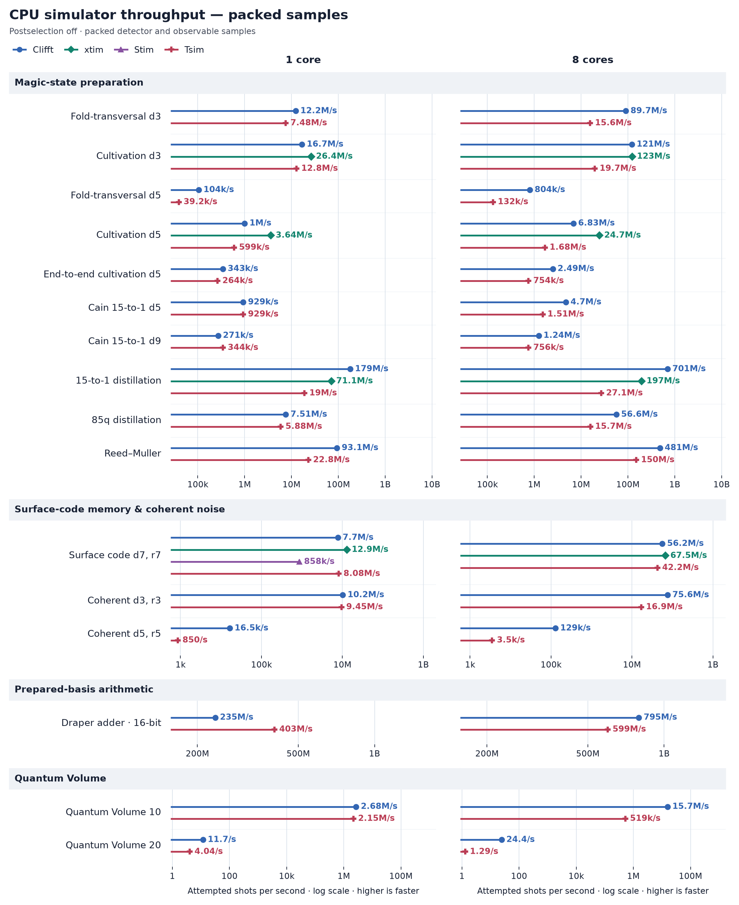
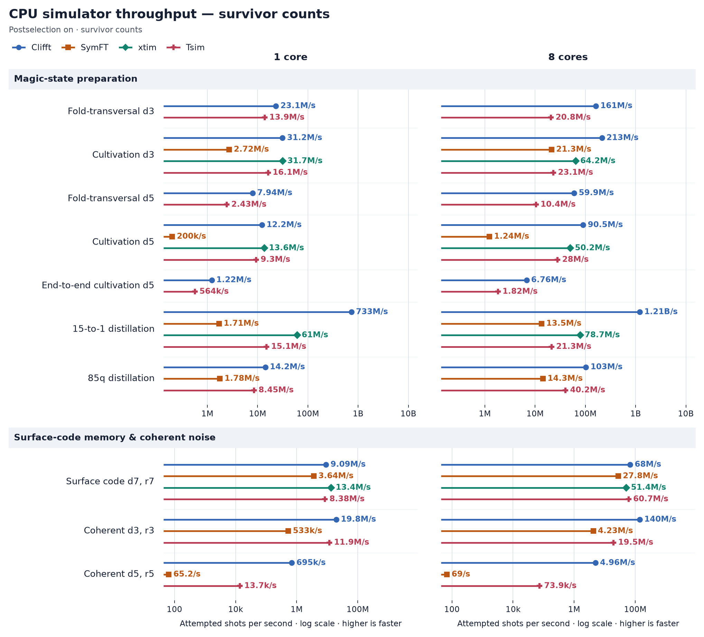
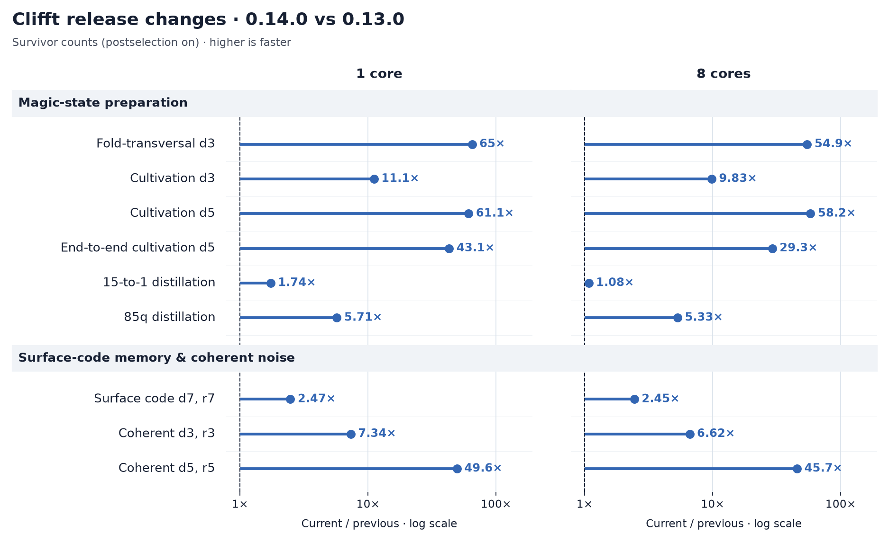

# release-clifft — 06b9e12f-1306-4659-a54e-0266b720465a

Classification: **official**. Collected 2026-11-24T02:44:50.398757Z.
Source: `c71cae87ca6d72fd1724c2336e91d254c95a33d9`; dirty: False.
Host: AMD EPYC 9R14 (Linux, x86_64).

## Collection sources

Clifft and paired release changes use the primary execution above.
Peer throughput is reused from run `1b252b89-75d2-4881-ade9-114e09db6c9d`, collected 2026-11-21T00:10:46.758644Z.
Peer source: `dd362f5977c178ad5da5d4588404841f59ae6e6c`.
These are separate collections on matching reference hardware and protocols;
cross-collection throughput is not a fresh paired comparison.
The peer versions below retain their source measurements; peers were not rerun.

## Measured implementations

| Implementation | Exact version | Commit |
| --- | --- | --- |
| clifft-0.13.0 | 0.13.0 | `9b9091c8267321e2a2fd967f0674a65e4baf0e38` |
| clifft-0.14.0rc3 | 0.14.0rc3 | `fc333207e051f453bb984d394311564a21aeaf17` |
| tsim-1.0.0 | 1.0.0 | `136bcc6bec7edba88bbb28152da05e33d17f77d0` |
| xtim-4.1.2 | 4.1.2 | `b6dc0302604c4faf59a7b753004fddb42cb8d615` |
| symft-2026.10.8 | 2026.10.8 | `81d28499b6da8c0b84b7567482c4692f509bd416` |
| stim-1.16.0 | 1.16.0 | `e2fc1eca7fd21684d433aa5f10f4504ea4860d07` |

## Outcomes

| Case | Outcome | Detail |
| --- | --- | --- |
| msc-d3-inject-cultivate-p1e-3--clifft-previous | success | 3 samples; batch unknown; 1 physical cores |
| msc-d5-inject-cultivate-p1e-3--clifft-previous | success | 3 samples; batch unknown; 1 physical cores |
| surface-code-d7-r7-p1e-3--clifft-previous | success | 3 samples; batch unknown; 1 physical cores |
| distillation-color-code-85q-p5e-2--clifft-previous | success | 3 samples; batch unknown; 1 physical cores |
| coherent-surface-d3-r3-p1e-3-rz2e-2--clifft-previous | success | 3 samples; batch unknown; 1 physical cores |
| coherent-surface-d5-r5-p1e-3-rz2e-2--clifft-previous | success | 3 samples; batch unknown; 1 physical cores |
| distillation-15to1-rm15-p1e-3--clifft-previous | success | 3 samples; batch unknown; 1 physical cores |
| msc-full-d5-cultivation-selected-p1e-3--clifft-previous | success | 3 samples; batch unknown; 1 physical cores |
| fold-transversal-d3-p1e-3--clifft-previous | success | 3 samples; batch unknown; 1 physical cores |
| msc-d3-inject-cultivate-p1e-3--clifft-current | success | 3 samples; batch 8192; 1 physical cores |
| msc-d5-inject-cultivate-p1e-3--clifft-current | success | 3 samples; batch 8192; 1 physical cores |
| surface-code-d7-r7-p1e-3--clifft-current | success | 3 samples; batch 2048; 1 physical cores |
| distillation-color-code-85q-p5e-2--clifft-current | success | 3 samples; batch 8192; 1 physical cores |
| coherent-surface-d3-r3-p1e-3-rz2e-2--clifft-current | success | 3 samples; batch 8192; 1 physical cores |
| coherent-surface-d5-r5-p1e-3-rz2e-2--clifft-current | success | 3 samples; batch 341; 1 physical cores |
| distillation-15to1-rm15-p1e-3--clifft-current | success | 3 samples; batch 2048; 1 physical cores |
| msc-full-d5-cultivation-selected-p1e-3--clifft-current | success | 3 samples; batch 8192; 1 physical cores |
| fold-transversal-d3-p1e-3--clifft-current | success | 3 samples; batch 8192; 1 physical cores |
| fold-transversal-d5-p1e-3--clifft-current | success | 3 samples; batch 8192; 1 physical cores |
| msc-d3-inject-cultivate-p1e-3--clifft-previous-off | unsupported | setup: UnsupportedConfiguration: clifft does not support postselect=off |
| msc-d5-inject-cultivate-p1e-3--clifft-previous-off | unsupported | setup: UnsupportedConfiguration: clifft does not support postselect=off |
| surface-code-d7-r7-p1e-3--clifft-previous-off | unsupported | setup: UnsupportedConfiguration: clifft does not support postselect=off |
| distillation-color-code-85q-p5e-2--clifft-previous-off | unsupported | setup: UnsupportedConfiguration: clifft does not support postselect=off |
| coherent-surface-d3-r3-p1e-3-rz2e-2--clifft-previous-off | unsupported | setup: UnsupportedConfiguration: clifft does not support postselect=off |
| coherent-surface-d5-r5-p1e-3-rz2e-2--clifft-previous-off | unsupported | setup: UnsupportedConfiguration: clifft does not support postselect=off |
| quantum-volume-q10-seed42-all-observables--clifft-previous-off | unsupported | setup: UnsupportedConfiguration: clifft does not support postselect=off |
| quantum-volume-q20-seed42-all-observables--clifft-previous-off | unsupported | setup: UnsupportedConfiguration: clifft does not support postselect=off |
| draper-adder-m16-basis-all-observables--clifft-previous-off | unsupported | setup: UnsupportedConfiguration: clifft does not support postselect=off |
| distillation-15to1-rm15-p1e-3--clifft-previous-off | unsupported | setup: UnsupportedConfiguration: clifft does not support postselect=off |
| bt27-direct-x--clifft-previous-off | unsupported | setup: UnsupportedConfiguration: clifft does not support postselect=off |
| bt81-direct-x--clifft-previous-off | unsupported | setup: UnsupportedConfiguration: clifft does not support postselect=off |
| reed-muller-measured--clifft-previous-off | unsupported | setup: UnsupportedConfiguration: clifft does not support postselect=off |
| msc-full-d5-cultivation-selected-p1e-3--clifft-previous-off | unsupported | setup: UnsupportedConfiguration: clifft does not support postselect=off |
| fold-transversal-d3-p1e-3--clifft-previous-off | unsupported | setup: UnsupportedConfiguration: clifft does not support postselect=off |
| fold-transversal-d5-p1e-3--clifft-previous-off | unsupported | setup: UnsupportedConfiguration: clifft does not support postselect=off |
| cain-15to1-d5-p1e-3--clifft-previous-off | unsupported | setup: UnsupportedConfiguration: clifft does not support postselect=off |
| cain-15to1-d9-p1e-3--clifft-previous-off | unsupported | setup: UnsupportedConfiguration: clifft does not support postselect=off |
| msc-d3-inject-cultivate-p1e-3--clifft-current-off | success | 3 samples; batch 8192; 1 physical cores |
| msc-d5-inject-cultivate-p1e-3--clifft-current-off | success | 3 samples; batch 512; 1 physical cores |
| surface-code-d7-r7-p1e-3--clifft-current-off | success | 3 samples; batch 2048; 1 physical cores |
| distillation-color-code-85q-p5e-2--clifft-current-off | success | 3 samples; batch 8192; 1 physical cores |
| coherent-surface-d3-r3-p1e-3-rz2e-2--clifft-current-off | success | 3 samples; batch 8192; 1 physical cores |
| coherent-surface-d5-r5-p1e-3-rz2e-2--clifft-current-off | success | 3 samples; batch 1; 1 physical cores |
| quantum-volume-q10-seed42-all-observables--clifft-current-off | success | 3 samples; batch 2730; 1 physical cores |
| quantum-volume-q20-seed42-all-observables--clifft-current-off | success | 3 samples; batch 2; 1 physical cores |
| draper-adder-m16-basis-all-observables--clifft-current-off | success | 3 samples; batch 2048; 1 physical cores |
| distillation-15to1-rm15-p1e-3--clifft-current-off | success | 3 samples; batch 2048; 1 physical cores |
| bt27-direct-x--clifft-current-off | success | 3 samples; batch 1; 1 physical cores |
| bt81-direct-x--clifft-current-off | success | 3 samples; batch 512; 1 physical cores |
| reed-muller-measured--clifft-current-off | success | 3 samples; batch 2048; 1 physical cores |
| msc-full-d5-cultivation-selected-p1e-3--clifft-current-off | success | 3 samples; batch 512; 1 physical cores |
| fold-transversal-d3-p1e-3--clifft-current-off | success | 3 samples; batch 8192; 1 physical cores |
| fold-transversal-d5-p1e-3--clifft-current-off | success | 3 samples; batch 128; 1 physical cores |
| cain-15to1-d5-p1e-3--clifft-current-off | success | 3 samples; batch 2048; 1 physical cores |
| cain-15to1-d9-p1e-3--clifft-current-off | success | 3 samples; batch 2048; 1 physical cores |
| msc-d3-inject-cultivate-p1e-3--clifft-previous-8c | success | 3 samples; batch unknown; 8 physical cores |
| msc-d5-inject-cultivate-p1e-3--clifft-previous-8c | success | 3 samples; batch unknown; 8 physical cores |
| surface-code-d7-r7-p1e-3--clifft-previous-8c | success | 3 samples; batch unknown; 8 physical cores |
| distillation-color-code-85q-p5e-2--clifft-previous-8c | success | 3 samples; batch unknown; 8 physical cores |
| coherent-surface-d3-r3-p1e-3-rz2e-2--clifft-previous-8c | success | 3 samples; batch unknown; 8 physical cores |
| coherent-surface-d5-r5-p1e-3-rz2e-2--clifft-previous-8c | success | 3 samples; batch unknown; 8 physical cores |
| distillation-15to1-rm15-p1e-3--clifft-previous-8c | success | 3 samples; batch unknown; 8 physical cores |
| msc-full-d5-cultivation-selected-p1e-3--clifft-previous-8c | success | 3 samples; batch unknown; 8 physical cores |
| fold-transversal-d3-p1e-3--clifft-previous-8c | success | 3 samples; batch unknown; 8 physical cores |
| msc-d3-inject-cultivate-p1e-3--clifft-current-8c | success | 3 samples; batch 8192; 8 physical cores |
| msc-d5-inject-cultivate-p1e-3--clifft-current-8c | success | 3 samples; batch 8192; 8 physical cores |
| surface-code-d7-r7-p1e-3--clifft-current-8c | success | 3 samples; batch 2048; 8 physical cores |
| distillation-color-code-85q-p5e-2--clifft-current-8c | success | 3 samples; batch 8192; 8 physical cores |
| coherent-surface-d3-r3-p1e-3-rz2e-2--clifft-current-8c | success | 3 samples; batch 8192; 8 physical cores |
| coherent-surface-d5-r5-p1e-3-rz2e-2--clifft-current-8c | success | 3 samples; batch 341; 8 physical cores |
| distillation-15to1-rm15-p1e-3--clifft-current-8c | success | 3 samples; batch 2048; 8 physical cores |
| msc-full-d5-cultivation-selected-p1e-3--clifft-current-8c | success | 3 samples; batch 2048; 8 physical cores |
| fold-transversal-d3-p1e-3--clifft-current-8c | success | 3 samples; batch 8192; 8 physical cores |
| fold-transversal-d5-p1e-3--clifft-current-8c | success | 3 samples; batch 8192; 8 physical cores |
| msc-d3-inject-cultivate-p1e-3--clifft-previous-off-8c | unsupported | setup: UnsupportedConfiguration: clifft does not support postselect=off |
| msc-d5-inject-cultivate-p1e-3--clifft-previous-off-8c | unsupported | setup: UnsupportedConfiguration: clifft does not support postselect=off |
| surface-code-d7-r7-p1e-3--clifft-previous-off-8c | unsupported | setup: UnsupportedConfiguration: clifft does not support postselect=off |
| distillation-color-code-85q-p5e-2--clifft-previous-off-8c | unsupported | setup: UnsupportedConfiguration: clifft does not support postselect=off |
| coherent-surface-d3-r3-p1e-3-rz2e-2--clifft-previous-off-8c | unsupported | setup: UnsupportedConfiguration: clifft does not support postselect=off |
| coherent-surface-d5-r5-p1e-3-rz2e-2--clifft-previous-off-8c | unsupported | setup: UnsupportedConfiguration: clifft does not support postselect=off |
| quantum-volume-q10-seed42-all-observables--clifft-previous-off-8c | unsupported | setup: UnsupportedConfiguration: clifft does not support postselect=off |
| quantum-volume-q20-seed42-all-observables--clifft-previous-off-8c | unsupported | setup: UnsupportedConfiguration: clifft does not support postselect=off |
| draper-adder-m16-basis-all-observables--clifft-previous-off-8c | unsupported | setup: UnsupportedConfiguration: clifft does not support postselect=off |
| distillation-15to1-rm15-p1e-3--clifft-previous-off-8c | unsupported | setup: UnsupportedConfiguration: clifft does not support postselect=off |
| bt27-direct-x--clifft-previous-off-8c | unsupported | setup: UnsupportedConfiguration: clifft does not support postselect=off |
| bt81-direct-x--clifft-previous-off-8c | unsupported | setup: UnsupportedConfiguration: clifft does not support postselect=off |
| reed-muller-measured--clifft-previous-off-8c | unsupported | setup: UnsupportedConfiguration: clifft does not support postselect=off |
| msc-full-d5-cultivation-selected-p1e-3--clifft-previous-off-8c | unsupported | setup: UnsupportedConfiguration: clifft does not support postselect=off |
| fold-transversal-d3-p1e-3--clifft-previous-off-8c | unsupported | setup: UnsupportedConfiguration: clifft does not support postselect=off |
| fold-transversal-d5-p1e-3--clifft-previous-off-8c | unsupported | setup: UnsupportedConfiguration: clifft does not support postselect=off |
| cain-15to1-d5-p1e-3--clifft-previous-off-8c | unsupported | setup: UnsupportedConfiguration: clifft does not support postselect=off |
| cain-15to1-d9-p1e-3--clifft-previous-off-8c | unsupported | setup: UnsupportedConfiguration: clifft does not support postselect=off |
| msc-d3-inject-cultivate-p1e-3--clifft-current-off-8c | success | 3 samples; batch 8192; 8 physical cores |
| msc-d5-inject-cultivate-p1e-3--clifft-current-off-8c | success | 3 samples; batch 512; 8 physical cores |
| surface-code-d7-r7-p1e-3--clifft-current-off-8c | success | 3 samples; batch 2048; 8 physical cores |
| distillation-color-code-85q-p5e-2--clifft-current-off-8c | success | 3 samples; batch 8192; 8 physical cores |
| coherent-surface-d3-r3-p1e-3-rz2e-2--clifft-current-off-8c | success | 3 samples; batch 8192; 8 physical cores |
| coherent-surface-d5-r5-p1e-3-rz2e-2--clifft-current-off-8c | success | 3 samples; batch 1; 8 physical cores |
| quantum-volume-q10-seed42-all-observables--clifft-current-off-8c | success | 3 samples; batch 2048; 8 physical cores |
| quantum-volume-q20-seed42-all-observables--clifft-current-off-8c | success | 3 samples; batch 2; 8 physical cores |
| draper-adder-m16-basis-all-observables--clifft-current-off-8c | success | 3 samples; batch 2048; 8 physical cores |
| distillation-15to1-rm15-p1e-3--clifft-current-off-8c | success | 3 samples; batch 2048; 8 physical cores |
| bt27-direct-x--clifft-current-off-8c | success | 3 samples; batch 1; 8 physical cores |
| bt81-direct-x--clifft-current-off-8c | success | 3 samples; batch 512; 8 physical cores |
| reed-muller-measured--clifft-current-off-8c | success | 3 samples; batch 2048; 8 physical cores |
| msc-full-d5-cultivation-selected-p1e-3--clifft-current-off-8c | success | 3 samples; batch 512; 8 physical cores |
| fold-transversal-d3-p1e-3--clifft-current-off-8c | success | 3 samples; batch 8192; 8 physical cores |
| fold-transversal-d5-p1e-3--clifft-current-off-8c | success | 3 samples; batch 128; 8 physical cores |
| cain-15to1-d5-p1e-3--clifft-current-off-8c | success | 3 samples; batch 2048; 8 physical cores |
| cain-15to1-d9-p1e-3--clifft-current-off-8c | success | 3 samples; batch 2048; 8 physical cores |
| msc-d3-inject-cultivate-p1e-3--tsim-current | success | 3 samples; batch unknown; 1 physical cores |
| msc-d5-inject-cultivate-p1e-3--tsim-current | success | 3 samples; batch unknown; 1 physical cores |
| surface-code-d7-r7-p1e-3--tsim-current | success | 3 samples; batch unknown; 1 physical cores |
| distillation-color-code-85q-p5e-2--tsim-current | success | 3 samples; batch unknown; 1 physical cores |
| coherent-surface-d3-r3-p1e-3-rz2e-2--tsim-current | success | 3 samples; batch unknown; 1 physical cores |
| coherent-surface-d5-r5-p1e-3-rz2e-2--tsim-current | success | 3 samples; batch unknown; 1 physical cores |
| distillation-15to1-rm15-p1e-3--tsim-current | success | 3 samples; batch unknown; 1 physical cores |
| msc-full-d5-cultivation-selected-p1e-3--tsim-current | success | 3 samples; batch unknown; 1 physical cores |
| fold-transversal-d3-p1e-3--tsim-current | success | 3 samples; batch unknown; 1 physical cores |
| fold-transversal-d5-p1e-3--tsim-current | success | 3 samples; batch unknown; 1 physical cores |
| msc-d3-inject-cultivate-p1e-3--xtim-current | success | 3 samples; batch unknown; 1 physical cores |
| msc-d5-inject-cultivate-p1e-3--xtim-current | success | 3 samples; batch unknown; 1 physical cores |
| surface-code-d7-r7-p1e-3--xtim-current | success | 3 samples; batch unknown; 1 physical cores |
| distillation-15to1-rm15-p1e-3--xtim-current | success | 3 samples; batch unknown; 1 physical cores |
| msc-full-d5-cultivation-selected-p1e-3--xtim-current | unsupported | setup: UnsupportedReferenceCircuit: xtim raw reference parity is unavailable for this circuit: Gate not found: 'T_DAG' |
| fold-transversal-d3-p1e-3--xtim-current | unsupported | setup: UnsupportedReferenceCircuit: xtim raw reference parity is unavailable for this circuit: Gate not found: 'T' |
| fold-transversal-d5-p1e-3--xtim-current | unsupported | setup: UnsupportedReferenceCircuit: xtim raw reference parity is unavailable for this circuit: Gate not found: 'T' |
| msc-d3-inject-cultivate-p1e-3--symft-current | success | 3 samples; batch 2048; 1 physical cores |
| msc-d5-inject-cultivate-p1e-3--symft-current | success | 3 samples; batch 32; 1 physical cores |
| surface-code-d7-r7-p1e-3--symft-current | success | 3 samples; batch 2048; 1 physical cores |
| distillation-color-code-85q-p5e-2--symft-current | success | 3 samples; batch 1024; 1 physical cores |
| coherent-surface-d3-r3-p1e-3-rz2e-2--symft-current | success | 3 samples; batch 256; 1 physical cores |
| coherent-surface-d5-r5-p1e-3-rz2e-2--symft-current | success | 3 samples; batch 1; 1 physical cores |
| distillation-15to1-rm15-p1e-3--symft-current | success | 3 samples; batch 1024; 1 physical cores |
| msc-full-d5-cultivation-selected-p1e-3--symft-current | unsupported | setup: UnsupportedConfiguration: symft does not support explicit detector subsets |
| surface-code-d7-r7-p1e-3--stim-current | unsupported | setup: UnsupportedConfiguration: stim does not support postselect=on |
| msc-d3-inject-cultivate-p1e-3--tsim-current-off | success | 3 samples; batch unknown; 1 physical cores |
| msc-d5-inject-cultivate-p1e-3--tsim-current-off | success | 3 samples; batch unknown; 1 physical cores |
| surface-code-d7-r7-p1e-3--tsim-current-off | success | 3 samples; batch unknown; 1 physical cores |
| distillation-color-code-85q-p5e-2--tsim-current-off | success | 3 samples; batch unknown; 1 physical cores |
| coherent-surface-d3-r3-p1e-3-rz2e-2--tsim-current-off | success | 3 samples; batch unknown; 1 physical cores |
| coherent-surface-d5-r5-p1e-3-rz2e-2--tsim-current-off | success | 3 samples; batch unknown; 1 physical cores |
| quantum-volume-q10-seed42-all-observables--tsim-current-off | success | 3 samples; batch unknown; 1 physical cores |
| quantum-volume-q20-seed42-all-observables--tsim-current-off | success | 3 samples; batch unknown; 1 physical cores |
| draper-adder-m16-basis-all-observables--tsim-current-off | success | 3 samples; batch unknown; 1 physical cores |
| distillation-15to1-rm15-p1e-3--tsim-current-off | success | 3 samples; batch unknown; 1 physical cores |
| reed-muller-measured--tsim-current-off | success | 3 samples; batch unknown; 1 physical cores |
| msc-full-d5-cultivation-selected-p1e-3--tsim-current-off | success | 3 samples; batch unknown; 1 physical cores |
| fold-transversal-d3-p1e-3--tsim-current-off | success | 3 samples; batch unknown; 1 physical cores |
| fold-transversal-d5-p1e-3--tsim-current-off | success | 3 samples; batch unknown; 1 physical cores |
| cain-15to1-d5-p1e-3--tsim-current-off | success | 3 samples; batch unknown; 1 physical cores |
| cain-15to1-d9-p1e-3--tsim-current-off | success | 3 samples; batch unknown; 1 physical cores |
| msc-d3-inject-cultivate-p1e-3--xtim-current-off | success | 3 samples; batch unknown; 1 physical cores |
| msc-d5-inject-cultivate-p1e-3--xtim-current-off | success | 3 samples; batch unknown; 1 physical cores |
| surface-code-d7-r7-p1e-3--xtim-current-off | success | 3 samples; batch unknown; 1 physical cores |
| distillation-15to1-rm15-p1e-3--xtim-current-off | success | 3 samples; batch unknown; 1 physical cores |
| bt27-direct-x--xtim-current-off | unsupported | setup: UnsupportedReferenceCircuit: xtim raw reference parity is unavailable for this circuit: Gate not found: 'T' |
| bt81-direct-x--xtim-current-off | unsupported | setup: UnsupportedReferenceCircuit: xtim raw reference parity is unavailable for this circuit: Gate not found: 'T' |
| reed-muller-measured--xtim-current-off | unsupported | setup: UnsupportedReferenceCircuit: xtim raw reference parity is unavailable for this circuit: Gate not found: 'T' |
| msc-full-d5-cultivation-selected-p1e-3--xtim-current-off | unsupported | setup: UnsupportedReferenceCircuit: xtim raw reference parity is unavailable for this circuit: Gate not found: 'T_DAG' |
| fold-transversal-d3-p1e-3--xtim-current-off | unsupported | setup: UnsupportedReferenceCircuit: xtim raw reference parity is unavailable for this circuit: Gate not found: 'T' |
| fold-transversal-d5-p1e-3--xtim-current-off | unsupported | setup: UnsupportedReferenceCircuit: xtim raw reference parity is unavailable for this circuit: Gate not found: 'T' |
| cain-15to1-d5-p1e-3--xtim-current-off | unsupported | setup: UnsupportedReferenceCircuit: xtim raw reference parity is unavailable for this circuit: Gate not found: 'T' |
| cain-15to1-d9-p1e-3--xtim-current-off | unsupported | setup: UnsupportedReferenceCircuit: xtim raw reference parity is unavailable for this circuit: Gate not found: 'T' |
| msc-d3-inject-cultivate-p1e-3--symft-current-off | unsupported | setup: UnsupportedConfiguration: symft does not support postselect=off |
| msc-d5-inject-cultivate-p1e-3--symft-current-off | unsupported | setup: UnsupportedConfiguration: symft does not support postselect=off |
| surface-code-d7-r7-p1e-3--symft-current-off | unsupported | setup: UnsupportedConfiguration: symft does not support postselect=off |
| distillation-color-code-85q-p5e-2--symft-current-off | unsupported | setup: UnsupportedConfiguration: symft does not support postselect=off |
| coherent-surface-d3-r3-p1e-3-rz2e-2--symft-current-off | unsupported | setup: UnsupportedConfiguration: symft does not support postselect=off |
| coherent-surface-d5-r5-p1e-3-rz2e-2--symft-current-off | unsupported | setup: UnsupportedConfiguration: symft does not support postselect=off |
| quantum-volume-q10-seed42-all-observables--symft-current-off | unsupported | setup: UnsupportedConfiguration: symft does not support postselect=off |
| quantum-volume-q20-seed42-all-observables--symft-current-off | unsupported | setup: UnsupportedConfiguration: symft does not support postselect=off |
| distillation-15to1-rm15-p1e-3--symft-current-off | unsupported | setup: UnsupportedConfiguration: symft does not support postselect=off |
| reed-muller-measured--symft-current-off | unsupported | setup: UnsupportedConfiguration: symft does not support postselect=off |
| msc-full-d5-cultivation-selected-p1e-3--symft-current-off | unsupported | setup: UnsupportedConfiguration: symft does not support postselect=off |
| surface-code-d7-r7-p1e-3--stim-current-off | success | 3 samples; batch unknown; 1 physical cores |
| msc-d3-inject-cultivate-p1e-3--tsim-current-8c | success | 3 samples; batch unknown; 8 physical cores |
| msc-d5-inject-cultivate-p1e-3--tsim-current-8c | success | 3 samples; batch unknown; 8 physical cores |
| surface-code-d7-r7-p1e-3--tsim-current-8c | success | 3 samples; batch unknown; 8 physical cores |
| distillation-color-code-85q-p5e-2--tsim-current-8c | success | 3 samples; batch unknown; 8 physical cores |
| coherent-surface-d3-r3-p1e-3-rz2e-2--tsim-current-8c | success | 3 samples; batch unknown; 8 physical cores |
| coherent-surface-d5-r5-p1e-3-rz2e-2--tsim-current-8c | success | 3 samples; batch unknown; 8 physical cores |
| distillation-15to1-rm15-p1e-3--tsim-current-8c | success | 3 samples; batch unknown; 8 physical cores |
| msc-full-d5-cultivation-selected-p1e-3--tsim-current-8c | success | 3 samples; batch unknown; 8 physical cores |
| fold-transversal-d3-p1e-3--tsim-current-8c | success | 3 samples; batch unknown; 8 physical cores |
| fold-transversal-d5-p1e-3--tsim-current-8c | success | 3 samples; batch unknown; 8 physical cores |
| msc-d3-inject-cultivate-p1e-3--xtim-current-8c | success | 3 samples; batch unknown; 8 physical cores |
| msc-d5-inject-cultivate-p1e-3--xtim-current-8c | success | 3 samples; batch unknown; 8 physical cores |
| surface-code-d7-r7-p1e-3--xtim-current-8c | success | 3 samples; batch unknown; 8 physical cores |
| distillation-15to1-rm15-p1e-3--xtim-current-8c | success | 3 samples; batch unknown; 8 physical cores |
| msc-full-d5-cultivation-selected-p1e-3--xtim-current-8c | unsupported | setup: UnsupportedReferenceCircuit: xtim raw reference parity is unavailable for this circuit: Gate not found: 'T_DAG' |
| fold-transversal-d3-p1e-3--xtim-current-8c | unsupported | setup: UnsupportedReferenceCircuit: xtim raw reference parity is unavailable for this circuit: Gate not found: 'T' |
| fold-transversal-d5-p1e-3--xtim-current-8c | unsupported | setup: UnsupportedReferenceCircuit: xtim raw reference parity is unavailable for this circuit: Gate not found: 'T' |
| msc-d3-inject-cultivate-p1e-3--symft-current-8c | success | 3 samples; batch 2048; 8 physical cores |
| msc-d5-inject-cultivate-p1e-3--symft-current-8c | success | 3 samples; batch 32; 8 physical cores |
| surface-code-d7-r7-p1e-3--symft-current-8c | success | 3 samples; batch 2048; 8 physical cores |
| distillation-color-code-85q-p5e-2--symft-current-8c | success | 3 samples; batch 1024; 8 physical cores |
| coherent-surface-d3-r3-p1e-3-rz2e-2--symft-current-8c | success | 3 samples; batch 256; 8 physical cores |
| coherent-surface-d5-r5-p1e-3-rz2e-2--symft-current-8c | success | 3 samples; batch 1; 8 physical cores |
| distillation-15to1-rm15-p1e-3--symft-current-8c | success | 3 samples; batch 1024; 8 physical cores |
| msc-full-d5-cultivation-selected-p1e-3--symft-current-8c | unsupported | setup: UnsupportedConfiguration: symft does not support explicit detector subsets |
| surface-code-d7-r7-p1e-3--stim-current-8c | unsupported | setup: UnsupportedConfiguration: stim does not support postselect=on |
| msc-d3-inject-cultivate-p1e-3--tsim-current-off-8c | success | 3 samples; batch unknown; 8 physical cores |
| msc-d5-inject-cultivate-p1e-3--tsim-current-off-8c | success | 3 samples; batch unknown; 8 physical cores |
| surface-code-d7-r7-p1e-3--tsim-current-off-8c | success | 3 samples; batch unknown; 8 physical cores |
| distillation-color-code-85q-p5e-2--tsim-current-off-8c | success | 3 samples; batch unknown; 8 physical cores |
| coherent-surface-d3-r3-p1e-3-rz2e-2--tsim-current-off-8c | success | 3 samples; batch unknown; 8 physical cores |
| coherent-surface-d5-r5-p1e-3-rz2e-2--tsim-current-off-8c | success | 3 samples; batch unknown; 8 physical cores |
| quantum-volume-q10-seed42-all-observables--tsim-current-off-8c | success | 3 samples; batch unknown; 8 physical cores |
| quantum-volume-q20-seed42-all-observables--tsim-current-off-8c | success | 3 samples; batch unknown; 8 physical cores |
| draper-adder-m16-basis-all-observables--tsim-current-off-8c | success | 3 samples; batch unknown; 8 physical cores |
| distillation-15to1-rm15-p1e-3--tsim-current-off-8c | success | 3 samples; batch unknown; 8 physical cores |
| reed-muller-measured--tsim-current-off-8c | success | 3 samples; batch unknown; 8 physical cores |
| msc-full-d5-cultivation-selected-p1e-3--tsim-current-off-8c | success | 3 samples; batch unknown; 8 physical cores |
| fold-transversal-d3-p1e-3--tsim-current-off-8c | success | 3 samples; batch unknown; 8 physical cores |
| fold-transversal-d5-p1e-3--tsim-current-off-8c | success | 3 samples; batch unknown; 8 physical cores |
| cain-15to1-d5-p1e-3--tsim-current-off-8c | success | 3 samples; batch unknown; 8 physical cores |
| cain-15to1-d9-p1e-3--tsim-current-off-8c | success | 3 samples; batch unknown; 8 physical cores |
| msc-d3-inject-cultivate-p1e-3--xtim-current-off-8c | success | 3 samples; batch unknown; 8 physical cores |
| msc-d5-inject-cultivate-p1e-3--xtim-current-off-8c | success | 3 samples; batch unknown; 8 physical cores |
| surface-code-d7-r7-p1e-3--xtim-current-off-8c | success | 3 samples; batch unknown; 8 physical cores |
| distillation-15to1-rm15-p1e-3--xtim-current-off-8c | success | 3 samples; batch unknown; 8 physical cores |
| bt27-direct-x--xtim-current-off-8c | unsupported | setup: UnsupportedReferenceCircuit: xtim raw reference parity is unavailable for this circuit: Gate not found: 'T' |
| bt81-direct-x--xtim-current-off-8c | unsupported | setup: UnsupportedReferenceCircuit: xtim raw reference parity is unavailable for this circuit: Gate not found: 'T' |
| reed-muller-measured--xtim-current-off-8c | unsupported | setup: UnsupportedReferenceCircuit: xtim raw reference parity is unavailable for this circuit: Gate not found: 'T' |
| msc-full-d5-cultivation-selected-p1e-3--xtim-current-off-8c | unsupported | setup: UnsupportedReferenceCircuit: xtim raw reference parity is unavailable for this circuit: Gate not found: 'T_DAG' |
| fold-transversal-d3-p1e-3--xtim-current-off-8c | unsupported | setup: UnsupportedReferenceCircuit: xtim raw reference parity is unavailable for this circuit: Gate not found: 'T' |
| fold-transversal-d5-p1e-3--xtim-current-off-8c | unsupported | setup: UnsupportedReferenceCircuit: xtim raw reference parity is unavailable for this circuit: Gate not found: 'T' |
| cain-15to1-d5-p1e-3--xtim-current-off-8c | unsupported | setup: UnsupportedReferenceCircuit: xtim raw reference parity is unavailable for this circuit: Gate not found: 'T' |
| cain-15to1-d9-p1e-3--xtim-current-off-8c | unsupported | setup: UnsupportedReferenceCircuit: xtim raw reference parity is unavailable for this circuit: Gate not found: 'T' |
| msc-d3-inject-cultivate-p1e-3--symft-current-off-8c | unsupported | setup: UnsupportedConfiguration: symft does not support postselect=off |
| msc-d5-inject-cultivate-p1e-3--symft-current-off-8c | unsupported | setup: UnsupportedConfiguration: symft does not support postselect=off |
| surface-code-d7-r7-p1e-3--symft-current-off-8c | unsupported | setup: UnsupportedConfiguration: symft does not support postselect=off |
| distillation-color-code-85q-p5e-2--symft-current-off-8c | unsupported | setup: UnsupportedConfiguration: symft does not support postselect=off |
| coherent-surface-d3-r3-p1e-3-rz2e-2--symft-current-off-8c | unsupported | setup: UnsupportedConfiguration: symft does not support postselect=off |
| coherent-surface-d5-r5-p1e-3-rz2e-2--symft-current-off-8c | unsupported | setup: UnsupportedConfiguration: symft does not support postselect=off |
| quantum-volume-q10-seed42-all-observables--symft-current-off-8c | unsupported | setup: UnsupportedConfiguration: symft does not support postselect=off |
| quantum-volume-q20-seed42-all-observables--symft-current-off-8c | unsupported | setup: UnsupportedConfiguration: symft does not support postselect=off |
| distillation-15to1-rm15-p1e-3--symft-current-off-8c | unsupported | setup: UnsupportedConfiguration: symft does not support postselect=off |
| reed-muller-measured--symft-current-off-8c | unsupported | setup: UnsupportedConfiguration: symft does not support postselect=off |
| msc-full-d5-cultivation-selected-p1e-3--symft-current-off-8c | unsupported | setup: UnsupportedConfiguration: symft does not support postselect=off |
| surface-code-d7-r7-p1e-3--stim-current-off-8c | unsupported | setup: UnsupportedConfiguration: stim does not support threads=8 |

## Measurements

| Case | Postselection | Shots per call | Compile (s) | First call (s) | Peak active width | Attempted shots/s (median) | Cores | 8-core / 1-core |
| --- | --- | ---: | ---: | ---: | ---: | ---: | ---: | ---: |
| msc-d3-inject-cultivate-p1e-3--clifft-previous | on | 262144 | 0.0123851 | 0.104565 | 4 | 2.80352e+06 | 1 | — |
| msc-d5-inject-cultivate-p1e-3--clifft-previous | on | 262144 | 0.0230772 | 1.32459 | 10 | 199598 | 1 | — |
| surface-code-d7-r7-p1e-3--clifft-previous | on | 262144 | 0.0129735 | 0.0722141 | 0 | 3.67342e+06 | 1 | — |
| distillation-color-code-85q-p5e-2--clifft-previous | on | 262144 | 0.00304894 | 0.106018 | 3 | 2.4865e+06 | 1 | — |
| coherent-surface-d3-r3-p1e-3-rz2e-2--clifft-previous | on | 262144 | 0.00130698 | 0.0979128 | 4 | 2.70274e+06 | 1 | — |
| coherent-surface-d5-r5-p1e-3-rz2e-2--clifft-previous | on | 16384 | 0.0132065 | 1.16498 | 13 | 14033.6 | 1 | — |
| distillation-15to1-rm15-p1e-3--clifft-previous | on | 262144 | 0.000275232 | 0.00148772 | 0 | 4.22733e+08 | 1 | — |
| msc-full-d5-cultivation-selected-p1e-3--clifft-previous | on | 16384 | 2.47328 | 0.582073 | 10 | 28322.9 | 1 | — |
| fold-transversal-d3-p1e-3--clifft-previous | on | 262144 | 0.00676641 | 0.738282 | 8 | 355371 | 1 | — |
| msc-d3-inject-cultivate-p1e-3--clifft-current | on | 262144 | 0.00588619 | 0.0100749 | 4 | 3.11932e+07 | 1 | — |
| msc-d5-inject-cultivate-p1e-3--clifft-current | on | 262144 | 0.0489152 | 0.0300076 | 6 | 1.21885e+07 | 1 | — |
| surface-code-d7-r7-p1e-3--clifft-current | on | 262144 | 0.0126409 | 0.0347648 | 0 | 9.09046e+06 | 1 | — |
| distillation-color-code-85q-p5e-2--clifft-current | on | 262144 | 0.00633995 | 0.0200628 | 3 | 1.42001e+07 | 1 | — |
| coherent-surface-d3-r3-p1e-3-rz2e-2--clifft-current | on | 262144 | 0.00307117 | 0.0142086 | 4 | 1.98352e+07 | 1 | — |
| coherent-surface-d5-r5-p1e-3-rz2e-2--clifft-current | on | 16384 | 0.037309 | 0.0239533 | 13 | 695458 | 1 | — |
| distillation-15to1-rm15-p1e-3--clifft-current | on | 262144 | 0.000231141 | 0.00124214 | 0 | 7.3346e+08 | 1 | — |
| msc-full-d5-cultivation-selected-p1e-3--clifft-current | on | 16384 | 1.46292 | 0.038139 | 6 | 1.22053e+06 | 1 | — |
| fold-transversal-d3-p1e-3--clifft-current | on | 262144 | 0.0137304 | 0.0141671 | 8 | 2.31018e+07 | 1 | — |
| fold-transversal-d5-p1e-3--clifft-current | on | 262144 | 0.102882 | 0.0447279 | 8 | 7.94348e+06 | 1 | — |
| msc-d3-inject-cultivate-p1e-3--clifft-previous-off | off | 262144 | — | — | — | — | 1 | — |
| msc-d5-inject-cultivate-p1e-3--clifft-previous-off | off | 262144 | — | — | — | — | 1 | — |
| surface-code-d7-r7-p1e-3--clifft-previous-off | off | 262144 | — | — | — | — | 1 | — |
| distillation-color-code-85q-p5e-2--clifft-previous-off | off | 262144 | — | — | — | — | 1 | — |
| coherent-surface-d3-r3-p1e-3-rz2e-2--clifft-previous-off | off | 262144 | — | — | — | — | 1 | — |
| coherent-surface-d5-r5-p1e-3-rz2e-2--clifft-previous-off | off | 16384 | — | — | — | — | 1 | — |
| quantum-volume-q10-seed42-all-observables--clifft-previous-off | off | 16384 | — | — | — | — | 1 | — |
| quantum-volume-q20-seed42-all-observables--clifft-previous-off | off | 32 | — | — | — | — | 1 | — |
| draper-adder-m16-basis-all-observables--clifft-previous-off | off | 262144 | — | — | — | — | 1 | — |
| distillation-15to1-rm15-p1e-3--clifft-previous-off | off | 262144 | — | — | — | — | 1 | — |
| bt27-direct-x--clifft-previous-off | off | 16384 | — | — | — | — | 1 | — |
| bt81-direct-x--clifft-previous-off | off | 16384 | — | — | — | — | 1 | — |
| reed-muller-measured--clifft-previous-off | off | 262144 | — | — | — | — | 1 | — |
| msc-full-d5-cultivation-selected-p1e-3--clifft-previous-off | off | 16384 | — | — | — | — | 1 | — |
| fold-transversal-d3-p1e-3--clifft-previous-off | off | 262144 | — | — | — | — | 1 | — |
| fold-transversal-d5-p1e-3--clifft-previous-off | off | 262144 | — | — | — | — | 1 | — |
| cain-15to1-d5-p1e-3--clifft-previous-off | off | 16384 | — | — | — | — | 1 | — |
| cain-15to1-d9-p1e-3--clifft-previous-off | off | 16384 | — | — | — | — | 1 | — |
| msc-d3-inject-cultivate-p1e-3--clifft-current-off | off | 262144 | 0.00561686 | 0.0179965 | 4 | 1.67066e+07 | 1 | — |
| msc-d5-inject-cultivate-p1e-3--clifft-current-off | off | 262144 | 0.0488666 | 0.269132 | 6 | 1.00123e+06 | 1 | — |
| surface-code-d7-r7-p1e-3--clifft-current-off | off | 262144 | 0.0125375 | 0.0469228 | 0 | 7.69947e+06 | 1 | — |
| distillation-color-code-85q-p5e-2--clifft-current-off | off | 262144 | 0.0061535 | 0.0371118 | 3 | 7.50849e+06 | 1 | — |
| coherent-surface-d3-r3-p1e-3-rz2e-2--clifft-current-off | off | 262144 | 0.00330077 | 0.0280923 | 4 | 1.01916e+07 | 1 | — |
| coherent-surface-d5-r5-p1e-3-rz2e-2--clifft-current-off | off | 16384 | 0.0433947 | 0.995139 | 11 | 16499.6 | 1 | — |
| quantum-volume-q10-seed42-all-observables--clifft-current-off | off | 16384 | 0.0310969 | 0.0126247 | 10 | 2.68292e+06 | 1 | — |
| quantum-volume-q20-seed42-all-observables--clifft-current-off | off | 32 | 0.492832 | 2.70482 | 20 | 11.7372 | 1 | — |
| draper-adder-m16-basis-all-observables--clifft-current-off | off | 262144 | 0.00260485 | 0.00248738 | 0 | 2.3491e+08 | 1 | — |
| distillation-15to1-rm15-p1e-3--clifft-current-off | off | 262144 | 0.000259671 | 0.0025994 | 0 | 1.78937e+08 | 1 | — |
| bt27-direct-x--clifft-current-off | off | 16384 | 0.0150276 | 0.0719848 | 9 | 230000 | 1 | — |
| bt81-direct-x--clifft-current-off | off | 16384 | 0.111262 | 0.00915507 | 6 | 2.0882e+06 | 1 | — |
| reed-muller-measured--clifft-current-off | off | 262144 | 0.000497174 | 0.00380884 | 1 | 9.30639e+07 | 1 | — |
| msc-full-d5-cultivation-selected-p1e-3--clifft-current-off | off | 16384 | 1.41747 | 0.0831574 | 6 | 343159 | 1 | — |
| fold-transversal-d3-p1e-3--clifft-current-off | off | 262144 | 0.0131864 | 0.0248797 | 6 | 1.22198e+07 | 1 | — |
| fold-transversal-d5-p1e-3--clifft-current-off | off | 262144 | 0.101532 | 2.52367 | 8 | 104360 | 1 | — |
| cain-15to1-d5-p1e-3--clifft-current-off | off | 16384 | 0.206862 | 0.0714623 | 4 | 928616 | 1 | — |
| cain-15to1-d9-p1e-3--clifft-current-off | off | 16384 | 1.00366 | 0.261222 | 4 | 271477 | 1 | — |
| msc-d3-inject-cultivate-p1e-3--clifft-previous-8c | on | 262144 | 0.00246653 | 0.0131926 | 4 | 2.16997e+07 | 8 | 7.74× |
| msc-d5-inject-cultivate-p1e-3--clifft-previous-8c | on | 262144 | 0.0227259 | 0.171624 | 10 | 1.55372e+06 | 8 | 7.784× |
| surface-code-d7-r7-p1e-3--clifft-previous-8c | on | 262144 | 0.0127719 | 0.0105546 | 0 | 2.77747e+07 | 8 | 7.561× |
| distillation-color-code-85q-p5e-2--clifft-previous-8c | on | 262144 | 0.00304562 | 0.0147054 | 3 | 1.92891e+07 | 8 | 7.758× |
| coherent-surface-d3-r3-p1e-3-rz2e-2--clifft-previous-8c | on | 262144 | 0.00129882 | 0.0136812 | 4 | 2.11566e+07 | 8 | 7.828× |
| coherent-surface-d5-r5-p1e-3-rz2e-2--clifft-previous-8c | on | 16384 | 0.0131977 | 0.152015 | 13 | 108596 | 8 | 7.738× |
| distillation-15to1-rm15-p1e-3--clifft-previous-8c | on | 262144 | 0.000276322 | 0.00147389 | 0 | 1.1193e+09 | 8 | 2.648× |
| msc-full-d5-cultivation-selected-p1e-3--clifft-previous-8c | on | 16384 | 2.47604 | 0.0732182 | 10 | 230974 | 8 | 8.155× |
| fold-transversal-d3-p1e-3--clifft-previous-8c | on | 262144 | 0.0068262 | 0.0933092 | 8 | 2.93808e+06 | 8 | 8.268× |
| msc-d3-inject-cultivate-p1e-3--clifft-current-8c | on | 262144 | 0.0057162 | 0.00334341 | 4 | 2.13333e+08 | 8 | 6.839× |
| msc-d5-inject-cultivate-p1e-3--clifft-current-8c | on | 262144 | 0.0486621 | 0.0120299 | 6 | 9.04866e+07 | 8 | 7.424× |
| surface-code-d7-r7-p1e-3--clifft-current-8c | on | 262144 | 0.0123834 | 0.00975847 | 0 | 6.79812e+07 | 8 | 7.478× |
| distillation-color-code-85q-p5e-2--clifft-current-8c | on | 262144 | 0.00622436 | 0.00452541 | 3 | 1.02715e+08 | 8 | 7.233× |
| coherent-surface-d3-r3-p1e-3-rz2e-2--clifft-current-8c | on | 262144 | 0.0030735 | 0.00338129 | 4 | 1.40076e+08 | 8 | 7.062× |
| coherent-surface-d5-r5-p1e-3-rz2e-2--clifft-current-8c | on | 16384 | 0.0373887 | 0.00525444 | 13 | 4.96362e+06 | 8 | 7.137× |
| distillation-15to1-rm15-p1e-3--clifft-current-8c | on | 262144 | 0.000245922 | 0.00197797 | 0 | 1.2053e+09 | 8 | 1.643× |
| msc-full-d5-cultivation-selected-p1e-3--clifft-current-8c | on | 16384 | 1.47417 | 0.0275786 | 6 | 6.75755e+06 | 8 | 5.537× |
| fold-transversal-d3-p1e-3--clifft-current-8c | on | 262144 | 0.0135325 | 0.00506695 | 8 | 1.61201e+08 | 8 | 6.978× |
| fold-transversal-d5-p1e-3--clifft-current-8c | on | 262144 | 0.102632 | 0.0158272 | 8 | 5.9882e+07 | 8 | 7.539× |
| msc-d3-inject-cultivate-p1e-3--clifft-previous-off-8c | off | 262144 | — | — | — | — | 8 | — |
| msc-d5-inject-cultivate-p1e-3--clifft-previous-off-8c | off | 262144 | — | — | — | — | 8 | — |
| surface-code-d7-r7-p1e-3--clifft-previous-off-8c | off | 262144 | — | — | — | — | 8 | — |
| distillation-color-code-85q-p5e-2--clifft-previous-off-8c | off | 262144 | — | — | — | — | 8 | — |
| coherent-surface-d3-r3-p1e-3-rz2e-2--clifft-previous-off-8c | off | 262144 | — | — | — | — | 8 | — |
| coherent-surface-d5-r5-p1e-3-rz2e-2--clifft-previous-off-8c | off | 16384 | — | — | — | — | 8 | — |
| quantum-volume-q10-seed42-all-observables--clifft-previous-off-8c | off | 16384 | — | — | — | — | 8 | — |
| quantum-volume-q20-seed42-all-observables--clifft-previous-off-8c | off | 32 | — | — | — | — | 8 | — |
| draper-adder-m16-basis-all-observables--clifft-previous-off-8c | off | 262144 | — | — | — | — | 8 | — |
| distillation-15to1-rm15-p1e-3--clifft-previous-off-8c | off | 262144 | — | — | — | — | 8 | — |
| bt27-direct-x--clifft-previous-off-8c | off | 16384 | — | — | — | — | 8 | — |
| bt81-direct-x--clifft-previous-off-8c | off | 16384 | — | — | — | — | 8 | — |
| reed-muller-measured--clifft-previous-off-8c | off | 262144 | — | — | — | — | 8 | — |
| msc-full-d5-cultivation-selected-p1e-3--clifft-previous-off-8c | off | 16384 | — | — | — | — | 8 | — |
| fold-transversal-d3-p1e-3--clifft-previous-off-8c | off | 262144 | — | — | — | — | 8 | — |
| fold-transversal-d5-p1e-3--clifft-previous-off-8c | off | 262144 | — | — | — | — | 8 | — |
| cain-15to1-d5-p1e-3--clifft-previous-off-8c | off | 16384 | — | — | — | — | 8 | — |
| cain-15to1-d9-p1e-3--clifft-previous-off-8c | off | 16384 | — | — | — | — | 8 | — |
| msc-d3-inject-cultivate-p1e-3--clifft-current-off-8c | off | 262144 | 0.00563666 | 0.00495482 | 4 | 1.21058e+08 | 8 | 7.246× |
| msc-d5-inject-cultivate-p1e-3--clifft-current-off-8c | off | 262144 | 0.0480764 | 0.0449328 | 6 | 6.83255e+06 | 8 | 6.824× |
| surface-code-d7-r7-p1e-3--clifft-current-off-8c | off | 262144 | 0.0127668 | 0.0185899 | 0 | 5.61524e+07 | 8 | 7.293× |
| distillation-color-code-85q-p5e-2--clifft-current-off-8c | off | 262144 | 0.00613099 | 0.00752802 | 3 | 5.65977e+07 | 8 | 7.538× |
| coherent-surface-d3-r3-p1e-3-rz2e-2--clifft-current-off-8c | off | 262144 | 0.00331416 | 0.00627524 | 4 | 7.56327e+07 | 8 | 7.421× |
| coherent-surface-d5-r5-p1e-3-rz2e-2--clifft-current-off-8c | off | 16384 | 0.0432868 | 0.127339 | 11 | 128533 | 8 | 7.79× |
| quantum-volume-q10-seed42-all-observables--clifft-current-off-8c | off | 16384 | 0.03118 | 0.0069444 | 10 | 1.5731e+07 | 8 | 5.863× |
| quantum-volume-q20-seed42-all-observables--clifft-current-off-8c | off | 32 | 0.497823 | 1.3021 | 20 | 24.3986 | 8 | 2.079× |
| draper-adder-m16-basis-all-observables--clifft-current-off-8c | off | 262144 | 0.00262291 | 0.00259142 | 0 | 7.94839e+08 | 8 | 3.384× |
| distillation-15to1-rm15-p1e-3--clifft-current-off-8c | off | 262144 | 0.000235782 | 0.00237711 | 0 | 7.01328e+08 | 8 | 3.919× |
| bt27-direct-x--clifft-current-off-8c | off | 16384 | 0.014983 | 0.0110385 | 9 | 1.75184e+06 | 8 | 7.617× |
| bt81-direct-x--clifft-current-off-8c | off | 16384 | 0.111804 | 0.00302315 | 6 | 1.23484e+07 | 8 | 5.913× |
| reed-muller-measured--clifft-current-off-8c | off | 262144 | 0.000503314 | 0.00254341 | 1 | 4.81141e+08 | 8 | 5.17× |
| msc-full-d5-cultivation-selected-p1e-3--clifft-current-off-8c | off | 16384 | 1.4295 | 0.0432455 | 6 | 2.4857e+06 | 8 | 7.244× |
| fold-transversal-d3-p1e-3--clifft-current-off-8c | off | 262144 | 0.0129771 | 0.00728157 | 6 | 8.96553e+07 | 8 | 7.337× |
| fold-transversal-d5-p1e-3--clifft-current-off-8c | off | 262144 | 0.101291 | 0.332229 | 8 | 803735 | 8 | 7.702× |
| cain-15to1-d5-p1e-3--clifft-current-off-8c | off | 16384 | 0.207421 | 0.05823 | 4 | 4.69658e+06 | 8 | 5.058× |
| cain-15to1-d9-p1e-3--clifft-current-off-8c | off | 16384 | 1.00406 | 0.226592 | 4 | 1.24442e+06 | 8 | 4.584× |
| msc-d3-inject-cultivate-p1e-3--tsim-current | on | 262144 | 0.0787931 | 0.865655 | 4 | 1.6116e+07 | 1 | — |
| msc-d5-inject-cultivate-p1e-3--tsim-current | on | 262144 | 0.218705 | 0.246105 | 6 | 9.30178e+06 | 1 | — |
| surface-code-d7-r7-p1e-3--tsim-current | on | 262144 | 0.192755 | 0.976586 | 0 | 8.38382e+06 | 1 | — |
| distillation-color-code-85q-p5e-2--tsim-current | on | 262144 | 0.0391939 | 0.253466 | 3 | 8.45034e+06 | 1 | — |
| coherent-surface-d3-r3-p1e-3-rz2e-2--tsim-current | on | 262144 | 0.021209 | 0.252697 | 4 | 1.18545e+07 | 1 | — |
| coherent-surface-d5-r5-p1e-3-rz2e-2--tsim-current | on | 16384 | 0.274375 | 1.44842 | 11 | 13664.6 | 1 | — |
| distillation-15to1-rm15-p1e-3--tsim-current | on | 262144 | 0.0111847 | 0.242115 | 4 | 1.5053e+07 | 1 | — |
| msc-full-d5-cultivation-selected-p1e-3--tsim-current | on | 16384 | 5.20456 | 0.243611 | 6 | 564308 | 1 | — |
| fold-transversal-d3-p1e-3--tsim-current | on | 262144 | 0.0719408 | 0.24553 | 6 | 1.3858e+07 | 1 | — |
| fold-transversal-d5-p1e-3--tsim-current | on | 262144 | 0.470865 | 0.322687 | 8 | 2.43084e+06 | 1 | — |
| msc-d3-inject-cultivate-p1e-3--xtim-current | on | 262144 | 0.0555054 | 0.0115271 | — | 3.17045e+07 | 1 | — |
| msc-d5-inject-cultivate-p1e-3--xtim-current | on | 262144 | 0.0522019 | 0.0197851 | — | 1.35917e+07 | 1 | — |
| surface-code-d7-r7-p1e-3--xtim-current | on | 262144 | 0.0475801 | 0.0228278 | — | 1.34139e+07 | 1 | — |
| distillation-15to1-rm15-p1e-3--xtim-current | on | 262144 | 0.00391194 | 0.00439767 | — | 6.10078e+07 | 1 | — |
| msc-full-d5-cultivation-selected-p1e-3--xtim-current | on | 16384 | — | — | — | — | 1 | — |
| fold-transversal-d3-p1e-3--xtim-current | on | 262144 | — | — | — | — | 1 | — |
| fold-transversal-d5-p1e-3--xtim-current | on | 262144 | — | — | — | — | 1 | — |
| msc-d3-inject-cultivate-p1e-3--symft-current | on | 262144 | 0.0109663 | 0.097697 | 4 | 2.72011e+06 | 1 | — |
| msc-d5-inject-cultivate-p1e-3--symft-current | on | 262144 | 0.043152 | 1.31476 | 10 | 200263 | 1 | — |
| surface-code-d7-r7-p1e-3--symft-current | on | 262144 | 0.0222402 | 0.0729959 | 0 | 3.63541e+06 | 1 | — |
| distillation-color-code-85q-p5e-2--symft-current | on | 262144 | 0.00339192 | 0.147775 | 5 | 1.77871e+06 | 1 | — |
| coherent-surface-d3-r3-p1e-3-rz2e-2--symft-current | on | 262144 | 0.00218415 | 0.492559 | 7 | 532555 | 1 | — |
| coherent-surface-d5-r5-p1e-3-rz2e-2--symft-current | on | 16384 | 0.03103 | 251.164 | 22 | 65.1531 | 1 | — |
| distillation-15to1-rm15-p1e-3--symft-current | on | 262144 | 0.000999719 | 0.153262 | 5 | 1.71086e+06 | 1 | — |
| msc-full-d5-cultivation-selected-p1e-3--symft-current | on | 16384 | — | — | — | — | 1 | — |
| surface-code-d7-r7-p1e-3--stim-current | on | 262144 | — | — | — | — | 1 | — |
| msc-d3-inject-cultivate-p1e-3--tsim-current-off | off | 262144 | 0.0359712 | 0.246191 | 4 | 1.27588e+07 | 1 | — |
| msc-d5-inject-cultivate-p1e-3--tsim-current-off | off | 262144 | 0.216567 | 0.696764 | 6 | 598818 | 1 | — |
| surface-code-d7-r7-p1e-3--tsim-current-off | off | 262144 | 0.193183 | 0.221809 | 0 | 8.07937e+06 | 1 | — |
| distillation-color-code-85q-p5e-2--tsim-current-off | off | 262144 | 0.0389787 | 0.270068 | 3 | 5.87571e+06 | 1 | — |
| coherent-surface-d3-r3-p1e-3-rz2e-2--tsim-current-off | off | 262144 | 0.0211941 | 0.253119 | 4 | 9.45496e+06 | 1 | — |
| coherent-surface-d5-r5-p1e-3-rz2e-2--tsim-current-off | off | 16384 | 0.275376 | 19.5539 | 11 | 849.868 | 1 | — |
| quantum-volume-q10-seed42-all-observables--tsim-current-off | off | 16384 | 0.240017 | 0.239065 | 10 | 2.14734e+06 | 1 | — |
| quantum-volume-q20-seed42-all-observables--tsim-current-off | off | 32 | 3.57196 | 9.15677 | 20 | 4.0419 | 1 | — |
| draper-adder-m16-basis-all-observables--tsim-current-off | off | 262144 | 0.0348141 | 0.195795 | 0 | 4.02557e+08 | 1 | — |
| distillation-15to1-rm15-p1e-3--tsim-current-off | off | 262144 | 0.0111835 | 0.23799 | 4 | 1.89561e+07 | 1 | — |
| reed-muller-measured--tsim-current-off | off | 262144 | 0.00609862 | 0.2329 | 1 | 2.27963e+07 | 1 | — |
| msc-full-d5-cultivation-selected-p1e-3--tsim-current-off | off | 16384 | 5.24909 | 0.276416 | 6 | 264063 | 1 | — |
| fold-transversal-d3-p1e-3--tsim-current-off | off | 262144 | 0.0722505 | 0.263569 | 6 | 7.48465e+06 | 1 | — |
| fold-transversal-d5-p1e-3--tsim-current-off | off | 262144 | 0.468207 | 6.91779 | 8 | 39221.4 | 1 | — |
| cain-15to1-d5-p1e-3--tsim-current-off | off | 16384 | 2.06083 | 0.221954 | 4 | 929046 | 1 | — |
| cain-15to1-d9-p1e-3--tsim-current-off | off | 16384 | 13.5428 | 0.274422 | 4 | 344266 | 1 | — |
| msc-d3-inject-cultivate-p1e-3--xtim-current-off | off | 262144 | 0.00690548 | 0.0125559 | — | 2.63901e+07 | 1 | — |
| msc-d5-inject-cultivate-p1e-3--xtim-current-off | off | 262144 | 0.0514465 | 0.195446 | — | 3.6392e+06 | 1 | — |
| surface-code-d7-r7-p1e-3--xtim-current-off | off | 262144 | 0.0461624 | 0.021073 | — | 1.29226e+07 | 1 | — |
| distillation-15to1-rm15-p1e-3--xtim-current-off | off | 262144 | 0.00383464 | 0.00397503 | — | 7.11443e+07 | 1 | — |
| bt27-direct-x--xtim-current-off | off | 16384 | — | — | — | — | 1 | — |
| bt81-direct-x--xtim-current-off | off | 16384 | — | — | — | — | 1 | — |
| reed-muller-measured--xtim-current-off | off | 262144 | — | — | — | — | 1 | — |
| msc-full-d5-cultivation-selected-p1e-3--xtim-current-off | off | 16384 | — | — | — | — | 1 | — |
| fold-transversal-d3-p1e-3--xtim-current-off | off | 262144 | — | — | — | — | 1 | — |
| fold-transversal-d5-p1e-3--xtim-current-off | off | 262144 | — | — | — | — | 1 | — |
| cain-15to1-d5-p1e-3--xtim-current-off | off | 16384 | — | — | — | — | 1 | — |
| cain-15to1-d9-p1e-3--xtim-current-off | off | 16384 | — | — | — | — | 1 | — |
| msc-d3-inject-cultivate-p1e-3--symft-current-off | off | 262144 | — | — | — | — | 1 | — |
| msc-d5-inject-cultivate-p1e-3--symft-current-off | off | 262144 | — | — | — | — | 1 | — |
| surface-code-d7-r7-p1e-3--symft-current-off | off | 262144 | — | — | — | — | 1 | — |
| distillation-color-code-85q-p5e-2--symft-current-off | off | 262144 | — | — | — | — | 1 | — |
| coherent-surface-d3-r3-p1e-3-rz2e-2--symft-current-off | off | 262144 | — | — | — | — | 1 | — |
| coherent-surface-d5-r5-p1e-3-rz2e-2--symft-current-off | off | 16384 | — | — | — | — | 1 | — |
| quantum-volume-q10-seed42-all-observables--symft-current-off | off | 16384 | — | — | — | — | 1 | — |
| quantum-volume-q20-seed42-all-observables--symft-current-off | off | 32 | — | — | — | — | 1 | — |
| distillation-15to1-rm15-p1e-3--symft-current-off | off | 262144 | — | — | — | — | 1 | — |
| reed-muller-measured--symft-current-off | off | 262144 | — | — | — | — | 1 | — |
| msc-full-d5-cultivation-selected-p1e-3--symft-current-off | off | 16384 | — | — | — | — | 1 | — |
| surface-code-d7-r7-p1e-3--stim-current-off | off | 262144 | 0.000843688 | 0.34625 | — | 857545 | 1 | — |
| msc-d3-inject-cultivate-p1e-3--tsim-current-8c | on | 262144 | 0.0357249 | 0.244695 | 4 | 2.31159e+07 | 8 | 1.434× |
| msc-d5-inject-cultivate-p1e-3--tsim-current-8c | on | 262144 | 0.215487 | 0.230336 | 6 | 2.80271e+07 | 8 | 3.013× |
| surface-code-d7-r7-p1e-3--tsim-current-8c | on | 262144 | 0.191919 | 1.75425 | 0 | 6.06533e+07 | 8 | 7.235× |
| distillation-color-code-85q-p5e-2--tsim-current-8c | on | 262144 | 0.0389714 | 0.235158 | 3 | 4.02347e+07 | 8 | 4.761× |
| coherent-surface-d3-r3-p1e-3-rz2e-2--tsim-current-8c | on | 262144 | 0.0211795 | 0.24204 | 4 | 1.95275e+07 | 8 | 1.647× |
| coherent-surface-d5-r5-p1e-3-rz2e-2--tsim-current-8c | on | 16384 | 0.27305 | 0.47168 | 11 | 73865.7 | 8 | 5.406× |
| distillation-15to1-rm15-p1e-3--tsim-current-8c | on | 262144 | 0.0111685 | 0.245108 | 4 | 2.13094e+07 | 8 | 1.416× |
| msc-full-d5-cultivation-selected-p1e-3--tsim-current-8c | on | 16384 | 5.22833 | 0.237587 | 6 | 1.81945e+06 | 8 | 3.224× |
| fold-transversal-d3-p1e-3--tsim-current-8c | on | 262144 | 0.0719312 | 0.239571 | 6 | 2.07573e+07 | 8 | 1.498× |
| fold-transversal-d5-p1e-3--tsim-current-8c | on | 262144 | 0.465312 | 0.253881 | 8 | 1.03882e+07 | 8 | 4.274× |
| msc-d3-inject-cultivate-p1e-3--xtim-current-8c | on | 262144 | 0.00699938 | 0.0130246 | — | 6.42383e+07 | 8 | 2.026× |
| msc-d5-inject-cultivate-p1e-3--xtim-current-8c | on | 262144 | 0.0516169 | 0.0104631 | — | 5.02467e+07 | 8 | 3.697× |
| surface-code-d7-r7-p1e-3--xtim-current-8c | on | 262144 | 0.0469979 | 0.00797476 | — | 5.13694e+07 | 8 | 3.83× |
| distillation-15to1-rm15-p1e-3--xtim-current-8c | on | 262144 | 0.00380724 | 0.00859048 | — | 7.8682e+07 | 8 | 1.29× |
| msc-full-d5-cultivation-selected-p1e-3--xtim-current-8c | on | 16384 | — | — | — | — | 8 | — |
| fold-transversal-d3-p1e-3--xtim-current-8c | on | 262144 | — | — | — | — | 8 | — |
| fold-transversal-d5-p1e-3--xtim-current-8c | on | 262144 | — | — | — | — | 8 | — |
| msc-d3-inject-cultivate-p1e-3--symft-current-8c | on | 262144 | 0.00841138 | 0.0130216 | 4 | 2.1311e+07 | 8 | 7.835× |
| msc-d5-inject-cultivate-p1e-3--symft-current-8c | on | 262144 | 0.0480746 | 0.215036 | 10 | 1.23693e+06 | 8 | 6.177× |
| surface-code-d7-r7-p1e-3--symft-current-8c | on | 262144 | 0.0301057 | 0.0167688 | 0 | 2.78323e+07 | 8 | 7.656× |
| distillation-color-code-85q-p5e-2--symft-current-8c | on | 262144 | 0.00751618 | 0.019072 | 5 | 1.43381e+07 | 8 | 8.061× |
| coherent-surface-d3-r3-p1e-3-rz2e-2--symft-current-8c | on | 262144 | 0.00602956 | 0.0621454 | 7 | 4.23225e+06 | 8 | 7.947× |
| coherent-surface-d5-r5-p1e-3-rz2e-2--symft-current-8c | on | 16384 | 0.129064 | 237.687 | 22 | 68.9907 | 8 | 1.059× |
| distillation-15to1-rm15-p1e-3--symft-current-8c | on | 262144 | 0.00489854 | 0.0202982 | 5 | 1.35264e+07 | 8 | 7.906× |
| msc-full-d5-cultivation-selected-p1e-3--symft-current-8c | on | 16384 | — | — | — | — | 8 | — |
| surface-code-d7-r7-p1e-3--stim-current-8c | on | 262144 | — | — | — | — | 8 | — |
| msc-d3-inject-cultivate-p1e-3--tsim-current-off-8c | off | 262144 | 0.0356856 | 0.24 | 4 | 1.96504e+07 | 8 | 1.54× |
| msc-d5-inject-cultivate-p1e-3--tsim-current-off-8c | off | 262144 | 0.217299 | 0.401966 | 6 | 1.68266e+06 | 8 | 2.81× |
| surface-code-d7-r7-p1e-3--tsim-current-off-8c | off | 262144 | 0.192221 | 0.199166 | 0 | 4.22451e+07 | 8 | 5.229× |
| distillation-color-code-85q-p5e-2--tsim-current-off-8c | off | 262144 | 0.0391421 | 0.249147 | 3 | 1.57441e+07 | 8 | 2.68× |
| coherent-surface-d3-r3-p1e-3-rz2e-2--tsim-current-off-8c | off | 262144 | 0.0213339 | 0.238041 | 4 | 1.69105e+07 | 8 | 1.789× |
| coherent-surface-d5-r5-p1e-3-rz2e-2--tsim-current-off-8c | off | 16384 | 0.275426 | 4.90445 | 11 | 3498.49 | 8 | 4.117× |
| quantum-volume-q10-seed42-all-observables--tsim-current-off-8c | off | 16384 | 0.238037 | 0.259712 | 10 | 518742 | 8 | 0.2416× |
| quantum-volume-q20-seed42-all-observables--tsim-current-off-8c | off | 32 | 3.54454 | 23.7901 | 20 | 1.29029 | 8 | 0.3192× |
| draper-adder-m16-basis-all-observables--tsim-current-off-8c | off | 262144 | 0.0346136 | 0.198606 | 0 | 5.99193e+08 | 8 | 1.488× |
| distillation-15to1-rm15-p1e-3--tsim-current-off-8c | off | 262144 | 0.0112589 | 0.235491 | 4 | 2.70734e+07 | 8 | 1.428× |
| reed-muller-measured--tsim-current-off-8c | off | 262144 | 0.00606862 | 0.230696 | 1 | 1.50269e+08 | 8 | 6.592× |
| msc-full-d5-cultivation-selected-p1e-3--tsim-current-off-8c | off | 16384 | 5.23318 | 0.244898 | 6 | 754389 | 8 | 2.857× |
| fold-transversal-d3-p1e-3--tsim-current-off-8c | off | 262144 | 0.0717696 | 0.245232 | 6 | 1.5638e+07 | 8 | 2.089× |
| fold-transversal-d5-p1e-3--tsim-current-off-8c | off | 262144 | 0.467155 | 2.25514 | 8 | 131552 | 8 | 3.354× |
| cain-15to1-d5-p1e-3--tsim-current-off-8c | off | 16384 | 2.05155 | 0.233465 | 4 | 1.51187e+06 | 8 | 1.627× |
| cain-15to1-d9-p1e-3--tsim-current-off-8c | off | 16384 | 13.5615 | 0.254307 | 4 | 755506 | 8 | 2.195× |
| msc-d3-inject-cultivate-p1e-3--xtim-current-off-8c | off | 262144 | 0.00687346 | 0.00796224 | — | 1.22822e+08 | 8 | 4.654× |
| msc-d5-inject-cultivate-p1e-3--xtim-current-off-8c | off | 262144 | 0.0516035 | 0.0551698 | — | 2.46567e+07 | 8 | 6.775× |
| surface-code-d7-r7-p1e-3--xtim-current-off-8c | off | 262144 | 0.0462077 | 0.00650134 | — | 6.75097e+07 | 8 | 5.224× |
| distillation-15to1-rm15-p1e-3--xtim-current-off-8c | off | 262144 | 0.00394469 | 0.00662671 | — | 1.97122e+08 | 8 | 2.771× |
| bt27-direct-x--xtim-current-off-8c | off | 16384 | — | — | — | — | 8 | — |
| bt81-direct-x--xtim-current-off-8c | off | 16384 | — | — | — | — | 8 | — |
| reed-muller-measured--xtim-current-off-8c | off | 262144 | — | — | — | — | 8 | — |
| msc-full-d5-cultivation-selected-p1e-3--xtim-current-off-8c | off | 16384 | — | — | — | — | 8 | — |
| fold-transversal-d3-p1e-3--xtim-current-off-8c | off | 262144 | — | — | — | — | 8 | — |
| fold-transversal-d5-p1e-3--xtim-current-off-8c | off | 262144 | — | — | — | — | 8 | — |
| cain-15to1-d5-p1e-3--xtim-current-off-8c | off | 16384 | — | — | — | — | 8 | — |
| cain-15to1-d9-p1e-3--xtim-current-off-8c | off | 16384 | — | — | — | — | 8 | — |
| msc-d3-inject-cultivate-p1e-3--symft-current-off-8c | off | 262144 | — | — | — | — | 8 | — |
| msc-d5-inject-cultivate-p1e-3--symft-current-off-8c | off | 262144 | — | — | — | — | 8 | — |
| surface-code-d7-r7-p1e-3--symft-current-off-8c | off | 262144 | — | — | — | — | 8 | — |
| distillation-color-code-85q-p5e-2--symft-current-off-8c | off | 262144 | — | — | — | — | 8 | — |
| coherent-surface-d3-r3-p1e-3-rz2e-2--symft-current-off-8c | off | 262144 | — | — | — | — | 8 | — |
| coherent-surface-d5-r5-p1e-3-rz2e-2--symft-current-off-8c | off | 16384 | — | — | — | — | 8 | — |
| quantum-volume-q10-seed42-all-observables--symft-current-off-8c | off | 16384 | — | — | — | — | 8 | — |
| quantum-volume-q20-seed42-all-observables--symft-current-off-8c | off | 32 | — | — | — | — | 8 | — |
| distillation-15to1-rm15-p1e-3--symft-current-off-8c | off | 262144 | — | — | — | — | 8 | — |
| reed-muller-measured--symft-current-off-8c | off | 262144 | — | — | — | — | 8 | — |
| msc-full-d5-cultivation-selected-p1e-3--symft-current-off-8c | off | 16384 | — | — | — | — | 8 | — |
| surface-code-d7-r7-p1e-3--stim-current-off-8c | off | 262144 | — | — | — | — | 8 | — |

## Paired comparisons

Ratios are candidate / baseline sample medians. Failed cases have no rate or ratio.
Bulk and short calls remain separate. Missing baselines are not regressions.

| Comparison | Workload | Candidate | Candidate / baseline | Outcome |
| --- | --- | --- | ---: | --- |
| current-vs-previous | msc-d3-inject-cultivate-p1e-3 | clifft-current | 11.1264× | baseline: measured; candidate: measured |
| current-vs-previous | msc-d5-inject-cultivate-p1e-3 | clifft-current | 61.0654× | baseline: measured; candidate: measured |
| current-vs-previous | surface-code-d7-r7-p1e-3 | clifft-current | 2.47466× | baseline: measured; candidate: measured |
| current-vs-previous | distillation-color-code-85q-p5e-2 | clifft-current | 5.7109× | baseline: measured; candidate: measured |
| current-vs-previous | coherent-surface-d3-r3-p1e-3-rz2e-2 | clifft-current | 7.33891× | baseline: measured; candidate: measured |
| current-vs-previous | coherent-surface-d5-r5-p1e-3-rz2e-2 | clifft-current | 49.5565× | baseline: measured; candidate: measured |
| current-vs-previous | distillation-15to1-rm15-p1e-3 | clifft-current | 1.73504× | baseline: measured; candidate: measured |
| current-vs-previous | msc-full-d5-cultivation-selected-p1e-3 | clifft-current | 43.0936× | baseline: measured; candidate: measured |
| current-vs-previous | fold-transversal-d3-p1e-3 | clifft-current | 65.0076× | baseline: measured; candidate: measured |
| current-vs-previous | fold-transversal-d5-p1e-3 | clifft-current | — | baseline: not measured; candidate: measured |
| current-vs-previous-8c | msc-d3-inject-cultivate-p1e-3 | clifft-current-8c | 9.83117× | baseline: measured; candidate: measured |
| current-vs-previous-8c | msc-d5-inject-cultivate-p1e-3 | clifft-current-8c | 58.2387× | baseline: measured; candidate: measured |
| current-vs-previous-8c | surface-code-d7-r7-p1e-3 | clifft-current-8c | 2.44759× | baseline: measured; candidate: measured |
| current-vs-previous-8c | distillation-color-code-85q-p5e-2 | clifft-current-8c | 5.32501× | baseline: measured; candidate: measured |
| current-vs-previous-8c | coherent-surface-d3-r3-p1e-3-rz2e-2 | clifft-current-8c | 6.62092× | baseline: measured; candidate: measured |
| current-vs-previous-8c | coherent-surface-d5-r5-p1e-3-rz2e-2 | clifft-current-8c | 45.7074× | baseline: measured; candidate: measured |
| current-vs-previous-8c | distillation-15to1-rm15-p1e-3 | clifft-current-8c | 1.07683× | baseline: measured; candidate: measured |
| current-vs-previous-8c | msc-full-d5-cultivation-selected-p1e-3 | clifft-current-8c | 29.2567× | baseline: measured; candidate: measured |
| current-vs-previous-8c | fold-transversal-d3-p1e-3 | clifft-current-8c | 54.8659× | baseline: measured; candidate: measured |
| current-vs-previous-8c | fold-transversal-d5-p1e-3 | clifft-current-8c | — | baseline: not measured; candidate: measured |

The paired table uses only the primary execution. Peer cases in the
outcomes and throughput figures belong to the peer source above.
Each source raw/CSV retains its own call sizes, selection, and samples.

## Figures

[Throughput data for the docs widget](simulator-throughput.json)

Rates count attempted shots after the first full call; compilation and that call
are reported separately. Later lazy planning remains timed. The main figures
share circuit selection and thematic ordering.
Each case uses a fresh worker. Tsim retains its upstream Numba disk cache.
Peer-comparison throughput figures are split by output mode with 1-core and
8-core budgets side by side; each thematic band has its own logarithmic scale.
When peer comparisons are present, peerless circuits are omitted from the
static peer-comparison PNGs while remaining in the tables above, `cases.csv`,
`raw.json`, and `simulator-throughput.json`.
The unverified cultivation proxy and bulk-call variants
remain in the detailed results above. Colors and marker shapes identify simulators.
Unsupported pairings have
no marker; unmeasured and failed cases are labeled. Exact identities and outcomes
are recorded above. Each source cases.csv/raw.json retains call sizes and postselection.

Release changes use a single logarithmic ratio axis when any change exceeds ±50%,
and a linear percentage axis when all changes remain within ±50%, with core
budgets side by side. Unpaired workloads have no ratio.

### CPU simulator throughput — packed samples

[Dark version](simulator-throughput-packed-dark.png)

### CPU simulator throughput — survivor counts

[Dark version](simulator-throughput-survivors-dark.png)

### Clifft release changes

[Dark version](release-change-dark.png)

