# release-v1 — 031a93c5-a1c7-4dc3-a045-3f8163cdc50b

Classification: **official**. Collected 2026-11-03T23:17:33.881427Z.
Source: `70bd59483489a5e6b3a0df840fbcb7ecf79e2f70`; dirty: False.
Host: AMD EPYC 9R14 (Linux, x86_64).

## Measured implementations

| Implementation | Exact version | Commit |
| --- | --- | --- |
| clifft-0.12.0rc1 | 0.12.0rc1 | `847757e2bc8c4f7439b9e92011550fd61719eb85` |
| clifft-0.13.0rc1 | 0.13.0rc1 | `69b5869267c1823ded4bc7156c76d9673c350ba5` |
| symft-0.1.1-c89b985 | 0.1.1 | `c89b98514a919240b8afa53a271e08d926d3c987` |
| stim-1.16.0 | 1.16.0 | `e2fc1eca7fd21684d433aa5f10f4504ea4860d07` |
| xtim-3.2.2-edf0dd0 | 3.2.2 | `edf0dd0cff804ac0228d517889e49b0c286cb19a` |
| tsim-0.1.5-e9406ed | 0.1.5 | `e9406ed5bb49fcff1b04b65534cf56bbb756b3a6` |

## Outcomes

| Case | Outcome | Detail |
| --- | --- | --- |
| msc-d3-inject-cultivate-p1e-3--clifft-previous | success | 5 samples; batch 2048 |
| msc-d5-inject-cultivate-p1e-3--clifft-previous | success | 5 samples; batch 1 |
| distillation-color-code-85q-p5e-2--clifft-previous | success | 5 samples; batch 1024 |
| surface-code-d7-r7-p1e-3--clifft-previous | success | 5 samples; batch 2048 |
| coherent-surface-d3-r3-p1e-3-rz2e-2--clifft-previous | success | 5 samples; batch 2048 |
| coherent-surface-d5-r5-p1e-3-rz2e-2--clifft-previous | success | 5 samples; batch 1 |
| draper-adder-m16-basis-all-observables--clifft-previous | success | 5 samples; batch 1024 |
| distillation-15to1-rm15-p1e-3--clifft-previous | success | 5 samples; batch 1024 |
| reed-muller-measured--clifft-previous | success | 5 samples; batch 1024 |
| msc-d3-inject-cultivate-p1e-3--clifft-current | success | 5 samples; batch 256 |
| msc-d5-inject-cultivate-p1e-3--clifft-current | success | 5 samples; batch 1 |
| distillation-color-code-85q-p5e-2--clifft-current | success | 5 samples; batch 1024 |
| surface-code-d7-r7-p1e-3--clifft-current | success | 5 samples; batch 2048 |
| coherent-surface-d3-r3-p1e-3-rz2e-2--clifft-current | success | 5 samples; batch 2048 |
| coherent-surface-d5-r5-p1e-3-rz2e-2--clifft-current | success | 5 samples; batch 1 |
| draper-adder-m16-basis-all-observables--clifft-current | success | 5 samples; batch 1024 |
| distillation-15to1-rm15-p1e-3--clifft-current | success | 5 samples; batch 2048 |
| bt27-direct-x--clifft-current | success | 5 samples; batch 1 |
| bt81-direct-x--clifft-current | success | 5 samples; batch 1024 |
| reed-muller-measured--clifft-current | success | 5 samples; batch 2048 |
| msc-d3-inject-cultivate-p1e-3--symft-current | success | 5 samples; batch 2048 |
| msc-d5-inject-cultivate-p1e-3--symft-current | success | 5 samples; batch 64 |
| distillation-color-code-85q-p5e-2--symft-current | success | 5 samples; batch 1024 |
| surface-code-d7-r7-p1e-3--symft-current | success | 5 samples; batch 2048 |
| coherent-surface-d3-r3-p1e-3-rz2e-2--symft-current | success | 5 samples; batch 32 |
| coherent-surface-d5-r5-p1e-3-rz2e-2--symft-current | success | 5 samples; batch 1 |
| distillation-15to1-rm15-p1e-3--symft-current | success | 5 samples; batch 1024 |
| reed-muller-measured--symft-current | success | 5 samples; batch 256 |
| surface-code-d7-r7-p1e-3--stim-current | success | 5 samples; batch 4096 |
| msc-d3-inject-cultivate-p1e-3--xtim-current | success | 5 samples; batch 100000 |
| msc-d5-inject-cultivate-p1e-3--xtim-current | success | 5 samples; batch 20000 |
| surface-code-d7-r7-p1e-3--xtim-current | success | 5 samples; batch 100000 |
| distillation-15to1-rm15-p1e-3--xtim-current | success | 5 samples; batch 100000 |
| msc-d3-inject-cultivate-p1e-3--tsim-current | success | 5 samples; batch 8192 |
| msc-d5-inject-cultivate-p1e-3--tsim-current | success | 5 samples; batch 20000 |
| distillation-color-code-85q-p5e-2--tsim-current | success | 5 samples; batch 65536 |
| surface-code-d7-r7-p1e-3--tsim-current | success | 5 samples; batch 1024 |
| coherent-surface-d3-r3-p1e-3-rz2e-2--tsim-current | success | 5 samples; batch 8192 |
| coherent-surface-d5-r5-p1e-3-rz2e-2--tsim-current | success | 5 samples; batch 1 |
| draper-adder-m16-basis-all-observables--tsim-current | success | 5 samples; batch 2048 |
| distillation-15to1-rm15-p1e-3--tsim-current | success | 5 samples; batch 8192 |
| reed-muller-measured--tsim-current | success | 5 samples; batch 8192 |
| coherent-surface-d5-r5-p1e-3-rz2e-2--clifft-bulk | success | 5 samples; batch 1 |
| draper-adder-m16-basis-all-observables--clifft-bulk | success | 5 samples; batch 2048 |
| coherent-surface-d5-r5-p1e-3-rz2e-2--symft-bulk | success | 5 samples; batch 1 |
| coherent-surface-d5-r5-p1e-3-rz2e-2--tsim-bulk | success | 5 samples; batch 32 |
| draper-adder-m16-basis-all-observables--tsim-bulk | success | 5 samples; batch 1 |
| msc-d3-inject-cultivate-p1e-3-unselected--clifft-coverage | success | 5 samples; batch 1024 |
| surface-code-d7-r7-p1e-3-unselected--clifft-coverage | success | 5 samples; batch 2048 |
| coherent-surface-d3-r3-p1e-3-rz2e-2-unselected--clifft-coverage | success | 5 samples; batch 2048 |
| quantum-volume-q10-seed42-all-observables--clifft-coverage | success | 5 samples; batch 1 |
| quantum-volume-q20-seed42-all-observables--clifft-coverage | success | 5 samples; batch 1 |
| msc-d7-proxy-unverified-p1e-3--clifft-coverage | success | 5 samples; batch 1 |
| msc-full-d5-cultivation-selected-p1e-3--clifft-coverage | success | 5 samples; batch 256 |
| msc-d3-inject-cultivate-p1e-3-unselected--symft-coverage | success | 5 samples; batch 1024 |
| surface-code-d7-r7-p1e-3-unselected--symft-coverage | success | 5 samples; batch 1024 |
| coherent-surface-d3-r3-p1e-3-rz2e-2-unselected--symft-coverage | success | 5 samples; batch 256 |
| quantum-volume-q10-seed42-all-observables--symft-coverage | success | 5 samples; batch 256 |
| quantum-volume-q20-seed42-all-observables--symft-coverage | success | 5 samples; batch 1 |
| msc-d7-proxy-unverified-p1e-3--symft-coverage | success | 5 samples; batch 64 |
| msc-d3-inject-cultivate-p1e-3-unselected--tsim-coverage | success | 5 samples; batch 8192 |
| surface-code-d7-r7-p1e-3-unselected--tsim-coverage | success | 5 samples; batch 65536 |
| coherent-surface-d3-r3-p1e-3-rz2e-2-unselected--tsim-coverage | success | 5 samples; batch 8192 |
| quantum-volume-q10-seed42-all-observables--tsim-coverage | success | 5 samples; batch 4096 |
| quantum-volume-q20-seed42-all-observables--tsim-coverage | success | 5 samples; batch 1 |
| msc-d7-proxy-unverified-p1e-3--tsim-coverage | success | 5 samples; batch 20000 |
| msc-full-d5-cultivation-selected-p1e-3--tsim-coverage | success | 5 samples; batch 8192 |
| msc-d3-inject-cultivate-p1e-3-unselected--xtim-coverage | success | 5 samples; batch 100000 |
| surface-code-d7-r7-p1e-3-unselected--xtim-coverage | success | 5 samples; batch 16384 |
| surface-code-d7-r7-p1e-3-unselected--stim-coverage | success | 5 samples; batch 4096 |

## Paired comparisons

Ratios are candidate / baseline sample medians. Failed cases have no rate or ratio.
Bulk and short calls remain separate. Missing baselines are not regressions.

| Comparison | Workload | Candidate | Candidate / baseline | Outcome |
| --- | --- | --- | ---: | --- |
| xtim-vs-current | msc-d3-inject-cultivate-p1e-3 | xtim-current | 5.04969× | baseline: measured; candidate: measured |
| xtim-vs-current | msc-d5-inject-cultivate-p1e-3 | xtim-current | 7.10937× | baseline: measured; candidate: measured |
| xtim-vs-current | distillation-color-code-85q-p5e-2 | xtim-current | — | baseline: measured; candidate: unsupported |
| xtim-vs-current | surface-code-d7-r7-p1e-3 | xtim-current | 1.15434× | baseline: measured; candidate: measured |
| xtim-vs-current | coherent-surface-d3-r3-p1e-3-rz2e-2 | xtim-current | — | baseline: measured; candidate: unsupported |
| xtim-vs-current | coherent-surface-d5-r5-p1e-3-rz2e-2 | xtim-current | — | baseline: measured; candidate: unsupported |
| xtim-vs-current | draper-adder-m16-basis-all-observables | xtim-current | — | baseline: measured; candidate: unsupported |
| xtim-vs-current | distillation-15to1-rm15-p1e-3 | xtim-current | 0.103246× | baseline: measured; candidate: measured |
| xtim-vs-current | bt27-direct-x | xtim-current | — | baseline: measured; candidate: unsupported |
| xtim-vs-current | bt81-direct-x | xtim-current | — | baseline: measured; candidate: unsupported |
| xtim-vs-current | reed-muller-measured | xtim-current | — | baseline: measured; candidate: unsupported |
| current-vs-previous | msc-d3-inject-cultivate-p1e-3 | clifft-current | 0.9846× | baseline: measured; candidate: measured |
| current-vs-previous | msc-d5-inject-cultivate-p1e-3 | clifft-current | 0.985444× | baseline: measured; candidate: measured |
| current-vs-previous | distillation-color-code-85q-p5e-2 | clifft-current | 0.998852× | baseline: measured; candidate: measured |
| current-vs-previous | surface-code-d7-r7-p1e-3 | clifft-current | 0.9998× | baseline: measured; candidate: measured |
| current-vs-previous | coherent-surface-d3-r3-p1e-3-rz2e-2 | clifft-current | 1.04341× | baseline: measured; candidate: measured |
| current-vs-previous | coherent-surface-d5-r5-p1e-3-rz2e-2 | clifft-current | 1.00679× | baseline: measured; candidate: measured |
| current-vs-previous | draper-adder-m16-basis-all-observables | clifft-current | 0.956193× | baseline: measured; candidate: measured |
| current-vs-previous | distillation-15to1-rm15-p1e-3 | clifft-current | 223.766× | baseline: measured; candidate: measured |
| current-vs-previous | reed-muller-measured | clifft-current | 15.3472× | baseline: measured; candidate: measured |
| current-vs-previous | bt27-direct-x | clifft-current | — | baseline: not measured; candidate: measured |
| current-vs-previous | bt81-direct-x | clifft-current | — | baseline: not measured; candidate: measured |
| alternatives-vs-current | msc-d3-inject-cultivate-p1e-3 | symft-current | 0.976428× | baseline: measured; candidate: measured |
| alternatives-vs-current | msc-d5-inject-cultivate-p1e-3 | symft-current | 0.667385× | baseline: measured; candidate: measured |
| alternatives-vs-current | distillation-color-code-85q-p5e-2 | symft-current | 0.728609× | baseline: measured; candidate: measured |
| alternatives-vs-current | surface-code-d7-r7-p1e-3 | symft-current | 0.858549× | baseline: measured; candidate: measured |
| alternatives-vs-current | coherent-surface-d3-r3-p1e-3-rz2e-2 | symft-current | 0.190831× | baseline: measured; candidate: measured |
| alternatives-vs-current | coherent-surface-d5-r5-p1e-3-rz2e-2 | symft-current | 0.00494536× | baseline: measured; candidate: measured |
| alternatives-vs-current | draper-adder-m16-basis-all-observables | symft-current | — | baseline: measured; candidate: unsupported |
| alternatives-vs-current | distillation-15to1-rm15-p1e-3 | symft-current | 0.00292042× | baseline: measured; candidate: measured |
| alternatives-vs-current | bt27-direct-x | symft-current | — | baseline: measured; candidate: unsupported |
| alternatives-vs-current | bt81-direct-x | symft-current | — | baseline: measured; candidate: unsupported |
| alternatives-vs-current | reed-muller-measured | symft-current | 0.0640807× | baseline: measured; candidate: measured |
| stim-anchor-vs-current | msc-d3-inject-cultivate-p1e-3 | stim-current | — | baseline: measured; candidate: unsupported |
| stim-anchor-vs-current | msc-d5-inject-cultivate-p1e-3 | stim-current | — | baseline: measured; candidate: unsupported |
| stim-anchor-vs-current | distillation-color-code-85q-p5e-2 | stim-current | — | baseline: measured; candidate: unsupported |
| stim-anchor-vs-current | surface-code-d7-r7-p1e-3 | stim-current | 0.265881× | baseline: measured; candidate: measured |
| stim-anchor-vs-current | coherent-surface-d3-r3-p1e-3-rz2e-2 | stim-current | — | baseline: measured; candidate: unsupported |
| stim-anchor-vs-current | coherent-surface-d5-r5-p1e-3-rz2e-2 | stim-current | — | baseline: measured; candidate: unsupported |
| stim-anchor-vs-current | draper-adder-m16-basis-all-observables | stim-current | — | baseline: measured; candidate: unsupported |
| stim-anchor-vs-current | distillation-15to1-rm15-p1e-3 | stim-current | — | baseline: measured; candidate: unsupported |
| stim-anchor-vs-current | bt27-direct-x | stim-current | — | baseline: measured; candidate: unsupported |
| stim-anchor-vs-current | bt81-direct-x | stim-current | — | baseline: measured; candidate: unsupported |
| stim-anchor-vs-current | reed-muller-measured | stim-current | — | baseline: measured; candidate: unsupported |
| tsim-vs-current | msc-d3-inject-cultivate-p1e-3 | tsim-current | 1.59037× | baseline: measured; candidate: measured |
| tsim-vs-current | msc-d5-inject-cultivate-p1e-3 | tsim-current | 10.8853× | baseline: measured; candidate: measured |
| tsim-vs-current | distillation-color-code-85q-p5e-2 | tsim-current | 1.64355× | baseline: measured; candidate: measured |
| tsim-vs-current | surface-code-d7-r7-p1e-3 | tsim-current | 1.32759× | baseline: measured; candidate: measured |
| tsim-vs-current | coherent-surface-d3-r3-p1e-3-rz2e-2 | tsim-current | 1.04288× | baseline: measured; candidate: measured |
| tsim-vs-current | coherent-surface-d5-r5-p1e-3-rz2e-2 | tsim-current | 0.236925× | baseline: measured; candidate: measured |
| tsim-vs-current | draper-adder-m16-basis-all-observables | tsim-current | 0.143088× | baseline: measured; candidate: measured |
| tsim-vs-current | distillation-15to1-rm15-p1e-3 | tsim-current | 0.00814373× | baseline: measured; candidate: measured |
| tsim-vs-current | bt27-direct-x | tsim-current | — | baseline: measured; candidate: unsupported |
| tsim-vs-current | bt81-direct-x | tsim-current | — | baseline: measured; candidate: unsupported |
| tsim-vs-current | reed-muller-measured | tsim-current | 0.146997× | baseline: measured; candidate: measured |
| bulk-alternatives-vs-current | coherent-surface-d5-r5-p1e-3-rz2e-2 | symft-bulk | 0.00497806× | baseline: measured; candidate: measured |
| bulk-alternatives-vs-current | draper-adder-m16-basis-all-observables | symft-bulk | — | baseline: measured; candidate: unsupported |
| bulk-alternatives-vs-current | coherent-surface-d5-r5-p1e-3-rz2e-2 | tsim-bulk | 0.705082× | baseline: measured; candidate: measured |
| bulk-alternatives-vs-current | draper-adder-m16-basis-all-observables | tsim-bulk | 0.075602× | baseline: measured; candidate: measured |
| coverage-alternatives-vs-current | msc-d3-inject-cultivate-p1e-3-unselected | symft-coverage | 1.06819× | baseline: measured; candidate: measured |
| coverage-alternatives-vs-current | surface-code-d7-r7-p1e-3-unselected | symft-coverage | 0.17537× | baseline: measured; candidate: measured |
| coverage-alternatives-vs-current | coherent-surface-d3-r3-p1e-3-rz2e-2-unselected | symft-coverage | 0.229836× | baseline: measured; candidate: measured |
| coverage-alternatives-vs-current | quantum-volume-q10-seed42-all-observables | symft-coverage | 0.0553296× | baseline: measured; candidate: measured |
| coverage-alternatives-vs-current | quantum-volume-q20-seed42-all-observables | symft-coverage | 0.0463033× | baseline: measured; candidate: measured |
| coverage-alternatives-vs-current | msc-d7-proxy-unverified-p1e-3 | symft-coverage | 0.912746× | baseline: measured; candidate: measured |
| coverage-alternatives-vs-current | msc-full-d5-cultivation-selected-p1e-3 | symft-coverage | — | baseline: measured; candidate: unsupported |
| coverage-alternatives-vs-current | msc-d3-inject-cultivate-p1e-3-unselected | tsim-coverage | 1.30353× | baseline: measured; candidate: measured |
| coverage-alternatives-vs-current | surface-code-d7-r7-p1e-3-unselected | tsim-coverage | 1.64044× | baseline: measured; candidate: measured |
| coverage-alternatives-vs-current | coherent-surface-d3-r3-p1e-3-rz2e-2-unselected | tsim-coverage | 0.983115× | baseline: measured; candidate: measured |
| coverage-alternatives-vs-current | quantum-volume-q10-seed42-all-observables | tsim-coverage | 19.9183× | baseline: measured; candidate: measured |
| coverage-alternatives-vs-current | quantum-volume-q20-seed42-all-observables | tsim-coverage | 0.0158543× | baseline: measured; candidate: measured |
| coverage-alternatives-vs-current | msc-d7-proxy-unverified-p1e-3 | tsim-coverage | 5.8646× | baseline: measured; candidate: measured |
| coverage-alternatives-vs-current | msc-full-d5-cultivation-selected-p1e-3 | tsim-coverage | 3.45281× | baseline: measured; candidate: measured |
| coverage-alternatives-vs-current | msc-d3-inject-cultivate-p1e-3-unselected | xtim-coverage | 5.08106× | baseline: measured; candidate: measured |
| coverage-alternatives-vs-current | surface-code-d7-r7-p1e-3-unselected | xtim-coverage | 1.09819× | baseline: measured; candidate: measured |
| coverage-alternatives-vs-current | coherent-surface-d3-r3-p1e-3-rz2e-2-unselected | xtim-coverage | — | baseline: measured; candidate: unsupported |
| coverage-alternatives-vs-current | quantum-volume-q10-seed42-all-observables | xtim-coverage | — | baseline: measured; candidate: unsupported |
| coverage-alternatives-vs-current | quantum-volume-q20-seed42-all-observables | xtim-coverage | — | baseline: measured; candidate: unsupported |
| coverage-alternatives-vs-current | msc-d7-proxy-unverified-p1e-3 | xtim-coverage | — | baseline: measured; candidate: unsupported |
| coverage-alternatives-vs-current | msc-full-d5-cultivation-selected-p1e-3 | xtim-coverage | — | baseline: measured; candidate: unsupported |
| coverage-alternatives-vs-current | msc-d3-inject-cultivate-p1e-3-unselected | stim-coverage | — | baseline: measured; candidate: unsupported |
| coverage-alternatives-vs-current | surface-code-d7-r7-p1e-3-unselected | stim-coverage | 0.270933× | baseline: measured; candidate: measured |
| coverage-alternatives-vs-current | coherent-surface-d3-r3-p1e-3-rz2e-2-unselected | stim-coverage | — | baseline: measured; candidate: unsupported |
| coverage-alternatives-vs-current | quantum-volume-q10-seed42-all-observables | stim-coverage | — | baseline: measured; candidate: unsupported |
| coverage-alternatives-vs-current | quantum-volume-q20-seed42-all-observables | stim-coverage | — | baseline: measured; candidate: unsupported |
| coverage-alternatives-vs-current | msc-d7-proxy-unverified-p1e-3 | stim-coverage | — | baseline: measured; candidate: unsupported |
| coverage-alternatives-vs-current | msc-full-d5-cultivation-selected-p1e-3 | stim-coverage | — | baseline: measured; candidate: unsupported |

## Figures

Rates count attempted shots and exclude compilation; lazy planning during sampling
is included. Workload call sizes appear on each row. Colors and marker shapes
identify implementations consistently across figures. Unsupported pairings have
no marker; unmeasured and failed cases are labeled. Exact identities and outcomes
are recorded above and in cases.csv.

Release changes within ±50% use a linear percentage axis; larger changes use
a separate logarithmic ratio panel. The shaded ±1.1% band is the contract's
inconclusive region, not a confidence interval. Unpaired workloads have no ratio.

### Clifft — QEC · all-detector postselection

[Dark version](clifft-throughput-dark.png)

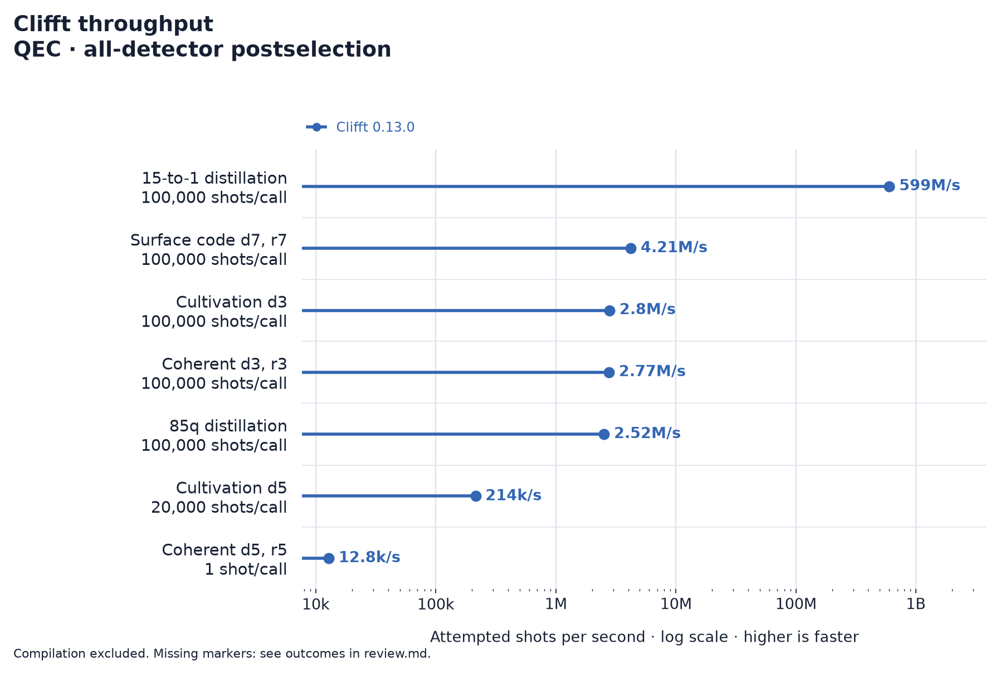

### Clifft — Arithmetic and code switching · postselection off

[Dark version](clifft-throughput-2-dark.png)

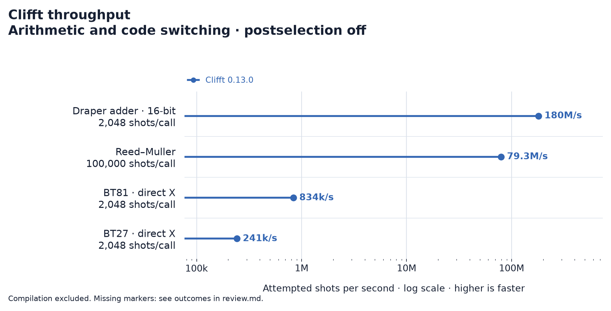

### Clifft — Bulk calls

[Dark version](clifft-throughput-3-dark.png)

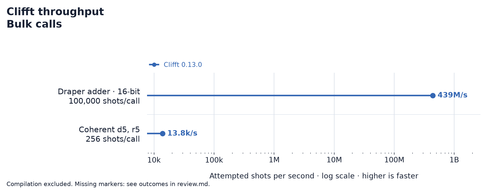

### Clifft — Selection controls · postselection off

[Dark version](clifft-throughput-4-dark.png)

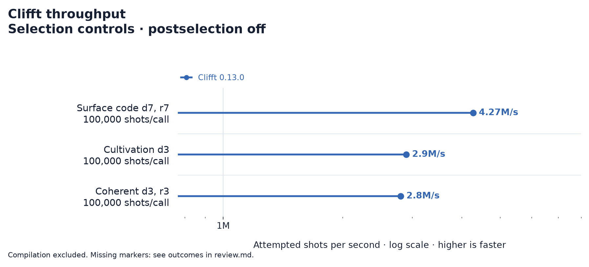

### Clifft — Dense Quantum Volume · repeated sampling

[Dark version](clifft-throughput-5-dark.png)

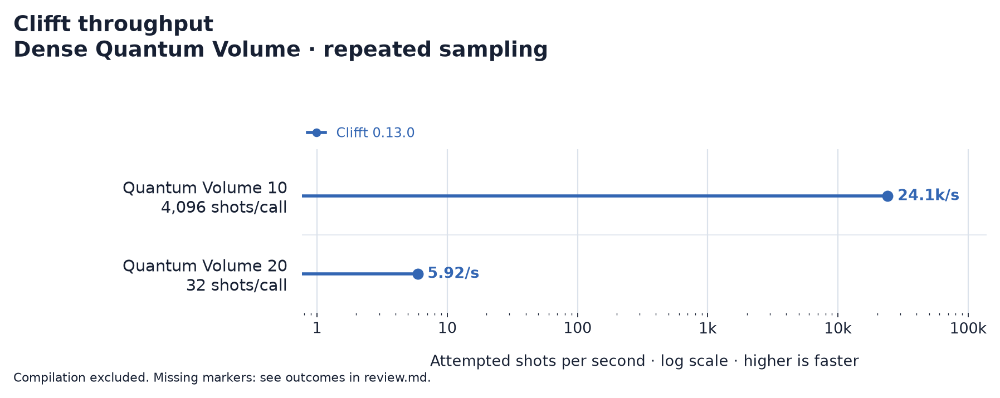

### Clifft — Cultivation stress workloads

[Dark version](clifft-throughput-6-dark.png)

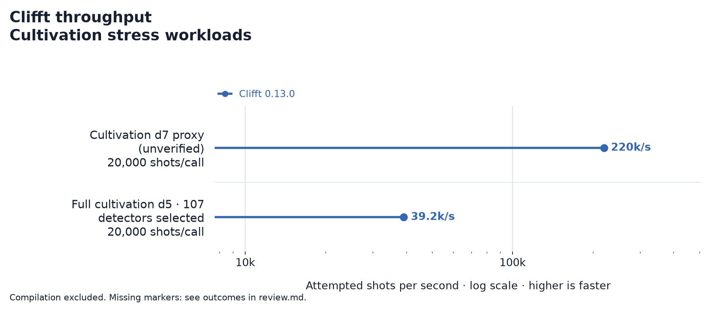

### CPU simulators — QEC · all-detector postselection

[Dark version](simulator-throughput-dark.png)

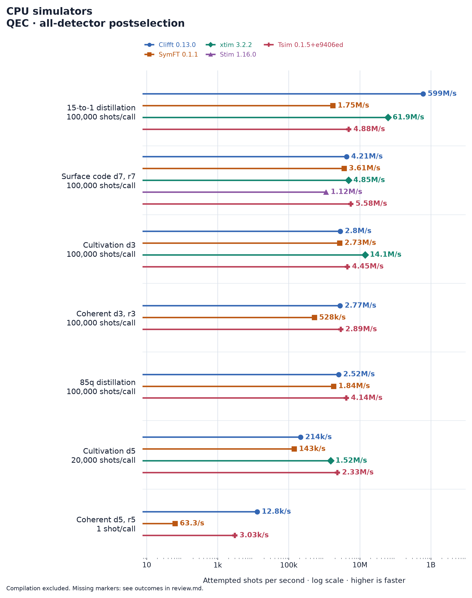

### CPU simulators — Arithmetic and code switching · postselection off

[Dark version](simulator-throughput-2-dark.png)

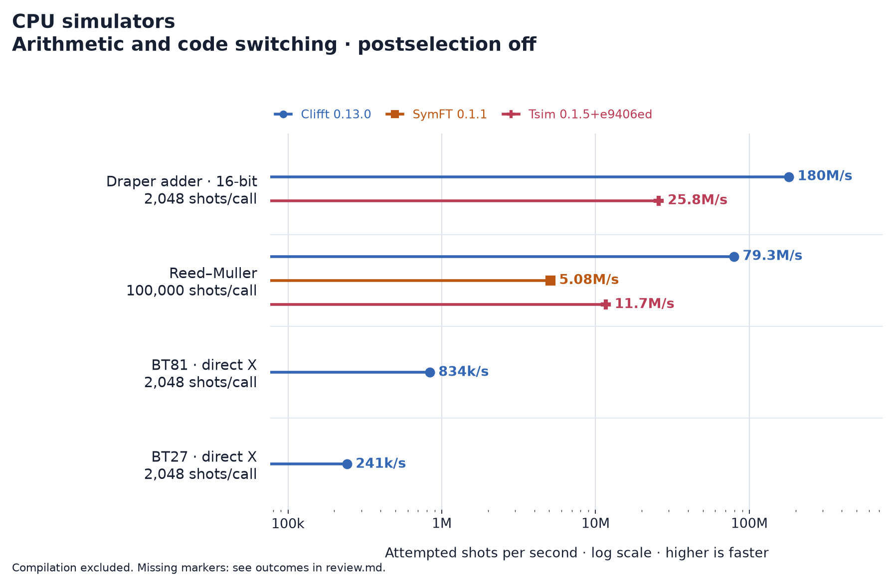

### CPU simulators — Bulk calls

[Dark version](simulator-throughput-3-dark.png)

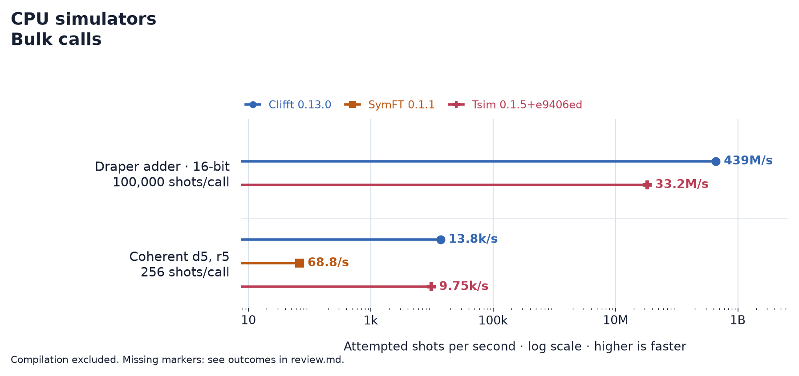

### CPU simulators — Selection controls · postselection off

[Dark version](simulator-throughput-4-dark.png)

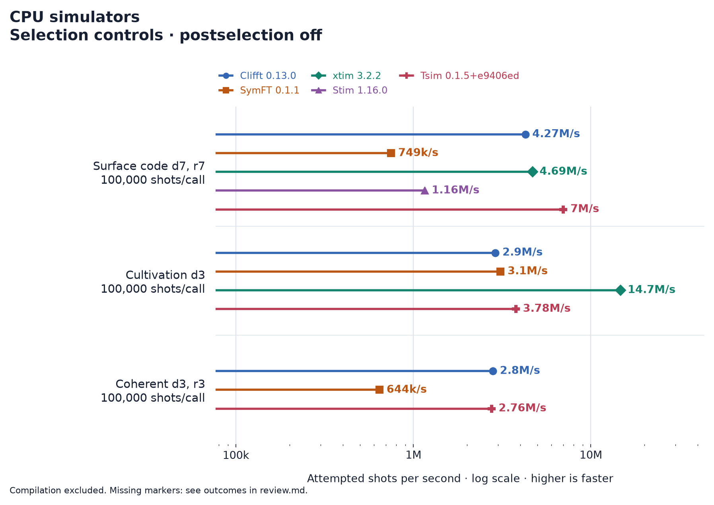

### CPU simulators — Dense Quantum Volume · repeated sampling

[Dark version](simulator-throughput-5-dark.png)

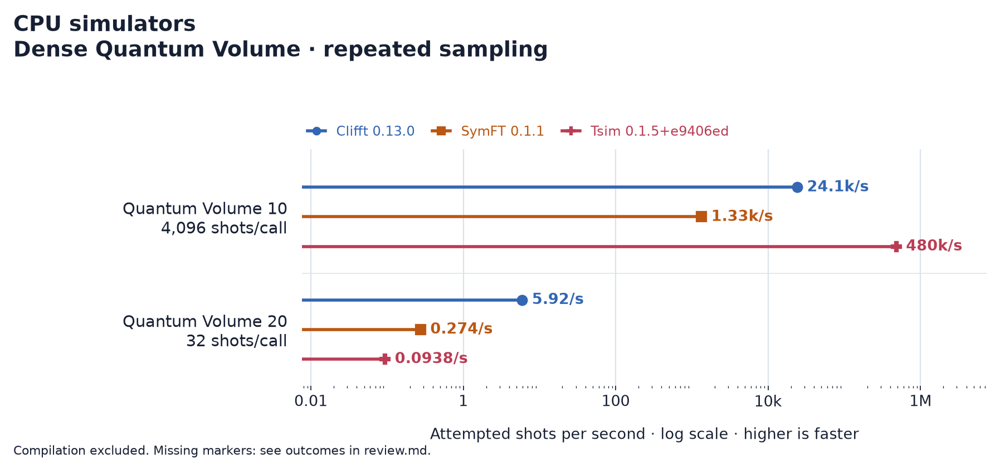

### CPU simulators — Cultivation stress workloads

[Dark version](simulator-throughput-6-dark.png)

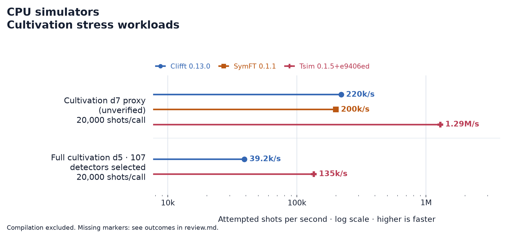

### Release changes

[Dark version](release-change-dark.png)

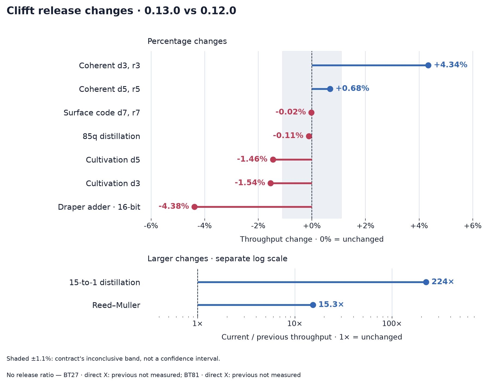
