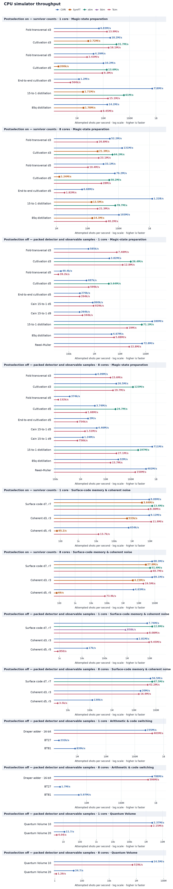
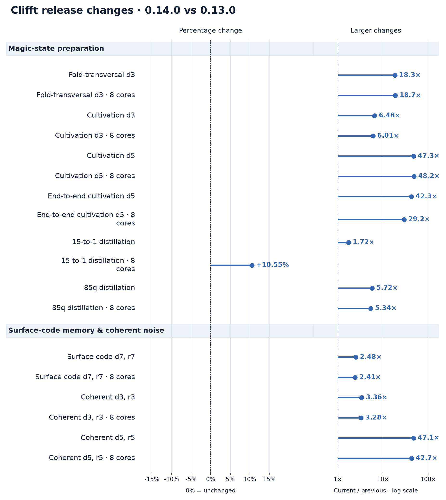

# release-v1 — 1b252b89-75d2-4881-ade9-114e09db6c9d

Classification: **official**. Collected 2026-11-21T00:10:46.758644Z.
Source: `dd362f5977c178ad5da5d4588404841f59ae6e6c`; dirty: False.
Host: AMD EPYC 9R14 (Linux, x86_64).

## Measured implementations

| Implementation | Exact version | Commit |
| --- | --- | --- |
| clifft-0.13.0 | 0.13.0 | `9b9091c8267321e2a2fd967f0674a65e4baf0e38` |
| clifft-0.14.0rc1 | 0.14.0rc1 | `7381d33e0038ab969b54ff65f8131196178f48f6` |
| tsim-1.0.0 | 1.0.0 | `136bcc6bec7edba88bbb28152da05e33d17f77d0` |
| xtim-4.1.2 | 4.1.2 | `b6dc0302604c4faf59a7b753004fddb42cb8d615` |
| symft-2026.10.8 | 2026.10.8 | `81d28499b6da8c0b84b7567482c4692f509bd416` |
| stim-1.16.0 | 1.16.0 | `e2fc1eca7fd21684d433aa5f10f4504ea4860d07` |

## Outcomes

| Case | Outcome | Detail |
| --- | --- | --- |
| msc-d3-inject-cultivate-p1e-3--clifft-previous | success | 3 samples; batch unknown; 1 physical cores |
| msc-d5-inject-cultivate-p1e-3--clifft-previous | success | 3 samples; batch unknown; 1 physical cores |
| surface-code-d7-r7-p1e-3--clifft-previous | success | 3 samples; batch unknown; 1 physical cores |
| distillation-color-code-85q-p5e-2--clifft-previous | success | 3 samples; batch unknown; 1 physical cores |
| coherent-surface-d3-r3-p1e-3-rz2e-2--clifft-previous | success | 3 samples; batch unknown; 1 physical cores |
| coherent-surface-d5-r5-p1e-3-rz2e-2--clifft-previous | success | 3 samples; batch unknown; 1 physical cores |
| distillation-15to1-rm15-p1e-3--clifft-previous | success | 3 samples; batch unknown; 1 physical cores |
| msc-full-d5-cultivation-selected-p1e-3--clifft-previous | success | 3 samples; batch unknown; 1 physical cores |
| fold-transversal-d3-p1e-3--clifft-previous | success | 3 samples; batch unknown; 1 physical cores |
| msc-d3-inject-cultivate-p1e-3--clifft-current | success | 3 samples; batch 8192; 1 physical cores |
| msc-d5-inject-cultivate-p1e-3--clifft-current | success | 3 samples; batch 8192; 1 physical cores |
| surface-code-d7-r7-p1e-3--clifft-current | success | 3 samples; batch 2048; 1 physical cores |
| distillation-color-code-85q-p5e-2--clifft-current | success | 3 samples; batch 8192; 1 physical cores |
| coherent-surface-d3-r3-p1e-3-rz2e-2--clifft-current | success | 3 samples; batch 8192; 1 physical cores |
| coherent-surface-d5-r5-p1e-3-rz2e-2--clifft-current | success | 3 samples; batch 341; 1 physical cores |
| distillation-15to1-rm15-p1e-3--clifft-current | success | 3 samples; batch 2048; 1 physical cores |
| msc-full-d5-cultivation-selected-p1e-3--clifft-current | success | 3 samples; batch 8192; 1 physical cores |
| fold-transversal-d3-p1e-3--clifft-current | success | 3 samples; batch 8192; 1 physical cores |
| fold-transversal-d5-p1e-3--clifft-current | success | 3 samples; batch 8192; 1 physical cores |
| msc-d3-inject-cultivate-p1e-3--tsim-current | success | 3 samples; batch unknown; 1 physical cores |
| msc-d5-inject-cultivate-p1e-3--tsim-current | success | 3 samples; batch unknown; 1 physical cores |
| surface-code-d7-r7-p1e-3--tsim-current | success | 3 samples; batch unknown; 1 physical cores |
| distillation-color-code-85q-p5e-2--tsim-current | success | 3 samples; batch unknown; 1 physical cores |
| coherent-surface-d3-r3-p1e-3-rz2e-2--tsim-current | success | 3 samples; batch unknown; 1 physical cores |
| coherent-surface-d5-r5-p1e-3-rz2e-2--tsim-current | success | 3 samples; batch unknown; 1 physical cores |
| distillation-15to1-rm15-p1e-3--tsim-current | success | 3 samples; batch unknown; 1 physical cores |
| msc-full-d5-cultivation-selected-p1e-3--tsim-current | success | 3 samples; batch unknown; 1 physical cores |
| fold-transversal-d3-p1e-3--tsim-current | success | 3 samples; batch unknown; 1 physical cores |
| fold-transversal-d5-p1e-3--tsim-current | success | 3 samples; batch unknown; 1 physical cores |
| msc-d3-inject-cultivate-p1e-3--xtim-current | success | 3 samples; batch unknown; 1 physical cores |
| msc-d5-inject-cultivate-p1e-3--xtim-current | success | 3 samples; batch unknown; 1 physical cores |
| surface-code-d7-r7-p1e-3--xtim-current | success | 3 samples; batch unknown; 1 physical cores |
| distillation-15to1-rm15-p1e-3--xtim-current | success | 3 samples; batch unknown; 1 physical cores |
| msc-full-d5-cultivation-selected-p1e-3--xtim-current | unsupported | setup: UnsupportedReferenceCircuit: xtim raw reference parity is unavailable for this circuit: Gate not found: 'T_DAG' |
| fold-transversal-d3-p1e-3--xtim-current | unsupported | setup: UnsupportedReferenceCircuit: xtim raw reference parity is unavailable for this circuit: Gate not found: 'T' |
| fold-transversal-d5-p1e-3--xtim-current | unsupported | setup: UnsupportedReferenceCircuit: xtim raw reference parity is unavailable for this circuit: Gate not found: 'T' |
| msc-d3-inject-cultivate-p1e-3--symft-current | success | 3 samples; batch 2048; 1 physical cores |
| msc-d5-inject-cultivate-p1e-3--symft-current | success | 3 samples; batch 32; 1 physical cores |
| surface-code-d7-r7-p1e-3--symft-current | success | 3 samples; batch 2048; 1 physical cores |
| distillation-color-code-85q-p5e-2--symft-current | success | 3 samples; batch 1024; 1 physical cores |
| coherent-surface-d3-r3-p1e-3-rz2e-2--symft-current | success | 3 samples; batch 256; 1 physical cores |
| coherent-surface-d5-r5-p1e-3-rz2e-2--symft-current | success | 3 samples; batch 1; 1 physical cores |
| distillation-15to1-rm15-p1e-3--symft-current | success | 3 samples; batch 1024; 1 physical cores |
| msc-full-d5-cultivation-selected-p1e-3--symft-current | unsupported | setup: UnsupportedConfiguration: symft does not support explicit detector subsets |
| surface-code-d7-r7-p1e-3--stim-current | unsupported | setup: UnsupportedConfiguration: stim does not support postselect=on |
| msc-d3-inject-cultivate-p1e-3--clifft-previous-off | unsupported | setup: UnsupportedConfiguration: clifft does not support postselect=off |
| msc-d5-inject-cultivate-p1e-3--clifft-previous-off | unsupported | setup: UnsupportedConfiguration: clifft does not support postselect=off |
| surface-code-d7-r7-p1e-3--clifft-previous-off | unsupported | setup: UnsupportedConfiguration: clifft does not support postselect=off |
| distillation-color-code-85q-p5e-2--clifft-previous-off | unsupported | setup: UnsupportedConfiguration: clifft does not support postselect=off |
| coherent-surface-d3-r3-p1e-3-rz2e-2--clifft-previous-off | unsupported | setup: UnsupportedConfiguration: clifft does not support postselect=off |
| coherent-surface-d5-r5-p1e-3-rz2e-2--clifft-previous-off | unsupported | setup: UnsupportedConfiguration: clifft does not support postselect=off |
| quantum-volume-q10-seed42-all-observables--clifft-previous-off | unsupported | setup: UnsupportedConfiguration: clifft does not support postselect=off |
| quantum-volume-q20-seed42-all-observables--clifft-previous-off | unsupported | setup: UnsupportedConfiguration: clifft does not support postselect=off |
| draper-adder-m16-basis-all-observables--clifft-previous-off | unsupported | setup: UnsupportedConfiguration: clifft does not support postselect=off |
| distillation-15to1-rm15-p1e-3--clifft-previous-off | unsupported | setup: UnsupportedConfiguration: clifft does not support postselect=off |
| bt27-direct-x--clifft-previous-off | unsupported | setup: UnsupportedConfiguration: clifft does not support postselect=off |
| bt81-direct-x--clifft-previous-off | unsupported | setup: UnsupportedConfiguration: clifft does not support postselect=off |
| reed-muller-measured--clifft-previous-off | unsupported | setup: UnsupportedConfiguration: clifft does not support postselect=off |
| msc-full-d5-cultivation-selected-p1e-3--clifft-previous-off | unsupported | setup: UnsupportedConfiguration: clifft does not support postselect=off |
| fold-transversal-d3-p1e-3--clifft-previous-off | unsupported | setup: UnsupportedConfiguration: clifft does not support postselect=off |
| fold-transversal-d5-p1e-3--clifft-previous-off | unsupported | setup: UnsupportedConfiguration: clifft does not support postselect=off |
| cain-15to1-d5-p1e-3--clifft-previous-off | unsupported | setup: UnsupportedConfiguration: clifft does not support postselect=off |
| cain-15to1-d9-p1e-3--clifft-previous-off | unsupported | setup: UnsupportedConfiguration: clifft does not support postselect=off |
| msc-d3-inject-cultivate-p1e-3--clifft-current-off | success | 3 samples; batch 2048; 1 physical cores |
| msc-d5-inject-cultivate-p1e-3--clifft-current-off | success | 3 samples; batch 512; 1 physical cores |
| surface-code-d7-r7-p1e-3--clifft-current-off | success | 3 samples; batch 2048; 1 physical cores |
| distillation-color-code-85q-p5e-2--clifft-current-off | success | 3 samples; batch 2048; 1 physical cores |
| coherent-surface-d3-r3-p1e-3-rz2e-2--clifft-current-off | success | 3 samples; batch 2048; 1 physical cores |
| coherent-surface-d5-r5-p1e-3-rz2e-2--clifft-current-off | success | 3 samples; batch 1; 1 physical cores |
| quantum-volume-q10-seed42-all-observables--clifft-current-off | success | 3 samples; batch 2730; 1 physical cores |
| quantum-volume-q20-seed42-all-observables--clifft-current-off | success | 3 samples; batch 2; 1 physical cores |
| draper-adder-m16-basis-all-observables--clifft-current-off | success | 3 samples; batch 2048; 1 physical cores |
| distillation-15to1-rm15-p1e-3--clifft-current-off | success | 3 samples; batch 2048; 1 physical cores |
| bt27-direct-x--clifft-current-off | success | 3 samples; batch 1; 1 physical cores |
| bt81-direct-x--clifft-current-off | success | 3 samples; batch 512; 1 physical cores |
| reed-muller-measured--clifft-current-off | success | 3 samples; batch 2048; 1 physical cores |
| msc-full-d5-cultivation-selected-p1e-3--clifft-current-off | success | 3 samples; batch 512; 1 physical cores |
| fold-transversal-d3-p1e-3--clifft-current-off | success | 3 samples; batch 512; 1 physical cores |
| fold-transversal-d5-p1e-3--clifft-current-off | success | 3 samples; batch 128; 1 physical cores |
| cain-15to1-d5-p1e-3--clifft-current-off | success | 3 samples; batch 2048; 1 physical cores |
| cain-15to1-d9-p1e-3--clifft-current-off | success | 3 samples; batch 2048; 1 physical cores |
| msc-d3-inject-cultivate-p1e-3--tsim-current-off | success | 3 samples; batch unknown; 1 physical cores |
| msc-d5-inject-cultivate-p1e-3--tsim-current-off | success | 3 samples; batch unknown; 1 physical cores |
| surface-code-d7-r7-p1e-3--tsim-current-off | success | 3 samples; batch unknown; 1 physical cores |
| distillation-color-code-85q-p5e-2--tsim-current-off | success | 3 samples; batch unknown; 1 physical cores |
| coherent-surface-d3-r3-p1e-3-rz2e-2--tsim-current-off | success | 3 samples; batch unknown; 1 physical cores |
| coherent-surface-d5-r5-p1e-3-rz2e-2--tsim-current-off | success | 3 samples; batch unknown; 1 physical cores |
| quantum-volume-q10-seed42-all-observables--tsim-current-off | success | 3 samples; batch unknown; 1 physical cores |
| quantum-volume-q20-seed42-all-observables--tsim-current-off | success | 3 samples; batch unknown; 1 physical cores |
| draper-adder-m16-basis-all-observables--tsim-current-off | success | 3 samples; batch unknown; 1 physical cores |
| distillation-15to1-rm15-p1e-3--tsim-current-off | success | 3 samples; batch unknown; 1 physical cores |
| reed-muller-measured--tsim-current-off | success | 3 samples; batch unknown; 1 physical cores |
| msc-full-d5-cultivation-selected-p1e-3--tsim-current-off | success | 3 samples; batch unknown; 1 physical cores |
| fold-transversal-d3-p1e-3--tsim-current-off | success | 3 samples; batch unknown; 1 physical cores |
| fold-transversal-d5-p1e-3--tsim-current-off | success | 3 samples; batch unknown; 1 physical cores |
| cain-15to1-d5-p1e-3--tsim-current-off | success | 3 samples; batch unknown; 1 physical cores |
| cain-15to1-d9-p1e-3--tsim-current-off | success | 3 samples; batch unknown; 1 physical cores |
| msc-d3-inject-cultivate-p1e-3--xtim-current-off | success | 3 samples; batch unknown; 1 physical cores |
| msc-d5-inject-cultivate-p1e-3--xtim-current-off | success | 3 samples; batch unknown; 1 physical cores |
| surface-code-d7-r7-p1e-3--xtim-current-off | success | 3 samples; batch unknown; 1 physical cores |
| distillation-15to1-rm15-p1e-3--xtim-current-off | success | 3 samples; batch unknown; 1 physical cores |
| bt27-direct-x--xtim-current-off | unsupported | setup: UnsupportedReferenceCircuit: xtim raw reference parity is unavailable for this circuit: Gate not found: 'T' |
| bt81-direct-x--xtim-current-off | unsupported | setup: UnsupportedReferenceCircuit: xtim raw reference parity is unavailable for this circuit: Gate not found: 'T' |
| reed-muller-measured--xtim-current-off | unsupported | setup: UnsupportedReferenceCircuit: xtim raw reference parity is unavailable for this circuit: Gate not found: 'T' |
| msc-full-d5-cultivation-selected-p1e-3--xtim-current-off | unsupported | setup: UnsupportedReferenceCircuit: xtim raw reference parity is unavailable for this circuit: Gate not found: 'T_DAG' |
| fold-transversal-d3-p1e-3--xtim-current-off | unsupported | setup: UnsupportedReferenceCircuit: xtim raw reference parity is unavailable for this circuit: Gate not found: 'T' |
| fold-transversal-d5-p1e-3--xtim-current-off | unsupported | setup: UnsupportedReferenceCircuit: xtim raw reference parity is unavailable for this circuit: Gate not found: 'T' |
| cain-15to1-d5-p1e-3--xtim-current-off | unsupported | setup: UnsupportedReferenceCircuit: xtim raw reference parity is unavailable for this circuit: Gate not found: 'T' |
| cain-15to1-d9-p1e-3--xtim-current-off | unsupported | setup: UnsupportedReferenceCircuit: xtim raw reference parity is unavailable for this circuit: Gate not found: 'T' |
| msc-d3-inject-cultivate-p1e-3--symft-current-off | unsupported | setup: UnsupportedConfiguration: symft does not support postselect=off |
| msc-d5-inject-cultivate-p1e-3--symft-current-off | unsupported | setup: UnsupportedConfiguration: symft does not support postselect=off |
| surface-code-d7-r7-p1e-3--symft-current-off | unsupported | setup: UnsupportedConfiguration: symft does not support postselect=off |
| distillation-color-code-85q-p5e-2--symft-current-off | unsupported | setup: UnsupportedConfiguration: symft does not support postselect=off |
| coherent-surface-d3-r3-p1e-3-rz2e-2--symft-current-off | unsupported | setup: UnsupportedConfiguration: symft does not support postselect=off |
| coherent-surface-d5-r5-p1e-3-rz2e-2--symft-current-off | unsupported | setup: UnsupportedConfiguration: symft does not support postselect=off |
| quantum-volume-q10-seed42-all-observables--symft-current-off | unsupported | setup: UnsupportedConfiguration: symft does not support postselect=off |
| quantum-volume-q20-seed42-all-observables--symft-current-off | unsupported | setup: UnsupportedConfiguration: symft does not support postselect=off |
| distillation-15to1-rm15-p1e-3--symft-current-off | unsupported | setup: UnsupportedConfiguration: symft does not support postselect=off |
| reed-muller-measured--symft-current-off | unsupported | setup: UnsupportedConfiguration: symft does not support postselect=off |
| msc-full-d5-cultivation-selected-p1e-3--symft-current-off | unsupported | setup: UnsupportedConfiguration: symft does not support postselect=off |
| surface-code-d7-r7-p1e-3--stim-current-off | success | 3 samples; batch unknown; 1 physical cores |
| msc-d3-inject-cultivate-p1e-3--clifft-previous-8c | success | 3 samples; batch unknown; 8 physical cores |
| msc-d5-inject-cultivate-p1e-3--clifft-previous-8c | success | 3 samples; batch unknown; 8 physical cores |
| surface-code-d7-r7-p1e-3--clifft-previous-8c | success | 3 samples; batch unknown; 8 physical cores |
| distillation-color-code-85q-p5e-2--clifft-previous-8c | success | 3 samples; batch unknown; 8 physical cores |
| coherent-surface-d3-r3-p1e-3-rz2e-2--clifft-previous-8c | success | 3 samples; batch unknown; 8 physical cores |
| coherent-surface-d5-r5-p1e-3-rz2e-2--clifft-previous-8c | success | 3 samples; batch unknown; 8 physical cores |
| distillation-15to1-rm15-p1e-3--clifft-previous-8c | success | 3 samples; batch unknown; 8 physical cores |
| msc-full-d5-cultivation-selected-p1e-3--clifft-previous-8c | success | 3 samples; batch unknown; 8 physical cores |
| fold-transversal-d3-p1e-3--clifft-previous-8c | success | 3 samples; batch unknown; 8 physical cores |
| msc-d3-inject-cultivate-p1e-3--clifft-current-8c | success | 3 samples; batch 8192; 8 physical cores |
| msc-d5-inject-cultivate-p1e-3--clifft-current-8c | success | 3 samples; batch 8192; 8 physical cores |
| surface-code-d7-r7-p1e-3--clifft-current-8c | success | 3 samples; batch 2048; 8 physical cores |
| distillation-color-code-85q-p5e-2--clifft-current-8c | success | 3 samples; batch 8192; 8 physical cores |
| coherent-surface-d3-r3-p1e-3-rz2e-2--clifft-current-8c | success | 3 samples; batch 8192; 8 physical cores |
| coherent-surface-d5-r5-p1e-3-rz2e-2--clifft-current-8c | success | 3 samples; batch 341; 8 physical cores |
| distillation-15to1-rm15-p1e-3--clifft-current-8c | success | 3 samples; batch 2048; 8 physical cores |
| msc-full-d5-cultivation-selected-p1e-3--clifft-current-8c | success | 3 samples; batch 2048; 8 physical cores |
| fold-transversal-d3-p1e-3--clifft-current-8c | success | 3 samples; batch 8192; 8 physical cores |
| fold-transversal-d5-p1e-3--clifft-current-8c | success | 3 samples; batch 8192; 8 physical cores |
| msc-d3-inject-cultivate-p1e-3--tsim-current-8c | success | 3 samples; batch unknown; 8 physical cores |
| msc-d5-inject-cultivate-p1e-3--tsim-current-8c | success | 3 samples; batch unknown; 8 physical cores |
| surface-code-d7-r7-p1e-3--tsim-current-8c | success | 3 samples; batch unknown; 8 physical cores |
| distillation-color-code-85q-p5e-2--tsim-current-8c | success | 3 samples; batch unknown; 8 physical cores |
| coherent-surface-d3-r3-p1e-3-rz2e-2--tsim-current-8c | success | 3 samples; batch unknown; 8 physical cores |
| coherent-surface-d5-r5-p1e-3-rz2e-2--tsim-current-8c | success | 3 samples; batch unknown; 8 physical cores |
| distillation-15to1-rm15-p1e-3--tsim-current-8c | success | 3 samples; batch unknown; 8 physical cores |
| msc-full-d5-cultivation-selected-p1e-3--tsim-current-8c | success | 3 samples; batch unknown; 8 physical cores |
| fold-transversal-d3-p1e-3--tsim-current-8c | success | 3 samples; batch unknown; 8 physical cores |
| fold-transversal-d5-p1e-3--tsim-current-8c | success | 3 samples; batch unknown; 8 physical cores |
| msc-d3-inject-cultivate-p1e-3--xtim-current-8c | success | 3 samples; batch unknown; 8 physical cores |
| msc-d5-inject-cultivate-p1e-3--xtim-current-8c | success | 3 samples; batch unknown; 8 physical cores |
| surface-code-d7-r7-p1e-3--xtim-current-8c | success | 3 samples; batch unknown; 8 physical cores |
| distillation-15to1-rm15-p1e-3--xtim-current-8c | success | 3 samples; batch unknown; 8 physical cores |
| msc-full-d5-cultivation-selected-p1e-3--xtim-current-8c | unsupported | setup: UnsupportedReferenceCircuit: xtim raw reference parity is unavailable for this circuit: Gate not found: 'T_DAG' |
| fold-transversal-d3-p1e-3--xtim-current-8c | unsupported | setup: UnsupportedReferenceCircuit: xtim raw reference parity is unavailable for this circuit: Gate not found: 'T' |
| fold-transversal-d5-p1e-3--xtim-current-8c | unsupported | setup: UnsupportedReferenceCircuit: xtim raw reference parity is unavailable for this circuit: Gate not found: 'T' |
| msc-d3-inject-cultivate-p1e-3--symft-current-8c | success | 3 samples; batch 2048; 8 physical cores |
| msc-d5-inject-cultivate-p1e-3--symft-current-8c | success | 3 samples; batch 32; 8 physical cores |
| surface-code-d7-r7-p1e-3--symft-current-8c | success | 3 samples; batch 2048; 8 physical cores |
| distillation-color-code-85q-p5e-2--symft-current-8c | success | 3 samples; batch 1024; 8 physical cores |
| coherent-surface-d3-r3-p1e-3-rz2e-2--symft-current-8c | success | 3 samples; batch 256; 8 physical cores |
| coherent-surface-d5-r5-p1e-3-rz2e-2--symft-current-8c | success | 3 samples; batch 1; 8 physical cores |
| distillation-15to1-rm15-p1e-3--symft-current-8c | success | 3 samples; batch 1024; 8 physical cores |
| msc-full-d5-cultivation-selected-p1e-3--symft-current-8c | unsupported | setup: UnsupportedConfiguration: symft does not support explicit detector subsets |
| surface-code-d7-r7-p1e-3--stim-current-8c | unsupported | setup: UnsupportedConfiguration: stim does not support postselect=on |
| msc-d3-inject-cultivate-p1e-3--clifft-previous-off-8c | unsupported | setup: UnsupportedConfiguration: clifft does not support postselect=off |
| msc-d5-inject-cultivate-p1e-3--clifft-previous-off-8c | unsupported | setup: UnsupportedConfiguration: clifft does not support postselect=off |
| surface-code-d7-r7-p1e-3--clifft-previous-off-8c | unsupported | setup: UnsupportedConfiguration: clifft does not support postselect=off |
| distillation-color-code-85q-p5e-2--clifft-previous-off-8c | unsupported | setup: UnsupportedConfiguration: clifft does not support postselect=off |
| coherent-surface-d3-r3-p1e-3-rz2e-2--clifft-previous-off-8c | unsupported | setup: UnsupportedConfiguration: clifft does not support postselect=off |
| coherent-surface-d5-r5-p1e-3-rz2e-2--clifft-previous-off-8c | unsupported | setup: UnsupportedConfiguration: clifft does not support postselect=off |
| quantum-volume-q10-seed42-all-observables--clifft-previous-off-8c | unsupported | setup: UnsupportedConfiguration: clifft does not support postselect=off |
| quantum-volume-q20-seed42-all-observables--clifft-previous-off-8c | unsupported | setup: UnsupportedConfiguration: clifft does not support postselect=off |
| draper-adder-m16-basis-all-observables--clifft-previous-off-8c | unsupported | setup: UnsupportedConfiguration: clifft does not support postselect=off |
| distillation-15to1-rm15-p1e-3--clifft-previous-off-8c | unsupported | setup: UnsupportedConfiguration: clifft does not support postselect=off |
| bt27-direct-x--clifft-previous-off-8c | unsupported | setup: UnsupportedConfiguration: clifft does not support postselect=off |
| bt81-direct-x--clifft-previous-off-8c | unsupported | setup: UnsupportedConfiguration: clifft does not support postselect=off |
| reed-muller-measured--clifft-previous-off-8c | unsupported | setup: UnsupportedConfiguration: clifft does not support postselect=off |
| msc-full-d5-cultivation-selected-p1e-3--clifft-previous-off-8c | unsupported | setup: UnsupportedConfiguration: clifft does not support postselect=off |
| fold-transversal-d3-p1e-3--clifft-previous-off-8c | unsupported | setup: UnsupportedConfiguration: clifft does not support postselect=off |
| fold-transversal-d5-p1e-3--clifft-previous-off-8c | unsupported | setup: UnsupportedConfiguration: clifft does not support postselect=off |
| cain-15to1-d5-p1e-3--clifft-previous-off-8c | unsupported | setup: UnsupportedConfiguration: clifft does not support postselect=off |
| cain-15to1-d9-p1e-3--clifft-previous-off-8c | unsupported | setup: UnsupportedConfiguration: clifft does not support postselect=off |
| msc-d3-inject-cultivate-p1e-3--clifft-current-off-8c | success | 3 samples; batch 2048; 8 physical cores |
| msc-d5-inject-cultivate-p1e-3--clifft-current-off-8c | success | 3 samples; batch 512; 8 physical cores |
| surface-code-d7-r7-p1e-3--clifft-current-off-8c | success | 3 samples; batch 2048; 8 physical cores |
| distillation-color-code-85q-p5e-2--clifft-current-off-8c | success | 3 samples; batch 2048; 8 physical cores |
| coherent-surface-d3-r3-p1e-3-rz2e-2--clifft-current-off-8c | success | 3 samples; batch 2048; 8 physical cores |
| coherent-surface-d5-r5-p1e-3-rz2e-2--clifft-current-off-8c | success | 3 samples; batch 1; 8 physical cores |
| quantum-volume-q10-seed42-all-observables--clifft-current-off-8c | success | 3 samples; batch 2048; 8 physical cores |
| quantum-volume-q20-seed42-all-observables--clifft-current-off-8c | success | 3 samples; batch 2; 8 physical cores |
| draper-adder-m16-basis-all-observables--clifft-current-off-8c | success | 3 samples; batch 2048; 8 physical cores |
| distillation-15to1-rm15-p1e-3--clifft-current-off-8c | success | 3 samples; batch 2048; 8 physical cores |
| bt27-direct-x--clifft-current-off-8c | success | 3 samples; batch 1; 8 physical cores |
| bt81-direct-x--clifft-current-off-8c | success | 3 samples; batch 512; 8 physical cores |
| reed-muller-measured--clifft-current-off-8c | success | 3 samples; batch 2048; 8 physical cores |
| msc-full-d5-cultivation-selected-p1e-3--clifft-current-off-8c | success | 3 samples; batch 512; 8 physical cores |
| fold-transversal-d3-p1e-3--clifft-current-off-8c | success | 3 samples; batch 512; 8 physical cores |
| fold-transversal-d5-p1e-3--clifft-current-off-8c | success | 3 samples; batch 128; 8 physical cores |
| cain-15to1-d5-p1e-3--clifft-current-off-8c | success | 3 samples; batch 2048; 8 physical cores |
| cain-15to1-d9-p1e-3--clifft-current-off-8c | success | 3 samples; batch 2048; 8 physical cores |
| msc-d3-inject-cultivate-p1e-3--tsim-current-off-8c | success | 3 samples; batch unknown; 8 physical cores |
| msc-d5-inject-cultivate-p1e-3--tsim-current-off-8c | success | 3 samples; batch unknown; 8 physical cores |
| surface-code-d7-r7-p1e-3--tsim-current-off-8c | success | 3 samples; batch unknown; 8 physical cores |
| distillation-color-code-85q-p5e-2--tsim-current-off-8c | success | 3 samples; batch unknown; 8 physical cores |
| coherent-surface-d3-r3-p1e-3-rz2e-2--tsim-current-off-8c | success | 3 samples; batch unknown; 8 physical cores |
| coherent-surface-d5-r5-p1e-3-rz2e-2--tsim-current-off-8c | success | 3 samples; batch unknown; 8 physical cores |
| quantum-volume-q10-seed42-all-observables--tsim-current-off-8c | success | 3 samples; batch unknown; 8 physical cores |
| quantum-volume-q20-seed42-all-observables--tsim-current-off-8c | success | 3 samples; batch unknown; 8 physical cores |
| draper-adder-m16-basis-all-observables--tsim-current-off-8c | success | 3 samples; batch unknown; 8 physical cores |
| distillation-15to1-rm15-p1e-3--tsim-current-off-8c | success | 3 samples; batch unknown; 8 physical cores |
| reed-muller-measured--tsim-current-off-8c | success | 3 samples; batch unknown; 8 physical cores |
| msc-full-d5-cultivation-selected-p1e-3--tsim-current-off-8c | success | 3 samples; batch unknown; 8 physical cores |
| fold-transversal-d3-p1e-3--tsim-current-off-8c | success | 3 samples; batch unknown; 8 physical cores |
| fold-transversal-d5-p1e-3--tsim-current-off-8c | success | 3 samples; batch unknown; 8 physical cores |
| cain-15to1-d5-p1e-3--tsim-current-off-8c | success | 3 samples; batch unknown; 8 physical cores |
| cain-15to1-d9-p1e-3--tsim-current-off-8c | success | 3 samples; batch unknown; 8 physical cores |
| msc-d3-inject-cultivate-p1e-3--xtim-current-off-8c | success | 3 samples; batch unknown; 8 physical cores |
| msc-d5-inject-cultivate-p1e-3--xtim-current-off-8c | success | 3 samples; batch unknown; 8 physical cores |
| surface-code-d7-r7-p1e-3--xtim-current-off-8c | success | 3 samples; batch unknown; 8 physical cores |
| distillation-15to1-rm15-p1e-3--xtim-current-off-8c | success | 3 samples; batch unknown; 8 physical cores |
| bt27-direct-x--xtim-current-off-8c | unsupported | setup: UnsupportedReferenceCircuit: xtim raw reference parity is unavailable for this circuit: Gate not found: 'T' |
| bt81-direct-x--xtim-current-off-8c | unsupported | setup: UnsupportedReferenceCircuit: xtim raw reference parity is unavailable for this circuit: Gate not found: 'T' |
| reed-muller-measured--xtim-current-off-8c | unsupported | setup: UnsupportedReferenceCircuit: xtim raw reference parity is unavailable for this circuit: Gate not found: 'T' |
| msc-full-d5-cultivation-selected-p1e-3--xtim-current-off-8c | unsupported | setup: UnsupportedReferenceCircuit: xtim raw reference parity is unavailable for this circuit: Gate not found: 'T_DAG' |
| fold-transversal-d3-p1e-3--xtim-current-off-8c | unsupported | setup: UnsupportedReferenceCircuit: xtim raw reference parity is unavailable for this circuit: Gate not found: 'T' |
| fold-transversal-d5-p1e-3--xtim-current-off-8c | unsupported | setup: UnsupportedReferenceCircuit: xtim raw reference parity is unavailable for this circuit: Gate not found: 'T' |
| cain-15to1-d5-p1e-3--xtim-current-off-8c | unsupported | setup: UnsupportedReferenceCircuit: xtim raw reference parity is unavailable for this circuit: Gate not found: 'T' |
| cain-15to1-d9-p1e-3--xtim-current-off-8c | unsupported | setup: UnsupportedReferenceCircuit: xtim raw reference parity is unavailable for this circuit: Gate not found: 'T' |
| msc-d3-inject-cultivate-p1e-3--symft-current-off-8c | unsupported | setup: UnsupportedConfiguration: symft does not support postselect=off |
| msc-d5-inject-cultivate-p1e-3--symft-current-off-8c | unsupported | setup: UnsupportedConfiguration: symft does not support postselect=off |
| surface-code-d7-r7-p1e-3--symft-current-off-8c | unsupported | setup: UnsupportedConfiguration: symft does not support postselect=off |
| distillation-color-code-85q-p5e-2--symft-current-off-8c | unsupported | setup: UnsupportedConfiguration: symft does not support postselect=off |
| coherent-surface-d3-r3-p1e-3-rz2e-2--symft-current-off-8c | unsupported | setup: UnsupportedConfiguration: symft does not support postselect=off |
| coherent-surface-d5-r5-p1e-3-rz2e-2--symft-current-off-8c | unsupported | setup: UnsupportedConfiguration: symft does not support postselect=off |
| quantum-volume-q10-seed42-all-observables--symft-current-off-8c | unsupported | setup: UnsupportedConfiguration: symft does not support postselect=off |
| quantum-volume-q20-seed42-all-observables--symft-current-off-8c | unsupported | setup: UnsupportedConfiguration: symft does not support postselect=off |
| distillation-15to1-rm15-p1e-3--symft-current-off-8c | unsupported | setup: UnsupportedConfiguration: symft does not support postselect=off |
| reed-muller-measured--symft-current-off-8c | unsupported | setup: UnsupportedConfiguration: symft does not support postselect=off |
| msc-full-d5-cultivation-selected-p1e-3--symft-current-off-8c | unsupported | setup: UnsupportedConfiguration: symft does not support postselect=off |
| surface-code-d7-r7-p1e-3--stim-current-off-8c | unsupported | setup: UnsupportedConfiguration: stim does not support threads=8 |

## Measurements

| Case | Postselection | Shots per call | Compile (s) | First call (s) | Peak active width | Attempted shots/s (median) | Cores | 8-core / 1-core |
| --- | --- | ---: | ---: | ---: | ---: | ---: | ---: | ---: |
| msc-d3-inject-cultivate-p1e-3--clifft-previous | on | 262144 | 0.0123688 | 0.102422 | 4 | 2.80966e+06 | 1 | — |
| msc-d5-inject-cultivate-p1e-3--clifft-previous | on | 262144 | 0.0230627 | 1.22533 | 10 | 215474 | 1 | — |
| surface-code-d7-r7-p1e-3--clifft-previous | on | 262144 | 0.0128131 | 0.072552 | 0 | 3.65971e+06 | 1 | — |
| distillation-color-code-85q-p5e-2--clifft-previous | on | 262144 | 0.00304227 | 0.106339 | 3 | 2.48198e+06 | 1 | — |
| coherent-surface-d3-r3-p1e-3-rz2e-2--clifft-previous | on | 262144 | 0.00129247 | 0.0970674 | 4 | 2.71522e+06 | 1 | — |
| coherent-surface-d5-r5-p1e-3-rz2e-2--clifft-previous | on | 16384 | 0.0132381 | 1.1793 | 13 | 13863.6 | 1 | — |
| distillation-15to1-rm15-p1e-3--clifft-previous | on | 262144 | 0.000267693 | 0.00150942 | 0 | 4.17835e+08 | 1 | — |
| msc-full-d5-cultivation-selected-p1e-3--clifft-previous | on | 16384 | 2.47255 | 0.582396 | 10 | 28348.2 | 1 | — |
| fold-transversal-d3-p1e-3--clifft-previous | on | 262144 | 0.00683086 | 0.702928 | 8 | 373394 | 1 | — |
| msc-d3-inject-cultivate-p1e-3--clifft-current | on | 262144 | 0.0215065 | 0.0243642 | 4 | 1.81965e+07 | 1 | — |
| msc-d5-inject-cultivate-p1e-3--clifft-current | on | 262144 | 0.0489526 | 0.0343072 | 6 | 1.019e+07 | 1 | — |
| surface-code-d7-r7-p1e-3--clifft-current | on | 262144 | 0.0125992 | 0.0347688 | 0 | 9.08612e+06 | 1 | — |
| distillation-color-code-85q-p5e-2--clifft-current | on | 262144 | 0.00638023 | 0.0200717 | 3 | 1.41969e+07 | 1 | — |
| coherent-surface-d3-r3-p1e-3-rz2e-2--clifft-current | on | 262144 | 0.00311578 | 0.0298699 | 4 | 9.11882e+06 | 1 | — |
| coherent-surface-d5-r5-p1e-3-rz2e-2--clifft-current | on | 16384 | 0.0376865 | 0.025435 | 13 | 653518 | 1 | — |
| distillation-15to1-rm15-p1e-3--clifft-current | on | 262144 | 0.000280232 | 0.00127972 | 0 | 7.17723e+08 | 1 | — |
| msc-full-d5-cultivation-selected-p1e-3--clifft-current | on | 16384 | 1.4529 | 0.0382964 | 6 | 1.20016e+06 | 1 | — |
| fold-transversal-d3-p1e-3--clifft-current | on | 262144 | 0.0137012 | 0.0412903 | 8 | 6.83063e+06 | 1 | — |
| fold-transversal-d5-p1e-3--clifft-current | on | 262144 | 0.103455 | 0.0718353 | 8 | 4.2898e+06 | 1 | — |
| msc-d3-inject-cultivate-p1e-3--tsim-current | on | 262144 | 0.0787931 | 0.865655 | 4 | 1.6116e+07 | 1 | — |
| msc-d5-inject-cultivate-p1e-3--tsim-current | on | 262144 | 0.218705 | 0.246105 | 6 | 9.30178e+06 | 1 | — |
| surface-code-d7-r7-p1e-3--tsim-current | on | 262144 | 0.192755 | 0.976586 | 0 | 8.38382e+06 | 1 | — |
| distillation-color-code-85q-p5e-2--tsim-current | on | 262144 | 0.0391939 | 0.253466 | 3 | 8.45034e+06 | 1 | — |
| coherent-surface-d3-r3-p1e-3-rz2e-2--tsim-current | on | 262144 | 0.021209 | 0.252697 | 4 | 1.18545e+07 | 1 | — |
| coherent-surface-d5-r5-p1e-3-rz2e-2--tsim-current | on | 16384 | 0.274375 | 1.44842 | 11 | 13664.6 | 1 | — |
| distillation-15to1-rm15-p1e-3--tsim-current | on | 262144 | 0.0111847 | 0.242115 | 4 | 1.5053e+07 | 1 | — |
| msc-full-d5-cultivation-selected-p1e-3--tsim-current | on | 16384 | 5.20456 | 0.243611 | 6 | 564308 | 1 | — |
| fold-transversal-d3-p1e-3--tsim-current | on | 262144 | 0.0719408 | 0.24553 | 6 | 1.3858e+07 | 1 | — |
| fold-transversal-d5-p1e-3--tsim-current | on | 262144 | 0.470865 | 0.322687 | 8 | 2.43084e+06 | 1 | — |
| msc-d3-inject-cultivate-p1e-3--xtim-current | on | 262144 | 0.0555054 | 0.0115271 | — | 3.17045e+07 | 1 | — |
| msc-d5-inject-cultivate-p1e-3--xtim-current | on | 262144 | 0.0522019 | 0.0197851 | — | 1.35917e+07 | 1 | — |
| surface-code-d7-r7-p1e-3--xtim-current | on | 262144 | 0.0475801 | 0.0228278 | — | 1.34139e+07 | 1 | — |
| distillation-15to1-rm15-p1e-3--xtim-current | on | 262144 | 0.00391194 | 0.00439767 | — | 6.10078e+07 | 1 | — |
| msc-full-d5-cultivation-selected-p1e-3--xtim-current | on | 16384 | — | — | — | — | 1 | — |
| fold-transversal-d3-p1e-3--xtim-current | on | 262144 | — | — | — | — | 1 | — |
| fold-transversal-d5-p1e-3--xtim-current | on | 262144 | — | — | — | — | 1 | — |
| msc-d3-inject-cultivate-p1e-3--symft-current | on | 262144 | 0.0109663 | 0.097697 | 4 | 2.72011e+06 | 1 | — |
| msc-d5-inject-cultivate-p1e-3--symft-current | on | 262144 | 0.043152 | 1.31476 | 10 | 200263 | 1 | — |
| surface-code-d7-r7-p1e-3--symft-current | on | 262144 | 0.0222402 | 0.0729959 | 0 | 3.63541e+06 | 1 | — |
| distillation-color-code-85q-p5e-2--symft-current | on | 262144 | 0.00339192 | 0.147775 | 5 | 1.77871e+06 | 1 | — |
| coherent-surface-d3-r3-p1e-3-rz2e-2--symft-current | on | 262144 | 0.00218415 | 0.492559 | 7 | 532555 | 1 | — |
| coherent-surface-d5-r5-p1e-3-rz2e-2--symft-current | on | 16384 | 0.03103 | 251.164 | 22 | 65.1531 | 1 | — |
| distillation-15to1-rm15-p1e-3--symft-current | on | 262144 | 0.000999719 | 0.153262 | 5 | 1.71086e+06 | 1 | — |
| msc-full-d5-cultivation-selected-p1e-3--symft-current | on | 16384 | — | — | — | — | 1 | — |
| surface-code-d7-r7-p1e-3--stim-current | on | 262144 | — | — | — | — | 1 | — |
| msc-d3-inject-cultivate-p1e-3--clifft-previous-off | off | 262144 | — | — | — | — | 1 | — |
| msc-d5-inject-cultivate-p1e-3--clifft-previous-off | off | 262144 | — | — | — | — | 1 | — |
| surface-code-d7-r7-p1e-3--clifft-previous-off | off | 262144 | — | — | — | — | 1 | — |
| distillation-color-code-85q-p5e-2--clifft-previous-off | off | 262144 | — | — | — | — | 1 | — |
| coherent-surface-d3-r3-p1e-3-rz2e-2--clifft-previous-off | off | 262144 | — | — | — | — | 1 | — |
| coherent-surface-d5-r5-p1e-3-rz2e-2--clifft-previous-off | off | 16384 | — | — | — | — | 1 | — |
| quantum-volume-q10-seed42-all-observables--clifft-previous-off | off | 16384 | — | — | — | — | 1 | — |
| quantum-volume-q20-seed42-all-observables--clifft-previous-off | off | 32 | — | — | — | — | 1 | — |
| draper-adder-m16-basis-all-observables--clifft-previous-off | off | 262144 | — | — | — | — | 1 | — |
| distillation-15to1-rm15-p1e-3--clifft-previous-off | off | 262144 | — | — | — | — | 1 | — |
| bt27-direct-x--clifft-previous-off | off | 16384 | — | — | — | — | 1 | — |
| bt81-direct-x--clifft-previous-off | off | 16384 | — | — | — | — | 1 | — |
| reed-muller-measured--clifft-previous-off | off | 262144 | — | — | — | — | 1 | — |
| msc-full-d5-cultivation-selected-p1e-3--clifft-previous-off | off | 16384 | — | — | — | — | 1 | — |
| fold-transversal-d3-p1e-3--clifft-previous-off | off | 262144 | — | — | — | — | 1 | — |
| fold-transversal-d5-p1e-3--clifft-previous-off | off | 262144 | — | — | — | — | 1 | — |
| cain-15to1-d5-p1e-3--clifft-previous-off | off | 16384 | — | — | — | — | 1 | — |
| cain-15to1-d9-p1e-3--clifft-previous-off | off | 16384 | — | — | — | — | 1 | — |
| msc-d3-inject-cultivate-p1e-3--clifft-current-off | off | 262144 | 0.00567419 | 0.0706549 | 4 | 3.8156e+06 | 1 | — |
| msc-d5-inject-cultivate-p1e-3--clifft-current-off | off | 262144 | 0.0487317 | 0.547776 | 6 | 486985 | 1 | — |
| surface-code-d7-r7-p1e-3--clifft-current-off | off | 262144 | 0.0125396 | 0.0470932 | 0 | 7.73787e+06 | 1 | — |
| distillation-color-code-85q-p5e-2--clifft-current-off | off | 262144 | 0.00617194 | 0.0580374 | 3 | 4.67221e+06 | 1 | — |
| coherent-surface-d3-r3-p1e-3-rz2e-2--clifft-current-off | off | 262144 | 0.00345502 | 0.0948737 | 4 | 2.80641e+06 | 1 | — |
| coherent-surface-d5-r5-p1e-3-rz2e-2--clifft-current-off | off | 16384 | 0.0434092 | 0.966694 | 11 | 16978 | 1 | — |
| quantum-volume-q10-seed42-all-observables--clifft-current-off | off | 16384 | 0.0314151 | 0.013714 | 10 | 2.36778e+06 | 1 | — |
| quantum-volume-q20-seed42-all-observables--clifft-current-off | off | 32 | 0.497556 | 2.7131 | 20 | 11.7173 | 1 | — |
| draper-adder-m16-basis-all-observables--clifft-current-off | off | 262144 | 0.00266522 | 0.00258611 | 0 | 2.35116e+08 | 1 | — |
| distillation-15to1-rm15-p1e-3--clifft-current-off | off | 262144 | 0.000278522 | 0.00262348 | 0 | 1.80225e+08 | 1 | — |
| bt27-direct-x--clifft-current-off | off | 16384 | 0.0151465 | 0.0717412 | 9 | 231510 | 1 | — |
| bt81-direct-x--clifft-current-off | off | 16384 | 0.111644 | 0.0205957 | 6 | 839153 | 1 | — |
| reed-muller-measured--clifft-current-off | off | 262144 | 0.000525835 | 0.00463332 | 1 | 7.28423e+07 | 1 | — |
| msc-full-d5-cultivation-selected-p1e-3--clifft-current-off | off | 16384 | 1.41076 | 0.0965891 | 6 | 270261 | 1 | — |
| fold-transversal-d3-p1e-3--clifft-current-off | off | 262144 | 0.0132686 | 0.452639 | 6 | 585402 | 1 | — |
| fold-transversal-d5-p1e-3--clifft-current-off | off | 262144 | 0.101397 | 5.31708 | 8 | 49405.1 | 1 | — |
| cain-15to1-d5-p1e-3--clifft-current-off | off | 16384 | 0.210281 | 0.0737492 | 4 | 859556 | 1 | — |
| cain-15to1-d9-p1e-3--clifft-current-off | off | 16384 | 1.0053 | 0.271835 | 4 | 264010 | 1 | — |
| msc-d3-inject-cultivate-p1e-3--tsim-current-off | off | 262144 | 0.0359712 | 0.246191 | 4 | 1.27588e+07 | 1 | — |
| msc-d5-inject-cultivate-p1e-3--tsim-current-off | off | 262144 | 0.216567 | 0.696764 | 6 | 598818 | 1 | — |
| surface-code-d7-r7-p1e-3--tsim-current-off | off | 262144 | 0.193183 | 0.221809 | 0 | 8.07937e+06 | 1 | — |
| distillation-color-code-85q-p5e-2--tsim-current-off | off | 262144 | 0.0389787 | 0.270068 | 3 | 5.87571e+06 | 1 | — |
| coherent-surface-d3-r3-p1e-3-rz2e-2--tsim-current-off | off | 262144 | 0.0211941 | 0.253119 | 4 | 9.45496e+06 | 1 | — |
| coherent-surface-d5-r5-p1e-3-rz2e-2--tsim-current-off | off | 16384 | 0.275376 | 19.5539 | 11 | 849.868 | 1 | — |
| quantum-volume-q10-seed42-all-observables--tsim-current-off | off | 16384 | 0.240017 | 0.239065 | 10 | 2.14734e+06 | 1 | — |
| quantum-volume-q20-seed42-all-observables--tsim-current-off | off | 32 | 3.57196 | 9.15677 | 20 | 4.0419 | 1 | — |
| draper-adder-m16-basis-all-observables--tsim-current-off | off | 262144 | 0.0348141 | 0.195795 | 0 | 4.02557e+08 | 1 | — |
| distillation-15to1-rm15-p1e-3--tsim-current-off | off | 262144 | 0.0111835 | 0.23799 | 4 | 1.89561e+07 | 1 | — |
| reed-muller-measured--tsim-current-off | off | 262144 | 0.00609862 | 0.2329 | 1 | 2.27963e+07 | 1 | — |
| msc-full-d5-cultivation-selected-p1e-3--tsim-current-off | off | 16384 | 5.24909 | 0.276416 | 6 | 264063 | 1 | — |
| fold-transversal-d3-p1e-3--tsim-current-off | off | 262144 | 0.0722505 | 0.263569 | 6 | 7.48465e+06 | 1 | — |
| fold-transversal-d5-p1e-3--tsim-current-off | off | 262144 | 0.468207 | 6.91779 | 8 | 39221.4 | 1 | — |
| cain-15to1-d5-p1e-3--tsim-current-off | off | 16384 | 2.06083 | 0.221954 | 4 | 929046 | 1 | — |
| cain-15to1-d9-p1e-3--tsim-current-off | off | 16384 | 13.5428 | 0.274422 | 4 | 344266 | 1 | — |
| msc-d3-inject-cultivate-p1e-3--xtim-current-off | off | 262144 | 0.00690548 | 0.0125559 | — | 2.63901e+07 | 1 | — |
| msc-d5-inject-cultivate-p1e-3--xtim-current-off | off | 262144 | 0.0514465 | 0.195446 | — | 3.6392e+06 | 1 | — |
| surface-code-d7-r7-p1e-3--xtim-current-off | off | 262144 | 0.0461624 | 0.021073 | — | 1.29226e+07 | 1 | — |
| distillation-15to1-rm15-p1e-3--xtim-current-off | off | 262144 | 0.00383464 | 0.00397503 | — | 7.11443e+07 | 1 | — |
| bt27-direct-x--xtim-current-off | off | 16384 | — | — | — | — | 1 | — |
| bt81-direct-x--xtim-current-off | off | 16384 | — | — | — | — | 1 | — |
| reed-muller-measured--xtim-current-off | off | 262144 | — | — | — | — | 1 | — |
| msc-full-d5-cultivation-selected-p1e-3--xtim-current-off | off | 16384 | — | — | — | — | 1 | — |
| fold-transversal-d3-p1e-3--xtim-current-off | off | 262144 | — | — | — | — | 1 | — |
| fold-transversal-d5-p1e-3--xtim-current-off | off | 262144 | — | — | — | — | 1 | — |
| cain-15to1-d5-p1e-3--xtim-current-off | off | 16384 | — | — | — | — | 1 | — |
| cain-15to1-d9-p1e-3--xtim-current-off | off | 16384 | — | — | — | — | 1 | — |
| msc-d3-inject-cultivate-p1e-3--symft-current-off | off | 262144 | — | — | — | — | 1 | — |
| msc-d5-inject-cultivate-p1e-3--symft-current-off | off | 262144 | — | — | — | — | 1 | — |
| surface-code-d7-r7-p1e-3--symft-current-off | off | 262144 | — | — | — | — | 1 | — |
| distillation-color-code-85q-p5e-2--symft-current-off | off | 262144 | — | — | — | — | 1 | — |
| coherent-surface-d3-r3-p1e-3-rz2e-2--symft-current-off | off | 262144 | — | — | — | — | 1 | — |
| coherent-surface-d5-r5-p1e-3-rz2e-2--symft-current-off | off | 16384 | — | — | — | — | 1 | — |
| quantum-volume-q10-seed42-all-observables--symft-current-off | off | 16384 | — | — | — | — | 1 | — |
| quantum-volume-q20-seed42-all-observables--symft-current-off | off | 32 | — | — | — | — | 1 | — |
| distillation-15to1-rm15-p1e-3--symft-current-off | off | 262144 | — | — | — | — | 1 | — |
| reed-muller-measured--symft-current-off | off | 262144 | — | — | — | — | 1 | — |
| msc-full-d5-cultivation-selected-p1e-3--symft-current-off | off | 16384 | — | — | — | — | 1 | — |
| surface-code-d7-r7-p1e-3--stim-current-off | off | 262144 | 0.000843688 | 0.34625 | — | 857545 | 1 | — |
| msc-d3-inject-cultivate-p1e-3--clifft-previous-8c | on | 262144 | 0.0025876 | 0.0130744 | 4 | 2.18005e+07 | 8 | 7.759× |
| msc-d5-inject-cultivate-p1e-3--clifft-previous-8c | on | 262144 | 0.0233309 | 0.166145 | 10 | 1.5808e+06 | 8 | 7.336× |
| surface-code-d7-r7-p1e-3--clifft-previous-8c | on | 262144 | 0.012936 | 0.0103358 | 0 | 2.83767e+07 | 8 | 7.754× |
| distillation-color-code-85q-p5e-2--clifft-previous-8c | on | 262144 | 0.00304818 | 0.0146411 | 3 | 1.93343e+07 | 8 | 7.79× |
| coherent-surface-d3-r3-p1e-3-rz2e-2--clifft-previous-8c | on | 262144 | 0.0012876 | 0.0136331 | 4 | 2.11011e+07 | 8 | 7.771× |
| coherent-surface-d5-r5-p1e-3-rz2e-2--clifft-previous-8c | on | 16384 | 0.0131499 | 0.152322 | 13 | 108360 | 8 | 7.816× |
| distillation-15to1-rm15-p1e-3--clifft-previous-8c | on | 262144 | 0.000279753 | 0.00154162 | 0 | 1.10329e+09 | 8 | 2.64× |
| msc-full-d5-cultivation-selected-p1e-3--clifft-previous-8c | on | 16384 | 2.48277 | 0.0735015 | 10 | 229262 | 8 | 8.087× |
| fold-transversal-d3-p1e-3--clifft-previous-8c | on | 262144 | 0.00683065 | 0.0944115 | 8 | 2.79813e+06 | 8 | 7.494× |
| msc-d3-inject-cultivate-p1e-3--clifft-current-8c | on | 262144 | 0.0059158 | 0.00411663 | 4 | 1.30935e+08 | 8 | 7.196× |
| msc-d5-inject-cultivate-p1e-3--clifft-current-8c | on | 262144 | 0.0488776 | 0.0126711 | 6 | 7.616e+07 | 8 | 7.474× |
| surface-code-d7-r7-p1e-3--clifft-current-8c | on | 262144 | 0.0122563 | 0.00985587 | 0 | 6.82851e+07 | 8 | 7.515× |
| distillation-color-code-85q-p5e-2--clifft-current-8c | on | 262144 | 0.00646254 | 0.00456509 | 3 | 1.03316e+08 | 8 | 7.277× |
| coherent-surface-d3-r3-p1e-3-rz2e-2--clifft-current-8c | on | 262144 | 0.00313506 | 0.0052173 | 4 | 6.9116e+07 | 8 | 7.579× |
| coherent-surface-d5-r5-p1e-3-rz2e-2--clifft-current-8c | on | 16384 | 0.0376248 | 0.00552666 | 13 | 4.62511e+06 | 8 | 7.077× |
| distillation-15to1-rm15-p1e-3--clifft-current-8c | on | 262144 | 0.000275673 | 0.00193755 | 0 | 1.2197e+09 | 8 | 1.699× |
| msc-full-d5-cultivation-selected-p1e-3--clifft-current-8c | on | 16384 | 1.477 | 0.0274771 | 6 | 6.68341e+06 | 8 | 5.569× |
| fold-transversal-d3-p1e-3--clifft-current-8c | on | 262144 | 0.0135298 | 0.00846467 | 8 | 5.22431e+07 | 8 | 7.648× |
| fold-transversal-d5-p1e-3--clifft-current-8c | on | 262144 | 0.102823 | 0.019452 | 8 | 3.30845e+07 | 8 | 7.712× |
| msc-d3-inject-cultivate-p1e-3--tsim-current-8c | on | 262144 | 0.0357249 | 0.244695 | 4 | 2.31159e+07 | 8 | 1.434× |
| msc-d5-inject-cultivate-p1e-3--tsim-current-8c | on | 262144 | 0.215487 | 0.230336 | 6 | 2.80271e+07 | 8 | 3.013× |
| surface-code-d7-r7-p1e-3--tsim-current-8c | on | 262144 | 0.191919 | 1.75425 | 0 | 6.06533e+07 | 8 | 7.235× |
| distillation-color-code-85q-p5e-2--tsim-current-8c | on | 262144 | 0.0389714 | 0.235158 | 3 | 4.02347e+07 | 8 | 4.761× |
| coherent-surface-d3-r3-p1e-3-rz2e-2--tsim-current-8c | on | 262144 | 0.0211795 | 0.24204 | 4 | 1.95275e+07 | 8 | 1.647× |
| coherent-surface-d5-r5-p1e-3-rz2e-2--tsim-current-8c | on | 16384 | 0.27305 | 0.47168 | 11 | 73865.7 | 8 | 5.406× |
| distillation-15to1-rm15-p1e-3--tsim-current-8c | on | 262144 | 0.0111685 | 0.245108 | 4 | 2.13094e+07 | 8 | 1.416× |
| msc-full-d5-cultivation-selected-p1e-3--tsim-current-8c | on | 16384 | 5.22833 | 0.237587 | 6 | 1.81945e+06 | 8 | 3.224× |
| fold-transversal-d3-p1e-3--tsim-current-8c | on | 262144 | 0.0719312 | 0.239571 | 6 | 2.07573e+07 | 8 | 1.498× |
| fold-transversal-d5-p1e-3--tsim-current-8c | on | 262144 | 0.465312 | 0.253881 | 8 | 1.03882e+07 | 8 | 4.274× |
| msc-d3-inject-cultivate-p1e-3--xtim-current-8c | on | 262144 | 0.00699938 | 0.0130246 | — | 6.42383e+07 | 8 | 2.026× |
| msc-d5-inject-cultivate-p1e-3--xtim-current-8c | on | 262144 | 0.0516169 | 0.0104631 | — | 5.02467e+07 | 8 | 3.697× |
| surface-code-d7-r7-p1e-3--xtim-current-8c | on | 262144 | 0.0469979 | 0.00797476 | — | 5.13694e+07 | 8 | 3.83× |
| distillation-15to1-rm15-p1e-3--xtim-current-8c | on | 262144 | 0.00380724 | 0.00859048 | — | 7.8682e+07 | 8 | 1.29× |
| msc-full-d5-cultivation-selected-p1e-3--xtim-current-8c | on | 16384 | — | — | — | — | 8 | — |
| fold-transversal-d3-p1e-3--xtim-current-8c | on | 262144 | — | — | — | — | 8 | — |
| fold-transversal-d5-p1e-3--xtim-current-8c | on | 262144 | — | — | — | — | 8 | — |
| msc-d3-inject-cultivate-p1e-3--symft-current-8c | on | 262144 | 0.00841138 | 0.0130216 | 4 | 2.1311e+07 | 8 | 7.835× |
| msc-d5-inject-cultivate-p1e-3--symft-current-8c | on | 262144 | 0.0480746 | 0.215036 | 10 | 1.23693e+06 | 8 | 6.177× |
| surface-code-d7-r7-p1e-3--symft-current-8c | on | 262144 | 0.0301057 | 0.0167688 | 0 | 2.78323e+07 | 8 | 7.656× |
| distillation-color-code-85q-p5e-2--symft-current-8c | on | 262144 | 0.00751618 | 0.019072 | 5 | 1.43381e+07 | 8 | 8.061× |
| coherent-surface-d3-r3-p1e-3-rz2e-2--symft-current-8c | on | 262144 | 0.00602956 | 0.0621454 | 7 | 4.23225e+06 | 8 | 7.947× |
| coherent-surface-d5-r5-p1e-3-rz2e-2--symft-current-8c | on | 16384 | 0.129064 | 237.687 | 22 | 68.9907 | 8 | 1.059× |
| distillation-15to1-rm15-p1e-3--symft-current-8c | on | 262144 | 0.00489854 | 0.0202982 | 5 | 1.35264e+07 | 8 | 7.906× |
| msc-full-d5-cultivation-selected-p1e-3--symft-current-8c | on | 16384 | — | — | — | — | 8 | — |
| surface-code-d7-r7-p1e-3--stim-current-8c | on | 262144 | — | — | — | — | 8 | — |
| msc-d3-inject-cultivate-p1e-3--clifft-previous-off-8c | off | 262144 | — | — | — | — | 8 | — |
| msc-d5-inject-cultivate-p1e-3--clifft-previous-off-8c | off | 262144 | — | — | — | — | 8 | — |
| surface-code-d7-r7-p1e-3--clifft-previous-off-8c | off | 262144 | — | — | — | — | 8 | — |
| distillation-color-code-85q-p5e-2--clifft-previous-off-8c | off | 262144 | — | — | — | — | 8 | — |
| coherent-surface-d3-r3-p1e-3-rz2e-2--clifft-previous-off-8c | off | 262144 | — | — | — | — | 8 | — |
| coherent-surface-d5-r5-p1e-3-rz2e-2--clifft-previous-off-8c | off | 16384 | — | — | — | — | 8 | — |
| quantum-volume-q10-seed42-all-observables--clifft-previous-off-8c | off | 16384 | — | — | — | — | 8 | — |
| quantum-volume-q20-seed42-all-observables--clifft-previous-off-8c | off | 32 | — | — | — | — | 8 | — |
| draper-adder-m16-basis-all-observables--clifft-previous-off-8c | off | 262144 | — | — | — | — | 8 | — |
| distillation-15to1-rm15-p1e-3--clifft-previous-off-8c | off | 262144 | — | — | — | — | 8 | — |
| bt27-direct-x--clifft-previous-off-8c | off | 16384 | — | — | — | — | 8 | — |
| bt81-direct-x--clifft-previous-off-8c | off | 16384 | — | — | — | — | 8 | — |
| reed-muller-measured--clifft-previous-off-8c | off | 262144 | — | — | — | — | 8 | — |
| msc-full-d5-cultivation-selected-p1e-3--clifft-previous-off-8c | off | 16384 | — | — | — | — | 8 | — |
| fold-transversal-d3-p1e-3--clifft-previous-off-8c | off | 262144 | — | — | — | — | 8 | — |
| fold-transversal-d5-p1e-3--clifft-previous-off-8c | off | 262144 | — | — | — | — | 8 | — |
| cain-15to1-d5-p1e-3--clifft-previous-off-8c | off | 16384 | — | — | — | — | 8 | — |
| cain-15to1-d9-p1e-3--clifft-previous-off-8c | off | 16384 | — | — | — | — | 8 | — |
| msc-d3-inject-cultivate-p1e-3--clifft-current-off-8c | off | 262144 | 0.00566142 | 0.011807 | 4 | 2.65198e+07 | 8 | 6.95× |
| msc-d5-inject-cultivate-p1e-3--clifft-current-off-8c | off | 262144 | 0.0479663 | 0.0776194 | 6 | 3.73593e+06 | 8 | 7.672× |
| surface-code-d7-r7-p1e-3--clifft-current-off-8c | off | 262144 | 0.0125975 | 0.0182707 | 0 | 5.65318e+07 | 8 | 7.306× |
| distillation-color-code-85q-p5e-2--clifft-current-off-8c | off | 262144 | 0.00613832 | 0.0102657 | 3 | 3.19686e+07 | 8 | 6.842× |
| coherent-surface-d3-r3-p1e-3-rz2e-2--clifft-current-off-8c | off | 262144 | 0.00336524 | 0.0144438 | 4 | 1.99969e+07 | 8 | 7.125× |
| coherent-surface-d5-r5-p1e-3-rz2e-2--clifft-current-off-8c | off | 16384 | 0.0433417 | 0.12761 | 11 | 130351 | 8 | 7.678× |
| quantum-volume-q10-seed42-all-observables--clifft-current-off-8c | off | 16384 | 0.031495 | 0.00708126 | 10 | 1.45375e+07 | 8 | 6.14× |
| quantum-volume-q20-seed42-all-observables--clifft-current-off-8c | off | 32 | 0.497335 | 1.28947 | 20 | 24.6796 | 8 | 2.106× |
| draper-adder-m16-basis-all-observables--clifft-current-off-8c | off | 262144 | 0.00274237 | 0.00253287 | 0 | 7.88305e+08 | 8 | 3.353× |
| distillation-15to1-rm15-p1e-3--clifft-current-off-8c | off | 262144 | 0.000295983 | 0.00230213 | 0 | 7.1114e+08 | 8 | 3.946× |
| bt27-direct-x--clifft-current-off-8c | off | 16384 | 0.0150926 | 0.0112659 | 9 | 1.69946e+06 | 8 | 7.341× |
| bt81-direct-x--clifft-current-off-8c | off | 16384 | 0.111241 | 0.00421277 | 6 | 5.96738e+06 | 8 | 7.111× |
| reed-muller-measured--clifft-current-off-8c | off | 262144 | 0.000553325 | 0.00227934 | 1 | 4.02425e+08 | 8 | 5.525× |
| msc-full-d5-cultivation-selected-p1e-3--clifft-current-off-8c | off | 16384 | 1.43968 | 0.0430133 | 6 | 2.00281e+06 | 8 | 7.411× |
| fold-transversal-d3-p1e-3--clifft-current-off-8c | off | 262144 | 0.0132512 | 0.0669294 | 6 | 4.08957e+06 | 8 | 6.986× |
| fold-transversal-d5-p1e-3--clifft-current-off-8c | off | 262144 | 0.103024 | 0.709348 | 8 | 373652 | 8 | 7.563× |
| cain-15to1-d5-p1e-3--clifft-current-off-8c | off | 16384 | 0.2088 | 0.0594626 | 4 | 4.46055e+06 | 8 | 5.189× |
| cain-15to1-d9-p1e-3--clifft-current-off-8c | off | 16384 | 0.980002 | 0.225679 | 4 | 1.23897e+06 | 8 | 4.693× |
| msc-d3-inject-cultivate-p1e-3--tsim-current-off-8c | off | 262144 | 0.0356856 | 0.24 | 4 | 1.96504e+07 | 8 | 1.54× |
| msc-d5-inject-cultivate-p1e-3--tsim-current-off-8c | off | 262144 | 0.217299 | 0.401966 | 6 | 1.68266e+06 | 8 | 2.81× |
| surface-code-d7-r7-p1e-3--tsim-current-off-8c | off | 262144 | 0.192221 | 0.199166 | 0 | 4.22451e+07 | 8 | 5.229× |
| distillation-color-code-85q-p5e-2--tsim-current-off-8c | off | 262144 | 0.0391421 | 0.249147 | 3 | 1.57441e+07 | 8 | 2.68× |
| coherent-surface-d3-r3-p1e-3-rz2e-2--tsim-current-off-8c | off | 262144 | 0.0213339 | 0.238041 | 4 | 1.69105e+07 | 8 | 1.789× |
| coherent-surface-d5-r5-p1e-3-rz2e-2--tsim-current-off-8c | off | 16384 | 0.275426 | 4.90445 | 11 | 3498.49 | 8 | 4.117× |
| quantum-volume-q10-seed42-all-observables--tsim-current-off-8c | off | 16384 | 0.238037 | 0.259712 | 10 | 518742 | 8 | 0.2416× |
| quantum-volume-q20-seed42-all-observables--tsim-current-off-8c | off | 32 | 3.54454 | 23.7901 | 20 | 1.29029 | 8 | 0.3192× |
| draper-adder-m16-basis-all-observables--tsim-current-off-8c | off | 262144 | 0.0346136 | 0.198606 | 0 | 5.99193e+08 | 8 | 1.488× |
| distillation-15to1-rm15-p1e-3--tsim-current-off-8c | off | 262144 | 0.0112589 | 0.235491 | 4 | 2.70734e+07 | 8 | 1.428× |
| reed-muller-measured--tsim-current-off-8c | off | 262144 | 0.00606862 | 0.230696 | 1 | 1.50269e+08 | 8 | 6.592× |
| msc-full-d5-cultivation-selected-p1e-3--tsim-current-off-8c | off | 16384 | 5.23318 | 0.244898 | 6 | 754389 | 8 | 2.857× |
| fold-transversal-d3-p1e-3--tsim-current-off-8c | off | 262144 | 0.0717696 | 0.245232 | 6 | 1.5638e+07 | 8 | 2.089× |
| fold-transversal-d5-p1e-3--tsim-current-off-8c | off | 262144 | 0.467155 | 2.25514 | 8 | 131552 | 8 | 3.354× |
| cain-15to1-d5-p1e-3--tsim-current-off-8c | off | 16384 | 2.05155 | 0.233465 | 4 | 1.51187e+06 | 8 | 1.627× |
| cain-15to1-d9-p1e-3--tsim-current-off-8c | off | 16384 | 13.5615 | 0.254307 | 4 | 755506 | 8 | 2.195× |
| msc-d3-inject-cultivate-p1e-3--xtim-current-off-8c | off | 262144 | 0.00687346 | 0.00796224 | — | 1.22822e+08 | 8 | 4.654× |
| msc-d5-inject-cultivate-p1e-3--xtim-current-off-8c | off | 262144 | 0.0516035 | 0.0551698 | — | 2.46567e+07 | 8 | 6.775× |
| surface-code-d7-r7-p1e-3--xtim-current-off-8c | off | 262144 | 0.0462077 | 0.00650134 | — | 6.75097e+07 | 8 | 5.224× |
| distillation-15to1-rm15-p1e-3--xtim-current-off-8c | off | 262144 | 0.00394469 | 0.00662671 | — | 1.97122e+08 | 8 | 2.771× |
| bt27-direct-x--xtim-current-off-8c | off | 16384 | — | — | — | — | 8 | — |
| bt81-direct-x--xtim-current-off-8c | off | 16384 | — | — | — | — | 8 | — |
| reed-muller-measured--xtim-current-off-8c | off | 262144 | — | — | — | — | 8 | — |
| msc-full-d5-cultivation-selected-p1e-3--xtim-current-off-8c | off | 16384 | — | — | — | — | 8 | — |
| fold-transversal-d3-p1e-3--xtim-current-off-8c | off | 262144 | — | — | — | — | 8 | — |
| fold-transversal-d5-p1e-3--xtim-current-off-8c | off | 262144 | — | — | — | — | 8 | — |
| cain-15to1-d5-p1e-3--xtim-current-off-8c | off | 16384 | — | — | — | — | 8 | — |
| cain-15to1-d9-p1e-3--xtim-current-off-8c | off | 16384 | — | — | — | — | 8 | — |
| msc-d3-inject-cultivate-p1e-3--symft-current-off-8c | off | 262144 | — | — | — | — | 8 | — |
| msc-d5-inject-cultivate-p1e-3--symft-current-off-8c | off | 262144 | — | — | — | — | 8 | — |
| surface-code-d7-r7-p1e-3--symft-current-off-8c | off | 262144 | — | — | — | — | 8 | — |
| distillation-color-code-85q-p5e-2--symft-current-off-8c | off | 262144 | — | — | — | — | 8 | — |
| coherent-surface-d3-r3-p1e-3-rz2e-2--symft-current-off-8c | off | 262144 | — | — | — | — | 8 | — |
| coherent-surface-d5-r5-p1e-3-rz2e-2--symft-current-off-8c | off | 16384 | — | — | — | — | 8 | — |
| quantum-volume-q10-seed42-all-observables--symft-current-off-8c | off | 16384 | — | — | — | — | 8 | — |
| quantum-volume-q20-seed42-all-observables--symft-current-off-8c | off | 32 | — | — | — | — | 8 | — |
| distillation-15to1-rm15-p1e-3--symft-current-off-8c | off | 262144 | — | — | — | — | 8 | — |
| reed-muller-measured--symft-current-off-8c | off | 262144 | — | — | — | — | 8 | — |
| msc-full-d5-cultivation-selected-p1e-3--symft-current-off-8c | off | 16384 | — | — | — | — | 8 | — |
| surface-code-d7-r7-p1e-3--stim-current-off-8c | off | 262144 | — | — | — | — | 8 | — |

## Paired comparisons

Ratios are candidate / baseline sample medians. Failed cases have no rate or ratio.
Bulk and short calls remain separate. Missing baselines are not regressions.

| Comparison | Workload | Candidate | Candidate / baseline | Outcome |
| --- | --- | --- | ---: | --- |
| current-vs-previous | msc-d3-inject-cultivate-p1e-3 | clifft-current | 6.47641× | baseline: measured; candidate: measured |
| current-vs-previous | msc-d5-inject-cultivate-p1e-3 | clifft-current | 47.2913× | baseline: measured; candidate: measured |
| current-vs-previous | surface-code-d7-r7-p1e-3 | clifft-current | 2.48274× | baseline: measured; candidate: measured |
| current-vs-previous | distillation-color-code-85q-p5e-2 | clifft-current | 5.71997× | baseline: measured; candidate: measured |
| current-vs-previous | coherent-surface-d3-r3-p1e-3-rz2e-2 | clifft-current | 3.35841× | baseline: measured; candidate: measured |
| current-vs-previous | coherent-surface-d5-r5-p1e-3-rz2e-2 | clifft-current | 47.139× | baseline: measured; candidate: measured |
| current-vs-previous | distillation-15to1-rm15-p1e-3 | clifft-current | 1.71772× | baseline: measured; candidate: measured |
| current-vs-previous | msc-full-d5-cultivation-selected-p1e-3 | clifft-current | 42.3363× | baseline: measured; candidate: measured |
| current-vs-previous | fold-transversal-d3-p1e-3 | clifft-current | 18.2934× | baseline: measured; candidate: measured |
| current-vs-previous | fold-transversal-d5-p1e-3 | clifft-current | — | baseline: not measured; candidate: measured |
| peers-vs-current | msc-d3-inject-cultivate-p1e-3 | tsim-current | 0.885665× | baseline: measured; candidate: measured |
| peers-vs-current | msc-d5-inject-cultivate-p1e-3 | tsim-current | 0.912831× | baseline: measured; candidate: measured |
| peers-vs-current | surface-code-d7-r7-p1e-3 | tsim-current | 0.922707× | baseline: measured; candidate: measured |
| peers-vs-current | distillation-color-code-85q-p5e-2 | tsim-current | 0.595226× | baseline: measured; candidate: measured |
| peers-vs-current | coherent-surface-d3-r3-p1e-3-rz2e-2 | tsim-current | 1.3× | baseline: measured; candidate: measured |
| peers-vs-current | coherent-surface-d5-r5-p1e-3-rz2e-2 | tsim-current | 0.0209093× | baseline: measured; candidate: measured |
| peers-vs-current | distillation-15to1-rm15-p1e-3 | tsim-current | 0.0209733× | baseline: measured; candidate: measured |
| peers-vs-current | msc-full-d5-cultivation-selected-p1e-3 | tsim-current | 0.470195× | baseline: measured; candidate: measured |
| peers-vs-current | fold-transversal-d3-p1e-3 | tsim-current | 2.0288× | baseline: measured; candidate: measured |
| peers-vs-current | fold-transversal-d5-p1e-3 | tsim-current | 0.566655× | baseline: measured; candidate: measured |
| peers-vs-current | msc-d3-inject-cultivate-p1e-3 | xtim-current | 1.74234× | baseline: measured; candidate: measured |
| peers-vs-current | msc-d5-inject-cultivate-p1e-3 | xtim-current | 1.33382× | baseline: measured; candidate: measured |
| peers-vs-current | surface-code-d7-r7-p1e-3 | xtim-current | 1.47631× | baseline: measured; candidate: measured |
| peers-vs-current | distillation-color-code-85q-p5e-2 | xtim-current | — | baseline: measured; candidate: unsupported |
| peers-vs-current | coherent-surface-d3-r3-p1e-3-rz2e-2 | xtim-current | — | baseline: measured; candidate: unsupported |
| peers-vs-current | coherent-surface-d5-r5-p1e-3-rz2e-2 | xtim-current | — | baseline: measured; candidate: unsupported |
| peers-vs-current | distillation-15to1-rm15-p1e-3 | xtim-current | 0.0850019× | baseline: measured; candidate: measured |
| peers-vs-current | msc-full-d5-cultivation-selected-p1e-3 | xtim-current | — | baseline: measured; candidate: unsupported |
| peers-vs-current | fold-transversal-d3-p1e-3 | xtim-current | — | baseline: measured; candidate: unsupported |
| peers-vs-current | fold-transversal-d5-p1e-3 | xtim-current | — | baseline: measured; candidate: unsupported |
| peers-vs-current | msc-d3-inject-cultivate-p1e-3 | symft-current | 0.149485× | baseline: measured; candidate: measured |
| peers-vs-current | msc-d5-inject-cultivate-p1e-3 | symft-current | 0.0196528× | baseline: measured; candidate: measured |
| peers-vs-current | surface-code-d7-r7-p1e-3 | symft-current | 0.400106× | baseline: measured; candidate: measured |
| peers-vs-current | distillation-color-code-85q-p5e-2 | symft-current | 0.125289× | baseline: measured; candidate: measured |
| peers-vs-current | coherent-surface-d3-r3-p1e-3-rz2e-2 | symft-current | 0.0584017× | baseline: measured; candidate: measured |
| peers-vs-current | coherent-surface-d5-r5-p1e-3-rz2e-2 | symft-current | 9.96959e-05× | baseline: measured; candidate: measured |
| peers-vs-current | distillation-15to1-rm15-p1e-3 | symft-current | 0.00238373× | baseline: measured; candidate: measured |
| peers-vs-current | msc-full-d5-cultivation-selected-p1e-3 | symft-current | — | baseline: measured; candidate: unsupported |
| peers-vs-current | fold-transversal-d3-p1e-3 | symft-current | — | baseline: measured; candidate: unsupported |
| peers-vs-current | fold-transversal-d5-p1e-3 | symft-current | — | baseline: measured; candidate: unsupported |
| peers-vs-current | msc-d3-inject-cultivate-p1e-3 | stim-current | — | baseline: measured; candidate: unsupported |
| peers-vs-current | msc-d5-inject-cultivate-p1e-3 | stim-current | — | baseline: measured; candidate: unsupported |
| peers-vs-current | surface-code-d7-r7-p1e-3 | stim-current | — | baseline: measured; candidate: unsupported |
| peers-vs-current | distillation-color-code-85q-p5e-2 | stim-current | — | baseline: measured; candidate: unsupported |
| peers-vs-current | coherent-surface-d3-r3-p1e-3-rz2e-2 | stim-current | — | baseline: measured; candidate: unsupported |
| peers-vs-current | coherent-surface-d5-r5-p1e-3-rz2e-2 | stim-current | — | baseline: measured; candidate: unsupported |
| peers-vs-current | distillation-15to1-rm15-p1e-3 | stim-current | — | baseline: measured; candidate: unsupported |
| peers-vs-current | msc-full-d5-cultivation-selected-p1e-3 | stim-current | — | baseline: measured; candidate: unsupported |
| peers-vs-current | fold-transversal-d3-p1e-3 | stim-current | — | baseline: measured; candidate: unsupported |
| peers-vs-current | fold-transversal-d5-p1e-3 | stim-current | — | baseline: measured; candidate: unsupported |
| peers-vs-current-off | msc-d3-inject-cultivate-p1e-3 | tsim-current-off | 3.34384× | baseline: measured; candidate: measured |
| peers-vs-current-off | msc-d5-inject-cultivate-p1e-3 | tsim-current-off | 1.22964× | baseline: measured; candidate: measured |
| peers-vs-current-off | surface-code-d7-r7-p1e-3 | tsim-current-off | 1.04413× | baseline: measured; candidate: measured |
| peers-vs-current-off | distillation-color-code-85q-p5e-2 | tsim-current-off | 1.25759× | baseline: measured; candidate: measured |
| peers-vs-current-off | coherent-surface-d3-r3-p1e-3-rz2e-2 | tsim-current-off | 3.36907× | baseline: measured; candidate: measured |
| peers-vs-current-off | coherent-surface-d5-r5-p1e-3-rz2e-2 | tsim-current-off | 0.050057× | baseline: measured; candidate: measured |
| peers-vs-current-off | quantum-volume-q10-seed42-all-observables | tsim-current-off | 0.906901× | baseline: measured; candidate: measured |
| peers-vs-current-off | quantum-volume-q20-seed42-all-observables | tsim-current-off | 0.34495× | baseline: measured; candidate: measured |
| peers-vs-current-off | draper-adder-m16-basis-all-observables | tsim-current-off | 1.71216× | baseline: measured; candidate: measured |
| peers-vs-current-off | distillation-15to1-rm15-p1e-3 | tsim-current-off | 0.10518× | baseline: measured; candidate: measured |
| peers-vs-current-off | bt27-direct-x | tsim-current-off | — | baseline: measured; candidate: unsupported |
| peers-vs-current-off | bt81-direct-x | tsim-current-off | — | baseline: measured; candidate: unsupported |
| peers-vs-current-off | reed-muller-measured | tsim-current-off | 0.312954× | baseline: measured; candidate: measured |
| peers-vs-current-off | msc-full-d5-cultivation-selected-p1e-3 | tsim-current-off | 0.977065× | baseline: measured; candidate: measured |
| peers-vs-current-off | fold-transversal-d3-p1e-3 | tsim-current-off | 12.7855× | baseline: measured; candidate: measured |
| peers-vs-current-off | fold-transversal-d5-p1e-3 | tsim-current-off | 0.793874× | baseline: measured; candidate: measured |
| peers-vs-current-off | cain-15to1-d5-p1e-3 | tsim-current-off | 1.08084× | baseline: measured; candidate: measured |
| peers-vs-current-off | cain-15to1-d9-p1e-3 | tsim-current-off | 1.30399× | baseline: measured; candidate: measured |
| peers-vs-current-off | msc-d3-inject-cultivate-p1e-3 | xtim-current-off | 6.91638× | baseline: measured; candidate: measured |
| peers-vs-current-off | msc-d5-inject-cultivate-p1e-3 | xtim-current-off | 7.47292× | baseline: measured; candidate: measured |
| peers-vs-current-off | surface-code-d7-r7-p1e-3 | xtim-current-off | 1.67004× | baseline: measured; candidate: measured |
| peers-vs-current-off | distillation-color-code-85q-p5e-2 | xtim-current-off | — | baseline: measured; candidate: unsupported |
| peers-vs-current-off | coherent-surface-d3-r3-p1e-3-rz2e-2 | xtim-current-off | — | baseline: measured; candidate: unsupported |
| peers-vs-current-off | coherent-surface-d5-r5-p1e-3-rz2e-2 | xtim-current-off | — | baseline: measured; candidate: unsupported |
| peers-vs-current-off | quantum-volume-q10-seed42-all-observables | xtim-current-off | — | baseline: measured; candidate: unsupported |
| peers-vs-current-off | quantum-volume-q20-seed42-all-observables | xtim-current-off | — | baseline: measured; candidate: unsupported |
| peers-vs-current-off | draper-adder-m16-basis-all-observables | xtim-current-off | — | baseline: measured; candidate: unsupported |
| peers-vs-current-off | distillation-15to1-rm15-p1e-3 | xtim-current-off | 0.394751× | baseline: measured; candidate: measured |
| peers-vs-current-off | bt27-direct-x | xtim-current-off | — | baseline: measured; candidate: unsupported |
| peers-vs-current-off | bt81-direct-x | xtim-current-off | — | baseline: measured; candidate: unsupported |
| peers-vs-current-off | reed-muller-measured | xtim-current-off | — | baseline: measured; candidate: unsupported |
| peers-vs-current-off | msc-full-d5-cultivation-selected-p1e-3 | xtim-current-off | — | baseline: measured; candidate: unsupported |
| peers-vs-current-off | fold-transversal-d3-p1e-3 | xtim-current-off | — | baseline: measured; candidate: unsupported |
| peers-vs-current-off | fold-transversal-d5-p1e-3 | xtim-current-off | — | baseline: measured; candidate: unsupported |
| peers-vs-current-off | cain-15to1-d5-p1e-3 | xtim-current-off | — | baseline: measured; candidate: unsupported |
| peers-vs-current-off | cain-15to1-d9-p1e-3 | xtim-current-off | — | baseline: measured; candidate: unsupported |
| peers-vs-current-off | msc-d3-inject-cultivate-p1e-3 | symft-current-off | — | baseline: measured; candidate: unsupported |
| peers-vs-current-off | msc-d5-inject-cultivate-p1e-3 | symft-current-off | — | baseline: measured; candidate: unsupported |
| peers-vs-current-off | surface-code-d7-r7-p1e-3 | symft-current-off | — | baseline: measured; candidate: unsupported |
| peers-vs-current-off | distillation-color-code-85q-p5e-2 | symft-current-off | — | baseline: measured; candidate: unsupported |
| peers-vs-current-off | coherent-surface-d3-r3-p1e-3-rz2e-2 | symft-current-off | — | baseline: measured; candidate: unsupported |
| peers-vs-current-off | coherent-surface-d5-r5-p1e-3-rz2e-2 | symft-current-off | — | baseline: measured; candidate: unsupported |
| peers-vs-current-off | quantum-volume-q10-seed42-all-observables | symft-current-off | — | baseline: measured; candidate: unsupported |
| peers-vs-current-off | quantum-volume-q20-seed42-all-observables | symft-current-off | — | baseline: measured; candidate: unsupported |
| peers-vs-current-off | draper-adder-m16-basis-all-observables | symft-current-off | — | baseline: measured; candidate: unsupported |
| peers-vs-current-off | distillation-15to1-rm15-p1e-3 | symft-current-off | — | baseline: measured; candidate: unsupported |
| peers-vs-current-off | bt27-direct-x | symft-current-off | — | baseline: measured; candidate: unsupported |
| peers-vs-current-off | bt81-direct-x | symft-current-off | — | baseline: measured; candidate: unsupported |
| peers-vs-current-off | reed-muller-measured | symft-current-off | — | baseline: measured; candidate: unsupported |
| peers-vs-current-off | msc-full-d5-cultivation-selected-p1e-3 | symft-current-off | — | baseline: measured; candidate: unsupported |
| peers-vs-current-off | fold-transversal-d3-p1e-3 | symft-current-off | — | baseline: measured; candidate: unsupported |
| peers-vs-current-off | fold-transversal-d5-p1e-3 | symft-current-off | — | baseline: measured; candidate: unsupported |
| peers-vs-current-off | cain-15to1-d5-p1e-3 | symft-current-off | — | baseline: measured; candidate: unsupported |
| peers-vs-current-off | cain-15to1-d9-p1e-3 | symft-current-off | — | baseline: measured; candidate: unsupported |
| peers-vs-current-off | msc-d3-inject-cultivate-p1e-3 | stim-current-off | — | baseline: measured; candidate: unsupported |
| peers-vs-current-off | msc-d5-inject-cultivate-p1e-3 | stim-current-off | — | baseline: measured; candidate: unsupported |
| peers-vs-current-off | surface-code-d7-r7-p1e-3 | stim-current-off | 0.110824× | baseline: measured; candidate: measured |
| peers-vs-current-off | distillation-color-code-85q-p5e-2 | stim-current-off | — | baseline: measured; candidate: unsupported |
| peers-vs-current-off | coherent-surface-d3-r3-p1e-3-rz2e-2 | stim-current-off | — | baseline: measured; candidate: unsupported |
| peers-vs-current-off | coherent-surface-d5-r5-p1e-3-rz2e-2 | stim-current-off | — | baseline: measured; candidate: unsupported |
| peers-vs-current-off | quantum-volume-q10-seed42-all-observables | stim-current-off | — | baseline: measured; candidate: unsupported |
| peers-vs-current-off | quantum-volume-q20-seed42-all-observables | stim-current-off | — | baseline: measured; candidate: unsupported |
| peers-vs-current-off | draper-adder-m16-basis-all-observables | stim-current-off | — | baseline: measured; candidate: unsupported |
| peers-vs-current-off | distillation-15to1-rm15-p1e-3 | stim-current-off | — | baseline: measured; candidate: unsupported |
| peers-vs-current-off | bt27-direct-x | stim-current-off | — | baseline: measured; candidate: unsupported |
| peers-vs-current-off | bt81-direct-x | stim-current-off | — | baseline: measured; candidate: unsupported |
| peers-vs-current-off | reed-muller-measured | stim-current-off | — | baseline: measured; candidate: unsupported |
| peers-vs-current-off | msc-full-d5-cultivation-selected-p1e-3 | stim-current-off | — | baseline: measured; candidate: unsupported |
| peers-vs-current-off | fold-transversal-d3-p1e-3 | stim-current-off | — | baseline: measured; candidate: unsupported |
| peers-vs-current-off | fold-transversal-d5-p1e-3 | stim-current-off | — | baseline: measured; candidate: unsupported |
| peers-vs-current-off | cain-15to1-d5-p1e-3 | stim-current-off | — | baseline: measured; candidate: unsupported |
| peers-vs-current-off | cain-15to1-d9-p1e-3 | stim-current-off | — | baseline: measured; candidate: unsupported |
| current-vs-previous-8c | msc-d3-inject-cultivate-p1e-3 | clifft-current-8c | 6.00604× | baseline: measured; candidate: measured |
| current-vs-previous-8c | msc-d5-inject-cultivate-p1e-3 | clifft-current-8c | 48.1782× | baseline: measured; candidate: measured |
| current-vs-previous-8c | surface-code-d7-r7-p1e-3 | clifft-current-8c | 2.40638× | baseline: measured; candidate: measured |
| current-vs-previous-8c | distillation-color-code-85q-p5e-2 | clifft-current-8c | 5.34366× | baseline: measured; candidate: measured |
| current-vs-previous-8c | coherent-surface-d3-r3-p1e-3-rz2e-2 | clifft-current-8c | 3.27547× | baseline: measured; candidate: measured |
| current-vs-previous-8c | coherent-surface-d5-r5-p1e-3-rz2e-2 | clifft-current-8c | 42.6828× | baseline: measured; candidate: measured |
| current-vs-previous-8c | distillation-15to1-rm15-p1e-3 | clifft-current-8c | 1.10552× | baseline: measured; candidate: measured |
| current-vs-previous-8c | msc-full-d5-cultivation-selected-p1e-3 | clifft-current-8c | 29.1519× | baseline: measured; candidate: measured |
| current-vs-previous-8c | fold-transversal-d3-p1e-3 | clifft-current-8c | 18.6707× | baseline: measured; candidate: measured |
| current-vs-previous-8c | fold-transversal-d5-p1e-3 | clifft-current-8c | — | baseline: not measured; candidate: measured |
| peers-vs-current-8c | msc-d3-inject-cultivate-p1e-3 | tsim-current-8c | 0.176545× | baseline: measured; candidate: measured |
| peers-vs-current-8c | msc-d5-inject-cultivate-p1e-3 | tsim-current-8c | 0.368003× | baseline: measured; candidate: measured |
| peers-vs-current-8c | surface-code-d7-r7-p1e-3 | tsim-current-8c | 0.888237× | baseline: measured; candidate: measured |
| peers-vs-current-8c | distillation-color-code-85q-p5e-2 | tsim-current-8c | 0.389433× | baseline: measured; candidate: measured |
| peers-vs-current-8c | coherent-surface-d3-r3-p1e-3-rz2e-2 | tsim-current-8c | 0.282533× | baseline: measured; candidate: measured |
| peers-vs-current-8c | coherent-surface-d5-r5-p1e-3-rz2e-2 | tsim-current-8c | 0.0159706× | baseline: measured; candidate: measured |
| peers-vs-current-8c | distillation-15to1-rm15-p1e-3 | tsim-current-8c | 0.017471× | baseline: measured; candidate: measured |
| peers-vs-current-8c | msc-full-d5-cultivation-selected-p1e-3 | tsim-current-8c | 0.272234× | baseline: measured; candidate: measured |
| peers-vs-current-8c | fold-transversal-d3-p1e-3 | tsim-current-8c | 0.397322× | baseline: measured; candidate: measured |
| peers-vs-current-8c | fold-transversal-d5-p1e-3 | tsim-current-8c | 0.313989× | baseline: measured; candidate: measured |
| peers-vs-current-8c | msc-d3-inject-cultivate-p1e-3 | xtim-current-8c | 0.490614× | baseline: measured; candidate: measured |
| peers-vs-current-8c | msc-d5-inject-cultivate-p1e-3 | xtim-current-8c | 0.659752× | baseline: measured; candidate: measured |
| peers-vs-current-8c | surface-code-d7-r7-p1e-3 | xtim-current-8c | 0.752278× | baseline: measured; candidate: measured |
| peers-vs-current-8c | distillation-color-code-85q-p5e-2 | xtim-current-8c | — | baseline: measured; candidate: unsupported |
| peers-vs-current-8c | coherent-surface-d3-r3-p1e-3-rz2e-2 | xtim-current-8c | — | baseline: measured; candidate: unsupported |
| peers-vs-current-8c | coherent-surface-d5-r5-p1e-3-rz2e-2 | xtim-current-8c | — | baseline: measured; candidate: unsupported |
| peers-vs-current-8c | distillation-15to1-rm15-p1e-3 | xtim-current-8c | 0.0645092× | baseline: measured; candidate: measured |
| peers-vs-current-8c | msc-full-d5-cultivation-selected-p1e-3 | xtim-current-8c | — | baseline: measured; candidate: unsupported |
| peers-vs-current-8c | fold-transversal-d3-p1e-3 | xtim-current-8c | — | baseline: measured; candidate: unsupported |
| peers-vs-current-8c | fold-transversal-d5-p1e-3 | xtim-current-8c | — | baseline: measured; candidate: unsupported |
| peers-vs-current-8c | msc-d3-inject-cultivate-p1e-3 | symft-current-8c | 0.162761× | baseline: measured; candidate: measured |
| peers-vs-current-8c | msc-d5-inject-cultivate-p1e-3 | symft-current-8c | 0.0162412× | baseline: measured; candidate: measured |
| peers-vs-current-8c | surface-code-d7-r7-p1e-3 | symft-current-8c | 0.407589× | baseline: measured; candidate: measured |
| peers-vs-current-8c | distillation-color-code-85q-p5e-2 | symft-current-8c | 0.138779× | baseline: measured; candidate: measured |
| peers-vs-current-8c | coherent-surface-d3-r3-p1e-3-rz2e-2 | symft-current-8c | 0.0612341× | baseline: measured; candidate: measured |
| peers-vs-current-8c | coherent-surface-d5-r5-p1e-3-rz2e-2 | symft-current-8c | 1.49166e-05× | baseline: measured; candidate: measured |
| peers-vs-current-8c | distillation-15to1-rm15-p1e-3 | symft-current-8c | 0.01109× | baseline: measured; candidate: measured |
| peers-vs-current-8c | msc-full-d5-cultivation-selected-p1e-3 | symft-current-8c | — | baseline: measured; candidate: unsupported |
| peers-vs-current-8c | fold-transversal-d3-p1e-3 | symft-current-8c | — | baseline: measured; candidate: unsupported |
| peers-vs-current-8c | fold-transversal-d5-p1e-3 | symft-current-8c | — | baseline: measured; candidate: unsupported |
| peers-vs-current-8c | msc-d3-inject-cultivate-p1e-3 | stim-current-8c | — | baseline: measured; candidate: unsupported |
| peers-vs-current-8c | msc-d5-inject-cultivate-p1e-3 | stim-current-8c | — | baseline: measured; candidate: unsupported |
| peers-vs-current-8c | surface-code-d7-r7-p1e-3 | stim-current-8c | — | baseline: measured; candidate: unsupported |
| peers-vs-current-8c | distillation-color-code-85q-p5e-2 | stim-current-8c | — | baseline: measured; candidate: unsupported |
| peers-vs-current-8c | coherent-surface-d3-r3-p1e-3-rz2e-2 | stim-current-8c | — | baseline: measured; candidate: unsupported |
| peers-vs-current-8c | coherent-surface-d5-r5-p1e-3-rz2e-2 | stim-current-8c | — | baseline: measured; candidate: unsupported |
| peers-vs-current-8c | distillation-15to1-rm15-p1e-3 | stim-current-8c | — | baseline: measured; candidate: unsupported |
| peers-vs-current-8c | msc-full-d5-cultivation-selected-p1e-3 | stim-current-8c | — | baseline: measured; candidate: unsupported |
| peers-vs-current-8c | fold-transversal-d3-p1e-3 | stim-current-8c | — | baseline: measured; candidate: unsupported |
| peers-vs-current-8c | fold-transversal-d5-p1e-3 | stim-current-8c | — | baseline: measured; candidate: unsupported |
| peers-vs-current-off-8c | msc-d3-inject-cultivate-p1e-3 | tsim-current-off-8c | 0.740972× | baseline: measured; candidate: measured |
| peers-vs-current-off-8c | msc-d5-inject-cultivate-p1e-3 | tsim-current-off-8c | 0.450398× | baseline: measured; candidate: measured |
| peers-vs-current-off-8c | surface-code-d7-r7-p1e-3 | tsim-current-off-8c | 0.74728× | baseline: measured; candidate: measured |
| peers-vs-current-off-8c | distillation-color-code-85q-p5e-2 | tsim-current-off-8c | 0.492486× | baseline: measured; candidate: measured |
| peers-vs-current-off-8c | coherent-surface-d3-r3-p1e-3-rz2e-2 | tsim-current-off-8c | 0.845656× | baseline: measured; candidate: measured |
| peers-vs-current-off-8c | coherent-surface-d5-r5-p1e-3-rz2e-2 | tsim-current-off-8c | 0.0268391× | baseline: measured; candidate: measured |
| peers-vs-current-off-8c | quantum-volume-q10-seed42-all-observables | tsim-current-off-8c | 0.0356829× | baseline: measured; candidate: measured |
| peers-vs-current-off-8c | quantum-volume-q20-seed42-all-observables | tsim-current-off-8c | 0.0522819× | baseline: measured; candidate: measured |
| peers-vs-current-off-8c | draper-adder-m16-basis-all-observables | tsim-current-off-8c | 0.760103× | baseline: measured; candidate: measured |
| peers-vs-current-off-8c | distillation-15to1-rm15-p1e-3 | tsim-current-off-8c | 0.0380704× | baseline: measured; candidate: measured |
| peers-vs-current-off-8c | bt27-direct-x | tsim-current-off-8c | — | baseline: measured; candidate: unsupported |
| peers-vs-current-off-8c | bt81-direct-x | tsim-current-off-8c | — | baseline: measured; candidate: unsupported |
| peers-vs-current-off-8c | reed-muller-measured | tsim-current-off-8c | 0.373408× | baseline: measured; candidate: measured |
| peers-vs-current-off-8c | msc-full-d5-cultivation-selected-p1e-3 | tsim-current-off-8c | 0.376665× | baseline: measured; candidate: measured |
| peers-vs-current-off-8c | fold-transversal-d3-p1e-3 | tsim-current-off-8c | 3.82387× | baseline: measured; candidate: measured |
| peers-vs-current-off-8c | fold-transversal-d5-p1e-3 | tsim-current-off-8c | 0.352071× | baseline: measured; candidate: measured |
| peers-vs-current-off-8c | cain-15to1-d5-p1e-3 | tsim-current-off-8c | 0.338943× | baseline: measured; candidate: measured |
| peers-vs-current-off-8c | cain-15to1-d9-p1e-3 | tsim-current-off-8c | 0.609785× | baseline: measured; candidate: measured |
| peers-vs-current-off-8c | msc-d3-inject-cultivate-p1e-3 | xtim-current-off-8c | 4.63133× | baseline: measured; candidate: measured |
| peers-vs-current-off-8c | msc-d5-inject-cultivate-p1e-3 | xtim-current-off-8c | 6.59987× | baseline: measured; candidate: measured |
| peers-vs-current-off-8c | surface-code-d7-r7-p1e-3 | xtim-current-off-8c | 1.19419× | baseline: measured; candidate: measured |
| peers-vs-current-off-8c | distillation-color-code-85q-p5e-2 | xtim-current-off-8c | — | baseline: measured; candidate: unsupported |
| peers-vs-current-off-8c | coherent-surface-d3-r3-p1e-3-rz2e-2 | xtim-current-off-8c | — | baseline: measured; candidate: unsupported |
| peers-vs-current-off-8c | coherent-surface-d5-r5-p1e-3-rz2e-2 | xtim-current-off-8c | — | baseline: measured; candidate: unsupported |
| peers-vs-current-off-8c | quantum-volume-q10-seed42-all-observables | xtim-current-off-8c | — | baseline: measured; candidate: unsupported |
| peers-vs-current-off-8c | quantum-volume-q20-seed42-all-observables | xtim-current-off-8c | — | baseline: measured; candidate: unsupported |
| peers-vs-current-off-8c | draper-adder-m16-basis-all-observables | xtim-current-off-8c | — | baseline: measured; candidate: unsupported |
| peers-vs-current-off-8c | distillation-15to1-rm15-p1e-3 | xtim-current-off-8c | 0.277192× | baseline: measured; candidate: measured |
| peers-vs-current-off-8c | bt27-direct-x | xtim-current-off-8c | — | baseline: measured; candidate: unsupported |
| peers-vs-current-off-8c | bt81-direct-x | xtim-current-off-8c | — | baseline: measured; candidate: unsupported |
| peers-vs-current-off-8c | reed-muller-measured | xtim-current-off-8c | — | baseline: measured; candidate: unsupported |
| peers-vs-current-off-8c | msc-full-d5-cultivation-selected-p1e-3 | xtim-current-off-8c | — | baseline: measured; candidate: unsupported |
| peers-vs-current-off-8c | fold-transversal-d3-p1e-3 | xtim-current-off-8c | — | baseline: measured; candidate: unsupported |
| peers-vs-current-off-8c | fold-transversal-d5-p1e-3 | xtim-current-off-8c | — | baseline: measured; candidate: unsupported |
| peers-vs-current-off-8c | cain-15to1-d5-p1e-3 | xtim-current-off-8c | — | baseline: measured; candidate: unsupported |
| peers-vs-current-off-8c | cain-15to1-d9-p1e-3 | xtim-current-off-8c | — | baseline: measured; candidate: unsupported |
| peers-vs-current-off-8c | msc-d3-inject-cultivate-p1e-3 | symft-current-off-8c | — | baseline: measured; candidate: unsupported |
| peers-vs-current-off-8c | msc-d5-inject-cultivate-p1e-3 | symft-current-off-8c | — | baseline: measured; candidate: unsupported |
| peers-vs-current-off-8c | surface-code-d7-r7-p1e-3 | symft-current-off-8c | — | baseline: measured; candidate: unsupported |
| peers-vs-current-off-8c | distillation-color-code-85q-p5e-2 | symft-current-off-8c | — | baseline: measured; candidate: unsupported |
| peers-vs-current-off-8c | coherent-surface-d3-r3-p1e-3-rz2e-2 | symft-current-off-8c | — | baseline: measured; candidate: unsupported |
| peers-vs-current-off-8c | coherent-surface-d5-r5-p1e-3-rz2e-2 | symft-current-off-8c | — | baseline: measured; candidate: unsupported |
| peers-vs-current-off-8c | quantum-volume-q10-seed42-all-observables | symft-current-off-8c | — | baseline: measured; candidate: unsupported |
| peers-vs-current-off-8c | quantum-volume-q20-seed42-all-observables | symft-current-off-8c | — | baseline: measured; candidate: unsupported |
| peers-vs-current-off-8c | draper-adder-m16-basis-all-observables | symft-current-off-8c | — | baseline: measured; candidate: unsupported |
| peers-vs-current-off-8c | distillation-15to1-rm15-p1e-3 | symft-current-off-8c | — | baseline: measured; candidate: unsupported |
| peers-vs-current-off-8c | bt27-direct-x | symft-current-off-8c | — | baseline: measured; candidate: unsupported |
| peers-vs-current-off-8c | bt81-direct-x | symft-current-off-8c | — | baseline: measured; candidate: unsupported |
| peers-vs-current-off-8c | reed-muller-measured | symft-current-off-8c | — | baseline: measured; candidate: unsupported |
| peers-vs-current-off-8c | msc-full-d5-cultivation-selected-p1e-3 | symft-current-off-8c | — | baseline: measured; candidate: unsupported |
| peers-vs-current-off-8c | fold-transversal-d3-p1e-3 | symft-current-off-8c | — | baseline: measured; candidate: unsupported |
| peers-vs-current-off-8c | fold-transversal-d5-p1e-3 | symft-current-off-8c | — | baseline: measured; candidate: unsupported |
| peers-vs-current-off-8c | cain-15to1-d5-p1e-3 | symft-current-off-8c | — | baseline: measured; candidate: unsupported |
| peers-vs-current-off-8c | cain-15to1-d9-p1e-3 | symft-current-off-8c | — | baseline: measured; candidate: unsupported |
| peers-vs-current-off-8c | msc-d3-inject-cultivate-p1e-3 | stim-current-off-8c | — | baseline: measured; candidate: unsupported |
| peers-vs-current-off-8c | msc-d5-inject-cultivate-p1e-3 | stim-current-off-8c | — | baseline: measured; candidate: unsupported |
| peers-vs-current-off-8c | surface-code-d7-r7-p1e-3 | stim-current-off-8c | — | baseline: measured; candidate: unsupported |
| peers-vs-current-off-8c | distillation-color-code-85q-p5e-2 | stim-current-off-8c | — | baseline: measured; candidate: unsupported |
| peers-vs-current-off-8c | coherent-surface-d3-r3-p1e-3-rz2e-2 | stim-current-off-8c | — | baseline: measured; candidate: unsupported |
| peers-vs-current-off-8c | coherent-surface-d5-r5-p1e-3-rz2e-2 | stim-current-off-8c | — | baseline: measured; candidate: unsupported |
| peers-vs-current-off-8c | quantum-volume-q10-seed42-all-observables | stim-current-off-8c | — | baseline: measured; candidate: unsupported |
| peers-vs-current-off-8c | quantum-volume-q20-seed42-all-observables | stim-current-off-8c | — | baseline: measured; candidate: unsupported |
| peers-vs-current-off-8c | draper-adder-m16-basis-all-observables | stim-current-off-8c | — | baseline: measured; candidate: unsupported |
| peers-vs-current-off-8c | distillation-15to1-rm15-p1e-3 | stim-current-off-8c | — | baseline: measured; candidate: unsupported |
| peers-vs-current-off-8c | bt27-direct-x | stim-current-off-8c | — | baseline: measured; candidate: unsupported |
| peers-vs-current-off-8c | bt81-direct-x | stim-current-off-8c | — | baseline: measured; candidate: unsupported |
| peers-vs-current-off-8c | reed-muller-measured | stim-current-off-8c | — | baseline: measured; candidate: unsupported |
| peers-vs-current-off-8c | msc-full-d5-cultivation-selected-p1e-3 | stim-current-off-8c | — | baseline: measured; candidate: unsupported |
| peers-vs-current-off-8c | fold-transversal-d3-p1e-3 | stim-current-off-8c | — | baseline: measured; candidate: unsupported |
| peers-vs-current-off-8c | fold-transversal-d5-p1e-3 | stim-current-off-8c | — | baseline: measured; candidate: unsupported |
| peers-vs-current-off-8c | cain-15to1-d5-p1e-3 | stim-current-off-8c | — | baseline: measured; candidate: unsupported |
| peers-vs-current-off-8c | cain-15to1-d9-p1e-3 | stim-current-off-8c | — | baseline: measured; candidate: unsupported |

## Figures

[Throughput data for the docs widget](simulator-throughput.json)

Rates count attempted shots after the first full call; compilation and that call
are reported separately. Later lazy planning remains timed. The main figures
share circuit selection and thematic ordering.
Each case uses a fresh worker. Tsim retains its upstream Numba disk cache.
Throughput panels have independent logarithmic axes; compare horizontal positions
within a panel. Quantum Volume has its own panel.
The unverified cultivation proxy and bulk-call variants
remain in the detailed results above. Colors and marker shapes identify simulators.
Unsupported pairings have
no marker; unmeasured and failed cases are labeled. Exact identities and outcomes
are recorded above. Each source cases.csv/raw.json retains call sizes and postselection.

Release changes within ±50% use a linear percentage axis; larger changes use
a separate logarithmic ratio panel. Unpaired workloads have no ratio.

### CPU simulator throughput

[Dark version](simulator-throughput-dark.png)

### Clifft release changes

[Dark version](release-change-dark.png)

